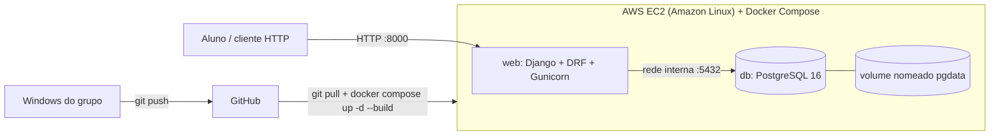
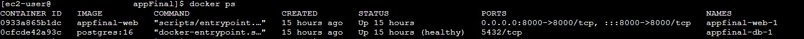
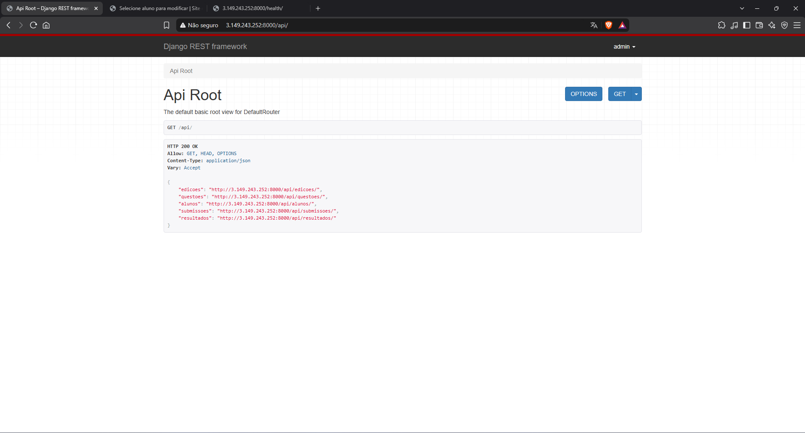
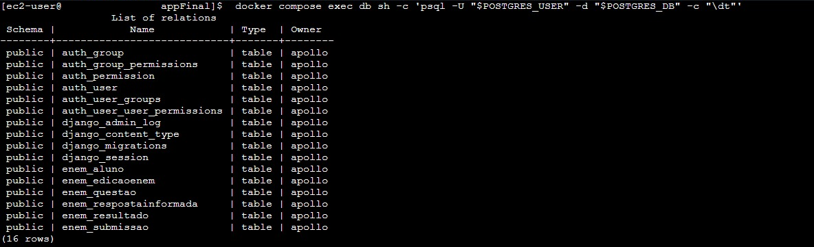
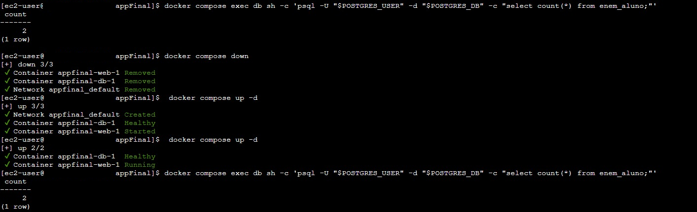
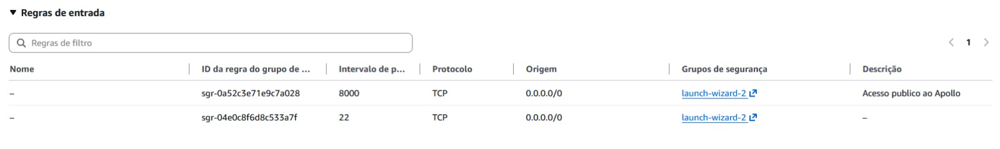
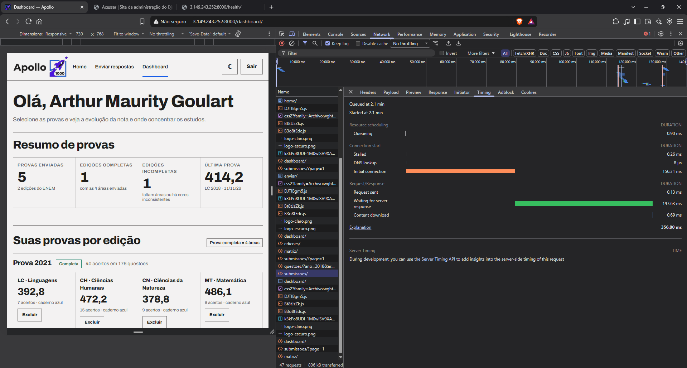

# Projeto Apollo — Análise de desempenho no ENEM (AP2)

**Disciplinas:** Big Data e Cloud Computing (IBM8936) · Projeto de Cloud<br>
**Turma:** PC_ADS_26.2_8001_III<br>
**Integrantes:** Arthur Maurity, Bernardo Casanovas, Bernardo Miller, Lucas Jesus

| | Link |
| --- | --- |
| **API publicada** | http://3.149.243.252:8000/api/ |
| **Front-end** | http://3.149.243.252:8000/ |
| **Saúde (app + banco)** | http://3.149.243.252:8000/health/ |
| **Documentação (MkDocs)** | https://projetos-de-extensao.github.io/PC_ADS_26.2_8001_III/ |

## Sobre

O Apollo é uma API Django REST + PostgreSQL que estima a nota TRI do ENEM. O aluno envia as 45 respostas de uma área (LC, CH, CN ou MT) de uma edição entre 2016 e 2025 e recebe acertos, erros, nota TRI estimada e as habilidades e eixos em que mais errou. A base usa os itens oficiais do INEP (7.400 questões, gabarito e parâmetros a/b/c). A nota é uma estimativa, não a oficial.

Na AP1 a API rodava no Elastic Beanstalk com SQLite. Na AP2 ela passou para **uma EC2 com Docker Compose** (contêineres `web` e `db`) e **PostgreSQL 16 multimodelo** (relacional + JSONB com índice GIN).

## Arquitetura



| Componente | Papel |
| --- | --- |
| EC2 t3.small (Amazon Linux, gp3 30 GB criptografado) | Hospeda os dois contêineres |
| Security Group | Entrada só 22 (SSH) e 8000 (API). A 5432 **não** é publicada |
| `web` | Django + DRF servido pelo Gunicorn (3 *workers*); roda migrations, `collectstatic` e importação dos itens ao subir |
| `db` | `postgres:16` com `healthcheck` (`pg_isready`) e volume `pgdata` |
| `.env` | Segredos (`SECRET_KEY`, `POSTGRES_*`, superusuário) só na EC2, fora do Git; `.env.example` versionado sem senhas |

Custo estimado: ≈ US$ 21,23/mês (EC2 t3.small + EBS gp3 30 GB + IPv4 público), calculado na [AWS Pricing Calculator](https://calculator.aws/#/estimate?id=365b5512217c340237a796be1dccc64a85cac245) (Leste dos EUA, sob demanda, Linux, 730 h/mês). Detalhes em [Dimensionamento de Computação](https://projetos-de-extensao.github.io/PC_ADS_26.2_8001_III/Elaboracao/dim_comp/) e [Atividades de Deploy](https://projetos-de-extensao.github.io/PC_ADS_26.2_8001_III/Transicao/ativ_deploy/).

### Modelo de dados

| Model | Tipo | Relacionamentos |
| --- | --- | --- |
| `EdicaoEnem` | Relacional | 1—N `Questao`, 1—N `Submissao` |
| `Questao` | Relacional + **documento** | `atributos` = `JSONField` (JSONB) com **índice GIN** `questao_atributos_gin` (migration `0001`) |
| `Aluno` | Relacional | 1—1 `User`; 1—N `Submissao` |
| `Submissao` | Relacional | FK `Aluno`, FK `EdicaoEnem`; **N—N** `Questao` via `RespostaInformada` |
| `RespostaInformada` | Tabela associativa com atributos | `alternativa`, `correta` |
| `Resultado` | Relacional + documento | 1—1 `Submissao`; `analise` em JSONB |

**Transação:** `POST /api/submissoes/` grava `Submissao` + 45 `RespostaInformada` + `Resultado` dentro de `transaction.atomic()`. Prova incompleta, alternativa inválida ou cor de caderno diferente da área parceira do mesmo dia ⇒ HTTP 400 e rollback total.

**Filtro JSONB:** `GET /api/questoes/?ano=2023&area=MT&atributos__habilidade=H12`.

### Endpoints principais (prefixo `/api/`)

| Método | Rota | Descrição |
| --- | --- | --- |
| POST | `/api/cadastro/` | Cria usuário + aluno |
| POST | `/api/login/` | Sessão (cookie) |
| POST | `/api/submissoes/` | Envio transacional da prova |
| GET/DELETE | `/api/submissoes/`, `/api/submissoes/{id}/` | Submissões do aluno com respostas e resultado aninhados |
| GET | `/api/dashboard/` | Nota por área, histórico e habilidades prioritárias |
| CRUD | `/api/edicoes/`, `/api/questoes/`, `/api/alunos/`, `/api/resultados/` | Escrita só para staff; também em `/admin/` |

Documentação completa da aplicação: [`appFinal/README.md`](appFinal/README.md).

## Execução local

Pré-requisito: Docker Desktop.

```bash
cd appFinal
cp .env.example .env              # PowerShell: Copy-Item .env.example .env — edite as senhas
docker compose up -d --build      # sobe db + web; migra e importa as questões sozinho
docker compose exec web python manage.py test
```

Abra http://localhost:8000/ (front-end), http://localhost:8000/api/ (API) e http://localhost:8000/admin/ (usuário e senha do `.env`).

## Deploy na EC2

1. Criar a EC2 (Amazon Linux, t3.small, gp3 30 GB criptografado) e o Security Group com entrada 22 (SSH) e 8000 (0.0.0.0/0).
2. Instalar Docker, Compose e Git:
   ```bash
   sudo dnf install -y docker git
   sudo systemctl enable --now docker
   # plugin Docker Compose v2: instalar conforme a documentação oficial do Docker
   sudo usermod -aG docker $USER   # reconectar o SSH depois
   ```
3. Clonar e gerar o `.env` (senhas aleatórias, permissão 600, nunca vai ao Git):
   ```bash
   git clone https://github.com/Projetos-de-Extensao/PC_ADS_26.2_8001_III.git apollo
   cd apollo/appFinal
   ./scripts/gerar_env.sh 3.149.243.252
   docker compose up -d --build
   curl http://localhost:8000/health/
   ```
4. Fluxo de atualização: alterar no Windows → `git push` → na EC2 `./scripts/deploy.sh` (faz `pg_dump` pré-deploy, `git pull`, `docker compose up -d --build` e checa `/health/`). Rollback: `./scripts/deploy.sh <tag-anterior>`.
5. Backup diário: cron com `scripts/backup.sh` (`pg_dump` compactado).

**Nunca** usar `docker compose down -v`: apaga o volume `pgdata`.

## Evidências do deploy (B8)

| Evidência | Print |
| --- | --- |
| `docker ps` com `web` e `db` (healthy) |  |
| `docker compose logs` |  |
| API acessada pelo IP público |  |
| Tabela no Postgres via `psql` |  |
| Persistência: dado existe antes e depois de `down`/`up` |  |
| Security Group (22 e 8000; sem 5432) |  |
| `manage.py test` passando |  |
| Tempo de 1 envio (POST /api/submissoes/): 356 ms |  |

Comandos usados (na EC2, dentro de `appFinal/`):

```bash
docker ps
docker compose logs --tail 50 web db
curl http://3.149.243.252:8000/api/
docker compose exec db sh -c 'psql -U "$POSTGRES_USER" -d "$POSTGRES_DB" -c "SELECT count(*) FROM enem_questao;"'
# persistência
docker compose exec db sh -c 'psql -U "$POSTGRES_USER" -d "$POSTGRES_DB" -c "SELECT count(*) FROM enem_submissao;"'
docker compose down && docker compose up -d
docker compose exec db sh -c 'psql -U "$POSTGRES_USER" -d "$POSTGRES_DB" -c "SELECT count(*) FROM enem_submissao;"'
docker compose exec web python manage.py test
```

## Documentação (RUP)

| Fase | Documentos |
| --- | --- |
| Iniciação | [Documento de Visão](https://projetos-de-extensao.github.io/PC_ADS_26.2_8001_III/Iniciacao/dv/), [Requisitos Suplementares](https://projetos-de-extensao.github.io/PC_ADS_26.2_8001_III/Iniciacao/rs/) |
| Elaboração | [Casos de Uso Arquiteturais](https://projetos-de-extensao.github.io/PC_ADS_26.2_8001_III/Elaboracao/cua/), [Pacotes/Segurança](https://projetos-de-extensao.github.io/PC_ADS_26.2_8001_III/Elaboracao/maps/), [Computação](https://projetos-de-extensao.github.io/PC_ADS_26.2_8001_III/Elaboracao/dim_comp/), [Banco de Dados](https://projetos-de-extensao.github.io/PC_ADS_26.2_8001_III/Elaboracao/dimrbd/), [Sequência e Comunicação](https://projetos-de-extensao.github.io/PC_ADS_26.2_8001_III/Elaboracao/seq_com/) |
| Transição | [Atividades de Deploy](https://projetos-de-extensao.github.io/PC_ADS_26.2_8001_III/Transicao/ativ_deploy/) |

O site é gerado com MkDocs Material a partir de `docs/` e publicado na branch `gh-pages` (`mkdocs gh-deploy`).
