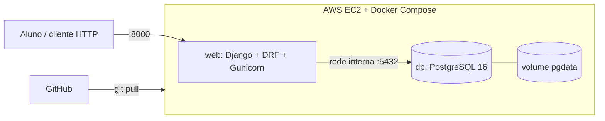

# Apollo — análise de desempenho no ENEM (AP2)

API Django + DRF + PostgreSQL 16 em Docker Compose, executada em uma EC2. Alunos enviam as respostas de uma área (45 questões) e recebem acertos/erros, **nota TRI estimada** e as habilidades prioritárias para estudo.

> **Dados:** questões reais do ENEM 2016–2025 (fonte: INEP) em `data/`. O comando `seed_enem` (dados sintéticos) só é usado se esse arquivo não existir. A nota TRI é uma estimativa, não a oficial: modelo logístico de 3 parâmetros com D=1, proficiência por EAP com priori N(0,1) e escala 500+100·θ (método do documento "Procedimentos de Análise" do INEP). Validação contra as notas oficiais de 600 participantes por área (ENEM 2016): erro absoluto médio de 5,4 pts (LC), 7,9 (CN), 10,4 (CH) e 21,6 (MT); com D=1,7 o erro em CN sobe para 18,4 e em LC para 11,7. Em MT o erro concentra-se em notas altas (acima de ~800 a nota estimada fica 70–80 pts abaixo da oficial, efeito da priori N(0,1)). Os 4 cadernos de 2016 (16 combinações área × cor) foram conferidos com os 28 mil participantes: o gabarito do app bate em 100% (111.612 de 111.612) e a nota estimada mantém o mesmo erro médio em todas as cores. Em 2017–2025 a estrutura é a mesma (4 cadernos consecutivos a partir do AZUL), mas não há notas oficiais aqui para confirmar; 2020–2025 foram conferidos com o gabarito oficial do AZUL.

## Arquitetura



Segurança: Security Group abre só 22 (IP do grupo) e 8000; a porta 5432 **não** é publicada. Segredos ficam em `.env` (fora do Git).

## Modelo de dados

`Aluno` 1—N `Submissao` N—N `Questao` (tabela associativa `RespostaInformada` com `alternativa`/`correta`), `Submissao` 1—1 `Resultado`, `EdicaoEnem` 1—N `Questao`/`Submissao`. `Questao.atributos` é **JSONB com índice GIN** (migration `0001`).

## Endpoints (prefixo `/api/`)

| Método | Rota | Descrição |
|---|---|---|
| GET | `/` `/login/` `/home/` `/enviar/` `/dashboard/` | Páginas do front-end (ver seção "Páginas") |
| GET | `/health/` | Saúde da aplicação + banco |
| POST | `/api/cadastro/` `{nome,email,senha}` | Cria usuário + aluno |
| POST | `/api/login/` `{email,senha}` | Sessão (cookie) |
| POST | `/api/submissoes/` `{ano,area,cor,lingua,respostas:[{numero,alternativa}]}` | **Transação atômica**: Submissao + 45 Respostas + Resultado; prova incompleta/inválida ⇒ rollback total. `cor` = caderno (padrão AZUL; ver `cores` em `/api/edicoes/`). **Regra do dia:** cada dia de prova tem um caderno único de 90 questões, então as duas áreas do dia têm a mesma cor (LC+CH e CN+MT; em 2016, CH+CN e LC+MT). Cor diferente da área parceira já enviada ⇒ 400 no campo `cor` |
| GET/DELETE | `/api/submissoes/` `/api/submissoes/{id}/` | Submissões do aluno (respostas e resultado aninhados); o aluno vê e apaga só as suas. Não há edição: uma prova corrigida é imutável (editar quebraria o resultado) — para corrigir, apague e reenvie |
| CRUD | `/api/resultados/` | Resultado da submissão: o aluno lê os seus; criar/editar/apagar só staff |
| GET | `/api/dashboard/` | Nota TRI por área, histórico e habilidades prioritárias |
| GET | `/api/questoes/?ano=2023&area=MT&cor=AMARELA&atributos__habilidade=H12` | Filtro por JSONB (gabarito oculto ao aluno) |
| CRUD | `/api/edicoes/`, `/api/questoes/`, `/api/alunos/`, `/api/resultados/` | Escrita só para staff; também em `/admin/` |

POST com sessão exige o header `X-CSRFToken` (valor do cookie `csrftoken` recebido no login).

## Provas reais (ENEM 2016–2025)

O repositório já inclui `data/itens_inep_2016_2025.csv` (gabarito, habilidade e parâmetros a/b/c do INEP, extraídos do `ITENS_PROVA` dos microdados). O contêiner o importa sozinho ao subir (idempotente). Regras da extração (`scripts/consolidar_itens_inep.py`): **4 cadernos regulares por área e ano** (AZUL e mais 3 cores, que variam por edição), **45 questões cada**; Linguagens tem as questões 1–5 em inglês e em espanhol; cadernos especiais (laranja, roxa, leitor de tela) e reaplicações ficam de fora. Itens anulados/abandonados pelo INEP (120 linhas, 30 itens distintos) continuam na prova, marcados `anulada`: o aluno responde 45, mas eles não entram em acertos, erros, nota nem análise. O script falha se algum caderno não tiver 45 questões ou se o mesmo item divergir entre cores (a habilidade de 1 item de 2023 divergia no arquivo do INEP e foi normalizada para a do AZUL). Reimportar sobre um banco antigo com submissões numeradas diferente é bloqueado: recrie o banco de teste.

Reimportar manualmente (os CSVs brutos do INEP devem passar antes por `scripts/consolidar_itens_inep.py`, que escolhe os 4 cadernos regulares; o importador usa o menor `CO_PROVA` de cada cor que encontrar):

```bash
docker compose exec web python manage.py importar_inep data/itens_inep_2016_2025.csv
docker compose exec web python manage.py importar_inep caminho/ITENS_PROVA_2023.csv --ano 2023
```

`scripts/baixar_itens_inep.py` baixa os CSVs brutos do INEP (leitura parcial dos zips). A nota continua sendo **estimativa**: usa os parâmetros do INEP, não a calibração oficial completa.

## Regra de cor por dia (validação)

O ENEM aplica um caderno de 90 questões por dia: **LC+CH (dia 1)** e **CN+MT (dia 2)** sempre têm a mesma cor (em 2016: CH+CN e LC+MT). A API recusa uma submissão cuja cor difere da última enviada pelo mesmo aluno para a área parceira na mesma edição; a tela de envio trava a cor da parceira; o dashboard marca a edição como "Inconsistente". Dias diferentes podem ter cores diferentes. Para listar dados antigos fora da regra (não altera nada):

```bash
python manage.py checar_cores
```

Para corrigir: no **Dashboard**, em "Suas provas por edição", use o botão **Excluir** do envio errado (pede confirmação) e reenvie. Equivale a `DELETE /api/submissoes/{id}/`.

## Páginas (front-end)

| Rota | Conteúdo |
|---|---|
| `/` | Landing; CTAs levam a `/login/?modo=criar` |
| `/login/` | Abas Entrar / Criar conta (senha mínima de 8 caracteres); logado vai para `/home/` |
| `/home/` | Saudação, atalhos, resumo de provas (versão curta) e as 5 últimas notas |
| `/enviar/` | Envio das respostas: aba "Formulário" ou "Copiar e colar" (sem foto, fora do escopo inicial) |
| `/dashboard/` | Resumo, **Resumo de provas**, **provas por edição** (completa = 4 áreas; incompleta avisa "Falta área X!"), **pizza de acertos e erros** da prova inteira (com seletor de área), desempenho por área (cada área só comparada com ela mesma), áreas a melhorar e rankings de eixos, competências e habilidades (competências com nome) |

Visual: tema claro e escuro (botão no cabeçalho; escolha salva no navegador), responsivo. Cores: azul `#175DE8` e roxo `#5817E8` (marca), amarelo (média), verde (prioridade baixa) e vermelho pastel `#E57373` (prioridade alta). Prioridade por taxa de erro: ≥60% alta, 40–59% média, <40% baixa. Logos em `enem/static/enem/`.

Após mudar um template, reinicie o servidor (o Django guarda os templates em cache quando `DEBUG` não é `True`). Em Docker/AWS rode `collectstatic` no build; no modo local os estáticos são servidos direto de `enem/static` (`WHITENOISE_USE_FINDERS`).

## Rodar localmente

Pré-requisito: Docker Desktop. Depois, na pasta do projeto:

```bash
cp .env.example .env          # Windows (PowerShell): Copy-Item .env.example .env — edite as senhas; para uso local, ALLOWED_HOSTS=localhost,127.0.0.1
docker compose up -d --build  # sobe db (PostgreSQL) + web (Django); migra e carrega o seed sozinho
```

Abra **http://localhost:8000/** — front-end (HTML + JS puro, servido pelo Django): crie a conta em `/login/`, envie a prova em `/enviar/` (use "Preencher aleatório (demo)" para testar) e veja nota TRI, erros por habilidade e gráficos no `/dashboard/`. Admin: http://localhost:8000/admin/ (usuário/senha do `.env`). Saúde: http://localhost:8000/health/.

```bash
docker compose exec web python manage.py test   # testes (usam Postgres)
```

Sem Docker: exporte as variáveis de `.env`, defina `POSTGRES_HOST=localhost`, `pip install -r requirements.txt`, `python manage.py migrate && python manage.py seed_enem && python manage.py runserver`.

## Deploy na EC2 (Ubuntu)

1. Instância t3.medium, disco gp3 30 GB **criptografado**; Security Group: 22 (seu IP) e 8000 (0.0.0.0/0). Preferir Elastic IP.
2. `sudo apt update && sudo apt install -y docker.io docker-compose-v2 git && sudo usermod -aG docker $USER` (reconecte o SSH).
3. `git clone <repo> apollo && cd apollo && ./scripts/gerar_env.sh <IP_PUBLICO>` — cria o `.env` com `SECRET_KEY` e senhas aleatórias (permissão 600, nada impresso; o `.env` fica só na EC2 e nunca vai ao Git). A senha do `/admin`: `grep DJANGO_SUPERUSER_PASSWORD .env`. (Manual: `cp .env.example .env` e edite.)
4. `docker compose up -d --build` e teste `curl http://<IP>:8000/health/`.
5. Atualizações: `./scripts/deploy.sh` (ou `./scripts/deploy.sh <tag>` para rollback). Backup diário: cron com `scripts/backup.sh`.

**Nunca** use `docker compose down -v` (apaga o banco).

## Teste de persistência (evidência B8)

```bash
docker compose exec web python manage.py shell -c "from enem.models import Aluno; Aluno.objects.create(nome='Teste', email='t@t.com')"
docker compose down && docker compose up -d
docker compose exec web python manage.py shell -c "from enem.models import Aluno; print(Aluno.objects.filter(email='t@t.com').exists())"   # True
```

## Evidências a anexar (preencher após o deploy)

- [ ] Print do Security Group (22/8000; sem 5432)
- [ ] `docker compose ps` com `db` healthy
- [ ] Persistência antes/depois do `down`/`up`
- [ ] `manage.py test` passando
- [ ] POST de submissão válida (201) e inválida (400, sem linhas gravadas)
- [ ] Consulta `?atributos__habilidade=` e `EXPLAIN` com o índice GIN
- Link da API: `http://<IP>:8000/health/` · Documentação: site MkDocs do projeto

## Eixos temáticos (análise de erros por conteúdo)

Cada questão (2016–2025) recebe um **eixo** (`data/classificacao_eixos.csv`, importado em `Questao.atributos["eixo"]`):
Matemática (numéricos, geométricos, estatística e probabilidade, algébricos), Ciências da Natureza (Física, Química, Biologia),
Ciências Humanas (História, Geografia, Filosofia, Sociologia) e Linguagens (Língua portuguesa e texto, Literatura, Artes,
Práticas corporais, TIC, Língua estrangeira). Taxonomia baseada nos objetos de conhecimento do edital/Matriz do ENEM (`enem/eixos.py`).

- **Fonte `matriz`** (261 itens): Língua estrangeira e Ciências da Natureza H20–H30 (Física H20–23, Química H24–27, Biologia H28–30) — vêm da Matriz oficial.
- **Fonte `leitura`** (1.559 itens): classificação feita lendo o enunciado, **sem validação por gabarito oficial**. Contra a Matriz (CN H20–30) a concordância foi 83% (134/161), então espere ~80% de acerto nessa fonte; trate como indicativo. Segunda leitura cega de 82 itens sorteados (MT 30, CH 20, LC 20, CN 12) concordou em 66 (80,5%): MT 77%, CH 90%, LC 80%, CN 75%. Não é validação independente (mesmo avaliador, texto truncado); as divergências ficaram no CSV por serem ambíguas (ex.: Química×Biologia em CN, Língua portuguesa×Literatura em LC), sem gabarito para desempatar.
- MT 2023 q.142 (texto ilegível no PDF) foi classificado manualmente olhando a prova: Conhecimentos geométricos.
- A API devolve `analise.eixos` na submissão e `eixos_prioritarios` no `/api/dashboard/`.
- Não há "tema" fino por questão: classificação automática por palavras-chave acertou só ~40% (MT) e foi descartada.
