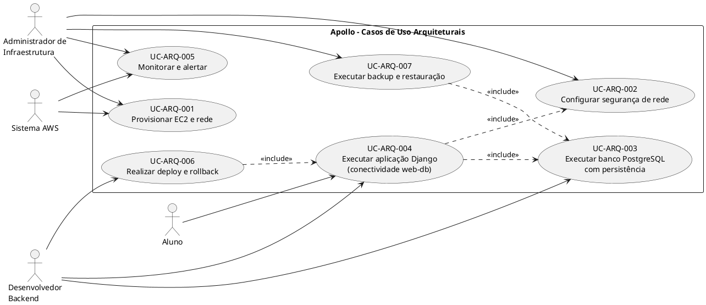
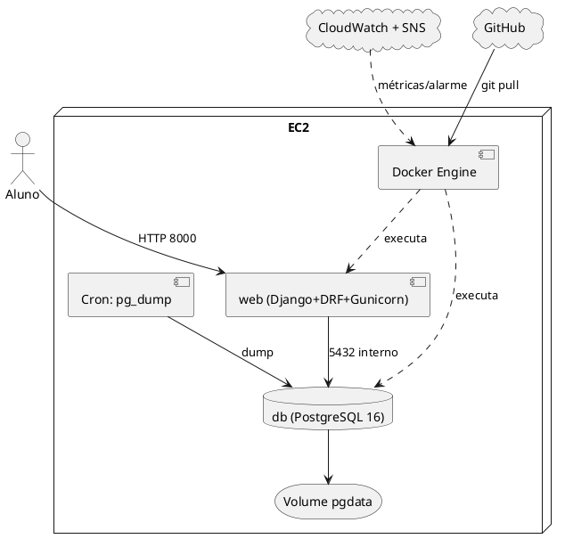
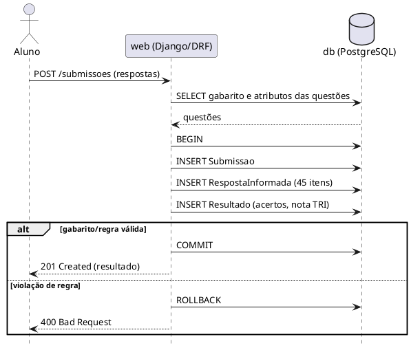
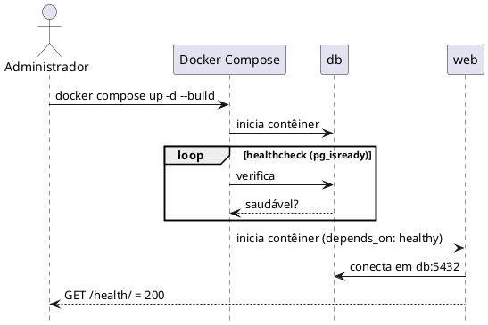
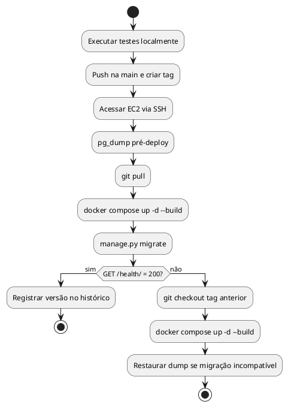
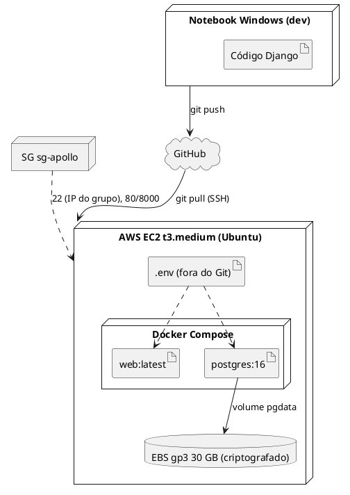

**Casos de Uso Arquiteturais**

**Projeto Apollo**

|  |  |
| --- | --- |
| **Projeto** | Apollo — Plataforma de Análise de Desempenho no ENEM |
| **Documento** | Modelo de Casos de Uso Arquiteturais |
| **Versão** | 2.0 |
| **Data** | 08/11/2026 |
| **Status** | Em Revisão |
| **Responsável** | Equipe do Projeto Apollo |
| **Disciplina** | Projeto de Cloud |
| **Fase RUP/UP** | Elaboração |

# 1. Introdução

## 1.1. Propósito

Descreve os Casos de Uso Arquiteturais (CUA) da infraestrutura do Apollo: rede, segurança, banco de dados, execução em contêineres, monitoramento e entrega. Diferem dos casos de uso funcionais (aluno enviar respostas, ver dashboard) por tratarem de requisitos de infraestrutura e operação.

## 1.2. Escopo

Cobre a arquitetura implementada na AP2: **uma EC2** com Docker Compose executando `web` (Django + DRF + Gunicorn) e `db` (PostgreSQL 16 com volume `pgdata`). O escopo é deliberadamente enxuto (4 estudantes, até US$ 100/mês): Multi-AZ, Auto Scaling e serviços gerenciados (RDS, Lambda) aparecem como alternativas avaliadas, não como requisito.

## 1.3. Siglas

| **Sigla** | **Definição** |
| --- | --- |
| CUA | Caso de Uso Arquitetural |
| SG | Security Group |
| EBS | Elastic Block Store |
| EIP | Elastic IP |
| SNS | Simple Notification Service |

## 1.4. Referências

* Documento de Visão (v2.0) e Requisitos Suplementares (v2.0)
* Roteiro 14 — Django + PostgreSQL em Docker na EC2
* AWS Well-Architected Framework

# 2. Visão Geral dos Casos de Uso

## 2.1. Atores

| **Ator** | **Descrição** | **Responsabilidades** |
| --- | --- | --- |
| Administrador de Infraestrutura | Estudante responsável pela EC2 e rede | Criar instância, Security Group, volumes e backups |
| Desenvolvedor Backend | Estudante responsável pelo Django | Manter código, migrações, Dockerfile/Compose e releases |
| Aluno | Usuário final | Acessa a API/portal |
| Sistema AWS | EC2, EBS, CloudWatch, SNS | Prover infraestrutura, métricas e alertas |
| Professor/Avaliador | Avalia a entrega | Acessa a API e o repositório |

## 2.2. Diagrama de Casos de Uso

# 3. Especificação dos Casos de Uso

## UC-ARQ-001: Provisionar EC2 e Rede

| **Campo** | **Descrição** |
| --- | --- |
| Identificador | UC-ARQ-001 |
| Versão / Data / Status | 2.0 / 08/11/2026 / Em Revisão |
| Ator Principal | Administrador de Infraestrutura |
| Ator Secundário | Sistema AWS |
| Pré-condição | Conta AWS ativa; permissão para criar EC2, SG e EBS; par de chaves SSH. |
| Pós-condição | EC2 Ubuntu em execução na VPC padrão, com IP público (idealmente Elastic IP), Docker, Docker Compose e Git instalados. |

**Fluxo Principal**

1. Administrador cria instância `t3.medium` (Ubuntu LTS) com disco gp3 de 30 GB **criptografado**.
2. Associa o Security Group do UC-ARQ-002 e o par de chaves.
3. (Opcional) Associa um Elastic IP para endereço estável.
4. Conecta por SSH, instala Docker Engine, plugin Compose e Git.
5. Adiciona o usuário ao grupo `docker`.
6. Valida: `docker run hello-world` e `git --version`.

**Fluxos Alternativos**

| **Alt.** | **Descrição** |
| --- | --- |
| Alt 1 | Limite de vCPU/instâncias da conta atingido → solicitar aumento ou usar outro tipo/região. |
| Alt 2 | SSH recusado → conferir SG (porta 22 e IP de origem) e permissões do arquivo `.pem`. |
| Alt 3 | IP público muda após parar/iniciar a instância → usar Elastic IP e atualizar o link no README. |

**Requisitos Não Funcionais**

| **Requisito** | **Métrica** |
| --- | --- |
| Desempenho | Provisionamento e instalação em até 30 min |
| Segurança | Disco criptografado; chave SSH privada fora do repositório (RNF-SEG-02/05) |
| Custo | ≈ US$ 37/mês no conjunto (RNF-CUS-01) |

**Riscos**

| **Risco** | **Mitigação** |
| --- | --- |
| Perda do arquivo `.pem` | Guardar cópia segura; criar nova chave via sessão do console se necessário |
| IP muda e a API "cai" na avaliação | Elastic IP; conferir o endereço antes da apresentação |

## UC-ARQ-002: Configurar Segurança de Rede

| **Campo** | **Descrição** |
| --- | --- |
| Identificador | UC-ARQ-002 |
| Versão / Data / Status | 2.0 / 08/11/2026 / Em Revisão |
| Ator Principal | Administrador de Infraestrutura |
| Ator Secundário | Sistema AWS |
| Pré-condição | Conta AWS ativa; VPC padrão disponível. |
| Pós-condição | SG `sg-apollo` com entradas mínimas; porta 5432 fechada; usuários IAM com MFA. |

**Fluxo Principal**

1. Cria o Security Group `sg-apollo`.
2. Regra de entrada TCP 22 com origem restrita ao IP do grupo (`/32`).
3. Regra de entrada TCP 8000 (API) e, se houver Nginx, TCP 80, origem `0.0.0.0/0`.
4. Mantém a saída padrão (necessária para `docker pull` e `apt`).
5. Verifica que **não existe** regra para a porta 5432 e que o Compose não publica `5432` no host.
6. Ativa MFA para os usuários IAM do grupo.
7. Valida com `nmap`/teste externo: apenas 22, 80 e/ou 8000 respondem.

**Fluxos Alternativos**

| **Alt.** | **Descrição** |
| --- | --- |
| Alt 1 | IP residencial do grupo muda e o SSH bloqueia → atualizar a regra (ou usar EC2 Instance Connect). |
| Alt 2 | Regra `0.0.0.0/0` criada em 22 ou 5432 por engano → remover imediatamente e revisar. |

**Requisitos Não Funcionais**

| **Requisito** | **Métrica** |
| --- | --- |
| Segurança | Somente portas 22 (IP restrito), 80 e/ou 8000 abertas (RNF-SEG-07) |
| Segurança | Menor privilégio e MFA (RNF-SEG-04) |
| Compliance | Tratamento de dados conforme LGPD (RNF-SEG-06) |

**Riscos**

| **Risco** | **Mitigação** |
| --- | --- |
| SG permissivo | Revisão das regras antes de cada entrega/apresentação |
| Banco exposto | Sem publicação de porta no Compose; verificação externa |

## UC-ARQ-003: Executar Banco PostgreSQL com Persistência

| **Campo** | **Descrição** |
| --- | --- |
| Identificador | UC-ARQ-003 |
| Versão / Data / Status | 2.0 / 08/11/2026 / Em Revisão |
| Ator Principal | Desenvolvedor Backend |
| Ator Secundário | Sistema AWS (EBS) |
| Pré-condição | UC-ARQ-001 concluído; arquivo `.env` presente na EC2 com `POSTGRES_*`. |
| Pós-condição | Contêiner `db` (`postgres:16`) saudável, dados em volume nomeado `pgdata`, sem porta pública. |

**Fluxo Principal**

1. Define no `docker-compose.yml` o serviço `db` com `image: postgres:16`, `env_file: .env` e `volumes: pgdata:/var/lib/postgresql/data`.
2. Configura `healthcheck` com `pg_isready -U $POSTGRES_USER -d $POSTGRES_DB`.
3. Sobe o serviço (`docker compose up -d db`).
4. Aguarda estado `healthy`.
5. Executa as migrações (inclui o índice GIN sobre o campo JSONB).
6. Carrega o *seed* de edições e questões.
7. Teste de persistência: `docker compose down` (sem `-v`), `up -d` e consulta dos dados.

**Fluxos Alternativos**

| **Alt.** | **Descrição** |
| --- | --- |
| Alt 1 | Falha de autenticação ao reutilizar volume antigo com outra senha → alinhar `.env` ou recriar o volume em ambiente de teste. |
| Alt 2 | Disco cheio → ampliar o EBS ou limpar imagens/logs antigos. |
| Alt 3 | `docker compose down -v` executado por engano → restaurar do último `pg_dump` (UC-ARQ-007). |

**Requisitos Não Funcionais**

| **Requisito** | **Métrica** |
| --- | --- |
| Confiabilidade | Dados preservados após reinício (RNF-DAD-02) |
| Segurança | Banco sem porta pública (RNF-SEG-07) |
| Desempenho | Consulta por atributo JSONB com índice GIN (RNF-PER-04) |

**Riscos**

| **Risco** | **Mitigação** |
| --- | --- |
| Perda do volume | Backup diário (UC-ARQ-007) e snapshot EBS |
| Senha fraca/padrão | Senha forte no `.env`, nunca versionada |

## UC-ARQ-004: Executar a Aplicação Django (Conectividade web–db)

| **Campo** | **Descrição** |
| --- | --- |
| Identificador | UC-ARQ-004 |
| Versão / Data / Status | 2.0 / 08/11/2026 / Em Revisão |
| Ator Principal | Desenvolvedor Backend |
| Ator Secundário | Aluno |
| Pré-condição | UC-ARQ-002 e UC-ARQ-003 concluídos; imagem da aplicação construída. |
| Pós-condição | `web` acessível na porta 8000, conectado ao `db` pelo host `db`, respondendo a `GET /health/`. |

**Fluxo Principal**

1. O Compose inicia `web` somente após `db` estar `healthy` (`depends_on: condition: service_healthy`).
2. Django lê `POSTGRES_HOST=db`, `POSTGRES_*`, `SECRET_KEY`, `DEBUG`, `ALLOWED_HOSTS` do ambiente.
3. Gunicorn atende a porta 8000.
4. Aluno acessa a API; o envio de respostas executa a transação atômica (Submissao + Respostas + Resultado).
5. Teste: `curl http://<IP>:8000/health/` retorna 200.

**Fluxos Alternativos**

| **Alt.** | **Descrição** |
| --- | --- |
| Alt 1 | `web` não conecta ao banco por usar `localhost` em vez de `db` → corrigir `POSTGRES_HOST`. |
| Alt 2 | Erro 400 `DisallowedHost` → incluir o IP/domínio em `ALLOWED_HOSTS`. |
| Alt 3 | Violação de regra de negócio no envio → *rollback* e resposta 400, sem linhas gravadas. |

**Requisitos Não Funcionais**

| **Requisito** | **Métrica** |
| --- | --- |
| Disponibilidade | 99% mensal (RNF-CON-01) |
| Desempenho | p95 < 1,5 s no envio (RNF-PER-01) |
| Segurança | `DEBUG=False`, hosts restritos (RNF-SEG-08) |

**Riscos**

| **Risco** | **Mitigação** |
| --- | --- |
| EC2 como ponto único de falha | `restart: unless-stopped`, backup, runbook de recuperação |
| Esgotamento de memória | Limitar *workers* do Gunicorn; medir com `docker stats` |

## UC-ARQ-005: Monitorar e Alertar

| **Campo** | **Descrição** |
| --- | --- |
| Identificador | UC-ARQ-005 |
| Versão / Data / Status | 2.0 / 08/11/2026 / Em Revisão |
| Ator Principal | Administrador de Infraestrutura |
| Ator Secundário | Sistema AWS (CloudWatch, SNS) |
| Pré-condição | UC-ARQ-001 e UC-ARQ-004 concluídos. |
| Pós-condição | Alarmes de falha da instância e da API; notificação por e-mail; logs acessíveis. |

**Fluxo Principal**

1. Cria um tópico SNS e inscreve os e-mails da equipe.
2. Cria alarme CloudWatch em `StatusCheckFailed` da EC2 e em CPU alta.
3. Cria verificação periódica do endpoint `/health/` (script cron com `curl` que registra falhas, ou Route 53 Health Check).
4. Disponibiliza logs via `docker compose logs web db`.
5. Cria AWS Budgets com alertas em 80% e 100%.

**Fluxos Alternativos**

| **Alt.** | **Descrição** |
| --- | --- |
| Alt 1 | E-mail de assinatura não confirmado → reenviar a confirmação. |
| Alt 2 | Falso positivo por manutenção → silenciar o alarme durante o deploy. |

**Requisitos Não Funcionais**

| **Requisito** | **Métrica** |
| --- | --- |
| Operação | Alerta em até 15 minutos (RNF-OPS-02) |
| Custo | Alerta de orçamento em 80%/100% (RNF-CUS-02) |

**Riscos**

| **Risco** | **Mitigação** |
| --- | --- |
| Falha não percebida | Verificação de `/health/` além do status da instância |

## UC-ARQ-006: Realizar Deploy e Rollback

| **Campo** | **Descrição** |
| --- | --- |
| Identificador | UC-ARQ-006 |
| Versão / Data / Status | 2.0 / 08/11/2026 / Em Revisão |
| Ator Principal | Desenvolvedor Backend |
| Ator Secundário | GitHub |
| Pré-condição | Código no GitHub; EC2 com repositório clonado e `.env` configurado. |
| Pós-condição | Nova versão em execução; versão anterior recuperável por *tag*. |

**Fluxo Principal**

1. Desenvolvedor executa os testes localmente (`python manage.py test`) e faz *push* na `main`, criando uma *tag* de versão.
2. Acessa a EC2 por SSH.
3. Executa `git pull` e `docker compose up -d --build`.
4. Executa `python manage.py migrate` no contêiner `web`.
5. Valida `/health/` e uma consulta de negócio.
6. Registra versão e horário no histórico de deploy.

**Fluxo de Rollback**

1. Identifica falha pós-deploy (health ou erro 5xx).
2. `git checkout <tag-anterior>` e `docker compose up -d --build`.
3. Se a migração for incompatível, restaura o `pg_dump` pré-deploy.
4. Revalida e comunica a equipe.

**Requisitos Não Funcionais**

| **Requisito** | **Métrica** |
| --- | --- |
| Manutenibilidade | Deploy em até 15 min (RNF-MAN-01) |
| Confiabilidade | Rollback em até 30 min (RNF-MAN-02) |

**Riscos**

| **Risco** | **Mitigação** |
| --- | --- |
| Falha no deploy manual | Script `deploy.sh` único e *checklist* |
| Migração irreversível | `pg_dump` obrigatório antes de migrar |

## UC-ARQ-007: Executar Backup e Restauração

| **Campo** | **Descrição** |
| --- | --- |
| Identificador | UC-ARQ-007 |
| Versão / Data / Status | 2.0 / 08/11/2026 / Em Revisão |
| Ator Principal | Administrador de Infraestrutura |
| Ator Secundário | Sistema AWS (EBS, S3 opcional) |
| Pré-condição | `db` em execução (UC-ARQ-003). |
| Pós-condição | Dump diário gerado e retido por 7 dias; restauração validada ao menos uma vez. |

**Fluxo Principal**

1. Cron diário executa `docker compose exec -T db pg_dump -U $POSTGRES_USER $POSTGRES_DB | gzip > backups/apollo_AAAAMMDD.sql.gz`.
2. Script remove dumps com mais de 7 dias.
3. (Opcional) copia o arquivo para um bucket S3.
4. Snapshot semanal do volume EBS.
5. **Restauração:** sobe `db` limpo, executa `gunzip -c <dump> | docker compose exec -T db psql -U ... -d ...` e valida contagens de tabelas.

**Fluxos Alternativos**

| **Alt.** | **Descrição** |
| --- | --- |
| Alt 1 | Disco sem espaço para o dump → enviar para S3 e limpar localmente. |
| Alt 2 | Dump corrompido → usar o dump anterior ou o snapshot EBS. |

**Requisitos Não Funcionais**

| **Requisito** | **Métrica** |
| --- | --- |
| Confiabilidade | RPO < 24 h; RTO < 4 h (RNF-CON-03/04) |
| Operação | Restauração testada com evidência (RNF-OPS-05) |

**Riscos**

| **Risco** | **Mitigação** |
| --- | --- |
| Backup nunca testado | Exercício de restauração agendado antes da entrega |

# 4. Diagrama de Componentes

# 5. Diagramas de Sequência

## 5.1. Envio de respostas com transação atômica

## 5.2. Inicialização com dependência de saúde do banco

# 6. Diagrama de Atividades — Deploy com Verificação

# 7. Diagrama de Implantação

# 8. Matriz de Rastreamento

| **Caso de Uso** | **Requisitos Suplementares** | **Documento de Visão** | **Serviços / Componentes** |
| --- | --- | --- | --- |
| UC-ARQ-001 | RNF-SEG-02, RNF-CUS-01 | Arquitetura da solução (Seção 6) | EC2, EBS, Elastic IP |
| UC-ARQ-002 | RNF-SEG-04, RNF-SEG-06, RNF-SEG-07 | Riscos (LGPD, segredos) | Security Group, IAM, MFA |
| UC-ARQ-003 | RNF-DAD-02, RNF-PER-04, RNF-SEG-07 | RF-02, RF-08 | Docker, PostgreSQL 16, volume `pgdata` |
| UC-ARQ-004 | RNF-CON-01, RNF-PER-01/02, RNF-SEG-08, RNF-DAD-01 | RF-03, RF-04, RF-05, RF-07 | Django, DRF, Gunicorn, Compose |
| UC-ARQ-005 | RNF-OPS-01/02/03, RNF-CUS-02 | Critérios de sucesso | CloudWatch, SNS, Budgets |
| UC-ARQ-006 | RNF-MAN-01/02/03 | Restrições, Critérios de sucesso | Git, GitHub, Docker Compose |
| UC-ARQ-007 | RNF-CON-03/04, RNF-OPS-04/05 | Riscos (ponto único de falha) | `pg_dump`, cron, EBS Snapshot, S3 (opcional) |

# 9. Considerações Finais

Os sete casos de uso cobrem o ciclo da infraestrutura do Apollo, do provisionamento ao backup. As métricas dependentes do ambiente implantado são registradas no README com evidências. A evolução para RDS, HTTPS/Nginx e automação de pipeline mantém os casos de uso, alterando apenas os componentes envolvidos.

# 10. Aprovações

| **Função** | **Nome** | **Data** | **Assinatura** |
| --- | --- | --- | --- |
| Arquiteto de Soluções | Arthur Maurity, Bernardo Casanovas, Bernardo Miller, Lucas Jesus | 10/11/2026 | Aprovado em revisão da equipe |
| Professor Responsável | Jonh Carvalho | 17/11/2026 | Pendente (avaliação da AP2) |

# 11. Histórico de Versões

| **Versão** | **Data** | **Autor** | **Descrição das Alterações** |
| --- | --- | --- | --- |
| 1.0 | 21/09/2026 | Equipe do Projeto Apollo | Versão inicial (serverless/RDS). |
| 2.0 | 08/11/2026 | Equipe do Projeto Apollo | Reescrita para EC2 + Docker Compose + PostgreSQL; novos UC-ARQ-003/007; diagramas PlantUML. |
