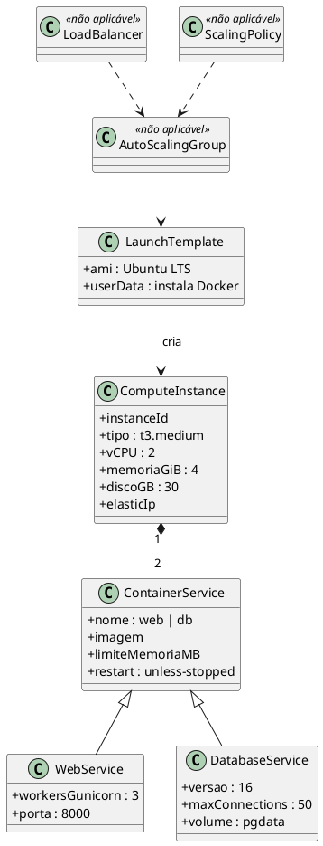
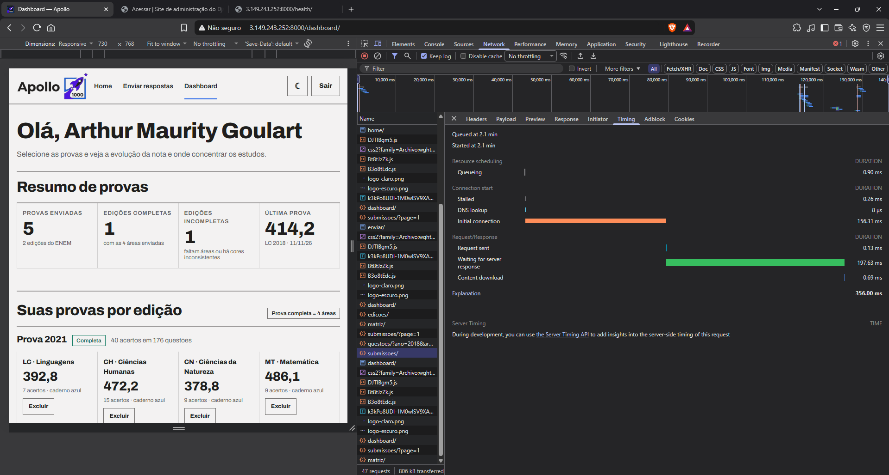

**Dimensionamento de Computação**

**Projeto Apollo**

|  |  |
| --- | --- |
| **Projeto** | Apollo — Plataforma de Análise de Desempenho no ENEM |
| **Documento** | Dimensionamento de Computação (Modelo de Análise de Classes — EC2) |
| **Versão** | 1.0 |
| **Data** | 08/11/2026 |
| **Status** | Em Revisão |
| **Responsável** | Equipe do Projeto Apollo |
| **Disciplina** | Projeto de Cloud |
| **Fase RUP/UP** | Elaboração |

# 1. Introdução

## 1.1. Propósito

Dimensionar a camada de computação do Apollo: instância EC2 e contêineres `web` (Django + Gunicorn) e `db` (PostgreSQL 16). O documento justifica o tipo de instância, a quantidade de *workers*, os limites de memória e o custo, e registra por que Auto Scaling e Load Balancer **não** fazem parte da entrega.

## 1.2. Escopo

Uma instância EC2 em uma AZ, executando Docker Compose. Fora do escopo: Auto Scaling Group, Application Load Balancer e múltiplas instâncias (avaliados na Seção 7).

## 1.3. Siglas

| **Sigla** | **Definição** |
| --- | --- |
| vCPU | CPU virtual |
| ASG | Auto Scaling Group |
| ALB | Application Load Balancer |
| TPS | Transações por segundo |
| WSGI | Interface Python entre servidor e aplicação (Gunicorn) |

## 1.4. Referências

* Requisitos Suplementares v2.0 (RNF-PER, RNF-CAP, RNF-CUS)
* Casos de Uso Arquiteturais v2.0 (UC-ARQ-001, UC-ARQ-004)
* Documentação AWS EC2 (tipos burstable T3) e Gunicorn

# 2. Requisitos de Dimensionamento

| **Parâmetro** | **Valor** | **Origem** |
| --- | --- | --- |
| Usuários cadastrados (projeto) | ≈ 200 alunos | Premissa de turma/demonstração |
| Pico de submissões | 50 por minuto (≈ 0,83 req/s) | RNF-PER-02 |
| Latência | p95 < 1,5 s no envio | RNF-PER-01 |
| Consultas de dashboard no pico | ≈ 2 por submissão (≈ 1,7 req/s) | Premissa |
| Disponibilidade | 99% | RNF-CON-01 |
| Custo estimado | ≈ US$ 36,42/mês (AWS Pricing Calculator) | RNF-CUS-01 |

# 3. Modelo de Análise de Classes

# 4. Especificação das Classes

| **Classe** | **Responsabilidade** | **Atributos-chave** | **Decisão** |
| --- | --- | --- | --- |
| ComputeInstance | Hospedar os contêineres | `t3.medium`, 2 vCPU, 4 GiB, gp3 30 GB | Adotada |
| ContainerService / WebService | Executar Django com Gunicorn | 3 *workers*, porta 8000, limite 1 GiB | Adotada |
| ContainerService / DatabaseService | Executar PostgreSQL | `postgres:16`, `max_connections=50`, limite 1,5 GiB | Adotada |
| LaunchTemplate | Padronizar a criação da instância (AMI + *user data*) | AMI Ubuntu LTS; script instala Docker/Git | Adotada (documentada, uso manual) |
| AutoScalingGroup | Escalar horizontalmente | — | **Não aplicável** (Seção 7) |
| LoadBalancer | Distribuir tráfego | — | **Não aplicável** (Seção 7) |
| ScalingPolicy | Regras de escala | — | **Não aplicável** (Seção 7) |

# 5. Memória de Cálculo

## 5.1. CPU

| **Item** | **Cálculo** | **Resultado** |
| --- | --- | --- |
| Taxa de requisições no pico | 50 submissões/min ÷ 60 + 100 consultas/min ÷ 60 | ≈ 2,5 req/s |
| Custo de CPU por submissão (premissa: 45 respostas + cálculo TRI) | ≈ 150 ms de CPU | [Guessing] — medir |
| CPU necessária | 0,83 × 0,15 + 1,7 × 0,03 | ≈ 0,18 vCPU |
| Capacidade base do t3.medium | 2 vCPU × 20% de linha de base | 0,4 vCPU sustentável sem gastar créditos |

**Conclusão:** o pico previsto (≈ 0,18 vCPU) cabe na linha de base do T3 (0,4 vCPU), com folga ≈ 2×. Picos maiores consomem créditos de CPU, aceitável para uso acadêmico.

## 5.2. Memória

| **Componente** | **Estimativa (MiB)** | **Base** |
| --- | --- | --- |
| Sistema operacional + Docker Engine | 600 | Típico Ubuntu + dockerd/containerd |
| `web`: 3 *workers* × ~120 MiB | 360 | Django + DRF por *worker* [Likely] |
| `web`: processo mestre e margem | 100 | — |
| `db`: `shared_buffers` | 256 | ~6% de 4 GiB; conservador |
| `db`: conexões (até 50 × ~10 MiB) | 500 | Pior caso |
| `db`: manutenção e `work_mem` | 150 | — |
| **Total** | **≈ 1.970 MiB** | ≈ 48% de 4 GiB |

**Verificação:** com `t3.small` (2 GiB) o uso seria ≈ 96%, sem margem para *page cache* e picos → **descartado**. Com `t3.medium` (4 GiB) sobra ≈ 2 GiB. Atende RNF-CAP-03 (< 80%) [Likely]; confirmar com `docker stats` após o deploy.

## 5.3. Número de *workers*

| **Regra** | **Cálculo** | **Valor** |
| --- | --- | --- |
| Recomendação geral do Gunicorn | 2 × vCPU + 1 | 5 |
| Valor adotado | Limitado pela memória e pelo pico baixo | **3** |

Três *workers* atendem ≈ 2,5 req/s com folga (cada um processa ≈ 6 req/s a 150 ms).

## 5.4. Armazenamento

| **Item** | **Cálculo** | **Resultado** |
| --- | --- | --- |
| SO + imagens Docker | — | ≈ 8 GB |
| Banco (10 edições, 4 áreas, até 4 cadernos por cor + respostas) | 7.400 itens de questão (medido na EC2); 200 alunos × 10 submissões × 45 respostas ≈ 90 mil linhas | < 200 MB |
| Backups locais (7 dias) | 7 × ~50 MB | ≈ 350 MB |
| Margem de logs e crescimento | — | ≈ 5 GB |
| **Disco adotado** | gp3 30 GB | folga > 60% |

# 6. Custo

Estimativa feita na [AWS Pricing Calculator](https://calculator.aws/#/estimate?id=8e4fe0a08f011b6f4a2ad10ee8757d1241cf9b53) (Leste dos EUA, sob demanda, Linux, 730 h/mês).

| **Item** | **Cálculo (Leste dos EUA)** | **US$/mês** |
| --- | --- | --- |
| EC2 t3.medium | 0,0416 × 730 h | ≈ 30,37 |
| EBS gp3 30 GB | 30 × 0,08 | 2,40 |
| IPv4 público | 0,005 × 730 | 3,65 |
| **Total** |  | **≈ 36,42** |

Parando a instância fora de períodos de teste (RNF-CUS-03), o custo de computação cai proporcionalmente (ex.: 12 h/dia → ≈ US$ 15 em EC2).

# 7. Alternativas Avaliadas

| **Alternativa** | **Prós** | **Contras** | **Decisão** |
| --- | --- | --- | --- |
| Instância única t3.medium (adotada) | Simples, barata, atende o pico | Ponto único de falha | **Escolhida** |
| t3.small | ≈ US$ 15/mês | Memória insuficiente (≈ 96%) | Descartada |
| 2 instâncias + ALB + ASG | Alta disponibilidade, escala | ALB ≈ US$ 16/mês + 2ª EC2; banco precisaria sair do contêiner (RDS) | Evolução |
| Fargate/ECS | Sem gerenciar a VM | Custo maior e mais configuração | Descartada |

# 8. Considerações Finais

A instância única é suficiente para o pico previsto e tem custo baixo (≈ US$ 36,42/mês na AWS Pricing Calculator). As estimativas de CPU e memória são premissas e devem ser confirmadas por medição após o deploy.

**Medição registrada após o deploy:**

| **Métrica** | **Previsto** | **Medido** |
| --- | --- | --- |
| Tempo de 1 envio (DevTools, POST /api/submissoes/, EC2 em produção) | < 1,5 s | 356 ms (espera do servidor 198 ms) |

# 9. Aprovações

| **Função** | **Nome** | **Data** | **Assinatura** |
| --- | --- | --- | --- |
| Arquiteto de Soluções | Arthur Maurity, Bernardo Casanovas, Bernardo Miller, Lucas Jesus | 10/11/2026 | Aprovado em revisão da equipe |
| Professor Responsável | Jonh Carvalho |  |  |

# 10. Histórico de Versões

| **Versão** | **Data** | **Autor** | **Descrição das Alterações** |
| --- | --- | --- | --- |
| 1.0 | 08/11/2026 | Equipe do Projeto Apollo | Criação: dimensionamento de `web` e `db` em uma EC2 t3.medium. |
| 1.1 | 10/11/2026 | Equipe do Projeto Apollo | Volumetria da base de provas ajustada para o valor medido (7.400 itens, 10 edições). |
