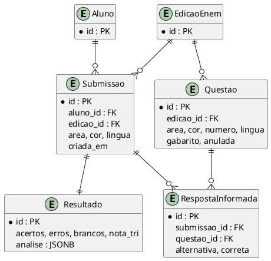
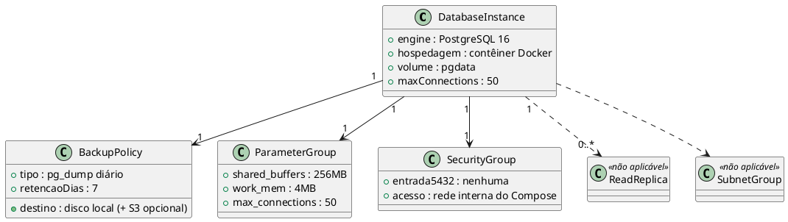
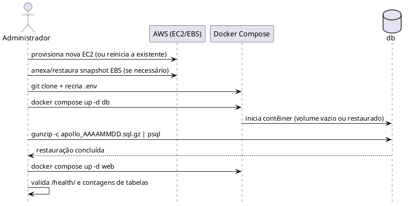
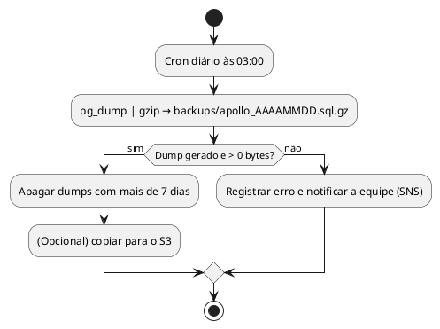

**Dimensionamento de Banco de Dados Relacional**

**Projeto Apollo**

|  |  |
| --- | --- |
| **Projeto** | Apollo — Plataforma de Análise de Desempenho no ENEM |
| **Documento** | Dimensionamento do Banco de Dados Relacional (PostgreSQL em Docker × Amazon RDS) |
| **Versão** | 1.0 |
| **Data** | 08/11/2026 |
| **Status** | Em Revisão |
| **Responsável** | Equipe do Projeto Apollo |
| **Disciplina** | Projeto de Cloud |
| **Fase RUP/UP** | Elaboração |

# 1. Introdução

## 1.1. Propósito

Dimensionar o banco de dados relacional do Apollo e **comparar** duas opções de hospedagem: (A) PostgreSQL 16 em contêiner Docker com volume `pgdata` na própria EC2 (**adotada**) e (B) Amazon RDS for PostgreSQL (alternativa avaliada).

## 1.2. Escopo

Modelo de dados, capacidade, backup/recuperação, parâmetros, segurança de rede e custo. Alta disponibilidade Multi-AZ e réplicas de leitura são avaliadas e descartadas para o escopo acadêmico.

## 1.3. Siglas

| **Sigla** | **Definição** |
| --- | --- |
| RDS | Relational Database Service |
| PITR | Point-in-Time Recovery |
| JSONB | JSON binário do PostgreSQL |
| GIN | Índice invertido (Generalized Inverted Index) |
| IOPS | Operações de E/S por segundo |
| WAL | Write-Ahead Log |

## 1.4. Referências

* Requisitos Suplementares v2.0 (RNF-PER, RNF-CAP, RNF-CON, RNF-DAD)
* Dimensionamento de Computação v1.0
* Roteiro 14; documentação do PostgreSQL 16 e do Amazon RDS

# 2. Requisitos

| **Parâmetro** | **Valor** | **Origem** |
| --- | --- | --- |
| Usuários | ≈ 200 alunos | Premissa |
| Submissões por dia | ≈ 100 (média); pico de 50/min | RNF-PER-02 |
| Pico de escrita | ≈ 0,83 submissão/s ≈ 40 INSERTs/s | 45 respostas por submissão |
| Latência de consulta | p95 < 1,5 s no fluxo de envio | RNF-PER-01 |
| Volume inicial | < 50 MB (10 edições, 7.400 questões) | Base de provas (medido na EC2) |
| Crescimento mensal | ≈ 30 MB | 100 submissões/dia × ~46 linhas × ~200 B × 30 |
| Conexões simultâneas | ≤ 50 | 3 *workers* + administração |
| RPO / RTO | < 24 h / < 4 h | RNF-CON-03/04 |

# 3. Modelo de Dados (resumo)

`RespostaInformada` é a tabela associativa (com os atributos `alternativa` e `correta`) entre Submissao e Questao, cumprindo o papel de N:N (`Submissao.questoes` é um `ManyToManyField` com `through`). Dois campos são JSONB: `Questao.atributos` guarda habilidade, competência, eixo e assunto, com índice GIN (`questao_atributos_gin`) que sustenta a consulta `?atributos__habilidade=H12`; `Resultado.analise` guarda os erros por habilidade de cada submissão. A migração `0001_initial` cria o índice GIN.

# 4. Modelo de Análise de Classes (Infraestrutura do Banco)

| **Classe** | **Opção A — Docker na EC2 (adotada)** | **Opção B — RDS (avaliada)** |
| --- | --- | --- |
| DatabaseInstance | `postgres:16` em contêiner, volume `pgdata` | `db.t3.micro`, 20 GB gp3 |
| BackupPolicy | `pg_dump` diário (cron) + snapshot EBS semanal | Backup automático, retenção 7 dias, PITR |
| ParameterGroup | Parâmetros em `command:`/`postgresql.conf` montado | Parameter Group do RDS |
| SecurityGroup | Sem exposição; acesso pela rede Docker | SG-RDS com 5432 a partir do SG da EC2 |
| ReadReplica | Não aplicável: carga de leitura baixa (< 2 req/s) | Possível, custo dobra |
| SubnetGroup | Não aplicável | Obrigatório (≥ 2 AZs) |

# 5. Diagramas de Comportamento

## 5.1. Restauração após falha (RTO < 4 h)

## 5.2. Rotina de backup e retenção

> **Nota:** o *Point-in-Time Recovery* contínuo (WAL) é recurso nativo do RDS. Na opção A, o ponto de recuperação é o último dump (RPO ≤ 24 h), o que atende RNF-CON-03.

# 6. Memória de Cálculo

## 6.1. Capacidade computacional

| **Item** | **Cálculo** | **Resultado** |
| --- | --- | --- |
| Escrita no pico | 0,83 submissão/s × 47 linhas (1 + 45 + 1) | ≈ 39 INSERTs/s |
| Capacidade do PostgreSQL em instância pequena | ordem de milhares de INSERTs/s em transação | folga > 50× [Likely] |
| vCPU do banco | fração da CPU da EC2 (ver Dimensionamento de Computação) | < 0,1 vCPU no pico |
| Memória do banco | `shared_buffers` 256 MiB + conexões 500 MiB + manutenção 150 MiB | ≈ 900 MiB |

## 6.2. Armazenamento e IOPS (12 meses)

| **Item** | **Cálculo** | **Resultado** |
| --- | --- | --- |
| Linhas por submissão | 1 Submissao + 45 Respostas + 1 Resultado | 47 |
| Tamanho médio de linha (com índices) | — | ≈ 200 B |
| Crescimento mensal | 100 sub/dia × 47 × 200 B × 30 | ≈ 28 MB |
| Crescimento em 12 meses | 28 MB × 12 | ≈ 340 MB |
| Base de provas | 7.400 questões × ~1 KB | ≈ 7,4 MB |
| Total estimado em 12 meses (com índices e *bloat* ×2) | (340 + 7,4) × 2 | ≈ 700 MB |
| IOPS no pico | ≈ 39 INSERTs/s + WAL ≈ 80 IOPS | gp3 base: 3.000 IOPS |

O volume de 30 GB (gp3) comporta o banco com margem superior a 95%.

## 6.3. Backup, RPO e RTO

| **Item** | **Cálculo** | **Resultado** |
| --- | --- | --- |
| Tamanho do dump compactado | ≈ 700 MB × 0,25 | ≈ 175 MB (após 12 meses) |
| Retenção local | 7 × 175 MB | ≈ 1,2 GB |
| RPO | Intervalo entre dumps | 24 h (meta: < 24 h — atendida no limite) |
| RTO (restauração) | Provisionar EC2 (≈ 20 min) + instalar Docker (≈ 15 min) + restaurar 175 MB (≈ 5 min) + validação (≈ 20 min) | ≈ 1 h [Guessing] — validar no exercício de restauração |

> Para RPO menor que 24 h, aumentar a frequência do dump (ex.: a cada 6 h). Custo marginal: apenas disco.

# 7. Comparação e Custo

| **Critério** | **A — Docker na EC2 (adotada)** | **B — RDS db.t3.micro** |
| --- | --- | --- |
| Custo mensal | US$ 0 adicional (usa a EC2 e o EBS já pagos) | ≈ US$ 12,50 (instância) + US$ 2,30 (20 GB) ≈ **US$ 15** |
| Backup | Manual (`pg_dump`/cron) | Automático + PITR |
| Patches | Manual (troca de imagem) | Gerenciado |
| Alta disponibilidade | Nenhuma (ponto único) | Multi-AZ opcional (dobra o custo) |
| Segurança de rede | Sem porta pública; mesma máquina da aplicação | SG dedicado; sub-rede privada |
| Desempenho | Compartilha CPU/RAM com `web` | Recursos dedicados |
| Aderência ao roteiro e à AP2 | Alta (Docker Compose, volume, healthcheck) | Baixa para o requisito de contêiner |
| Risco de perda de dados | Alto se o volume/EC2 for perdido sem dump | Baixo |

**Decisão:** opção A. O custo e o objetivo da AP2 (ciclo completo em Docker) favorecem a EC2 com volume; o RPO/RTO é atendido por `pg_dump` diário e restauração testada. O RDS é a **evolução recomendada** assim que o Apollo tiver usuários reais.

## 7.1. Parâmetros do PostgreSQL

| **Parâmetro** | **Valor** | **Justificativa** |
| --- | --- | --- |
| `shared_buffers` | 256 MB | ~6% da RAM; conservador por dividir a máquina com `web` |
| `work_mem` | 4 MB | Consultas pequenas |
| `max_connections` | 50 | Alinhado a 3 *workers* + administração |
| `log_min_duration_statement` | 500 ms | Detectar consultas lentas (meta p95 < 1,5 s) |

# 8. Riscos

| **Risco** | **Impacto** | **Mitigação** |
| --- | --- | --- |
| `docker compose down -v` apaga o volume | Perda total | Nunca usar `-v` em produção; dump diário |
| Disco cheio | Banco para | Alarme de disco; retenção de 7 dias |
| Falha da EC2 | Indisponibilidade | Snapshot EBS e runbook de restauração |
| Competição de memória `web` × `db` | Lentidão | Monitorar com `docker stats` (sem limites de memória no Compose) |

# 9. Considerações Finais

A opção A atende aos requisitos de desempenho, capacidade e recuperação a custo adicional zero. As estimativas de RTO e consumo de recursos serão validadas no exercício de restauração e nos testes de carga, com registro no README.

# 10. Aprovações

| **Função** | **Nome** | **Data** | **Assinatura** |
| --- | --- | --- | --- |
| Arquiteto de Soluções | Arthur Maurity, Bernardo Casanovas, Bernardo Miller, Lucas Jesus | 10/11/2026 | Aprovado em revisão da equipe |
| Professor Responsável | Jonh Carvalho |  |  |

# 11. Histórico de Versões

| **Versão** | **Data** | **Autor** | **Descrição das Alterações** |
| --- | --- | --- | --- |
| 1.0 | 08/11/2026 | Equipe do Projeto Apollo | Criação: comparação Docker/EC2 × RDS, modelo de dados, cálculo e custo. |
| 1.1 | 10/11/2026 | Equipe do Projeto Apollo | Modelo de dados e volumetria alinhados ao banco implantado (6 tabelas do app, 7.400 itens, 2 campos JSONB). |
