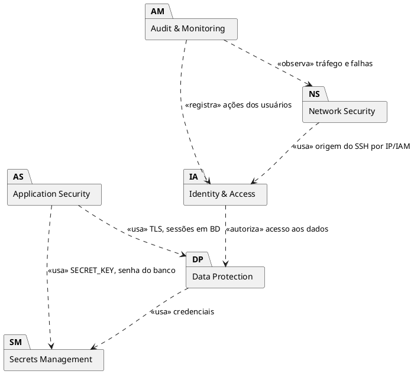

**Modelo de Análise (Pacotes/Subsistemas) — Segurança**

**Projeto Apollo**

|  |  |
| --- | --- |
| **Projeto** | Apollo — Plataforma de Análise de Desempenho no ENEM |
| **Documento** | Modelo de Análise (Pacotes/Subsistemas) — Segurança |
| **Versão** | 2.0 |
| **Data** | 08/11/2026 |
| **Status** | Em Revisão |
| **Responsável** | Equipe do Projeto Apollo |
| **Disciplina** | Projeto de Cloud |
| **Fase RUP/UP** | Elaboração |

# 1. Introdução

## 1.1. Propósito

Organiza os controles de segurança do Apollo em pacotes coesos e rastreáveis aos requisitos RNF-SEG. A arquitetura-alvo é **Django + PostgreSQL em Docker Compose numa EC2**; os controles são escolhidos para o contexto acadêmico e para o risco real do projeto: vazamento de segredos, banco exposto e dados pessoais de alunos (LGPD).

## 1.2. Escopo

Protege: respostas e resultados dos alunos, credenciais do banco, `SECRET_KEY` do Django, acesso SSH à EC2 e o volume `pgdata`. Serviços premium (WAF, GuardDuty, Security Hub) ficam como evolução (Seção 7).

## 1.3. Definições e Siglas

| **Sigla** | **Definição** |
| --- | --- |
| IAM | Identity and Access Management |
| MFA | Multi-Factor Authentication |
| SG | Security Group |
| EBS | Elastic Block Store |
| TLS | Transport Layer Security |
| LGPD | Lei Geral de Proteção de Dados |
| CSRF | Cross-Site Request Forgery |

## 1.4. Referências

* Requisitos Suplementares v2.0 (RNF-SEG-01 a 08)
* Casos de Uso Arquiteturais v2.0 (UC-ARQ-002, 003, 004, 007)
* AWS Well-Architected — Security Pillar; Django Security Checklist (`manage.py check --deploy`)

# 2. Visão Geral dos Pacotes

## 2.1. Diagrama de Pacotes

## 2.2. Descrição dos Pacotes

| **Pacote** | **Responsabilidade** | **Tecnologias** | **Requisitos Atendidos** |
| --- | --- | --- | --- |
| Identity & Access | Identidades humanas e permissões na AWS | IAM, grupos, MFA | RNF-SEG-04 |
| Network Security | Filtrar tráfego e esconder o banco | Security Group, rede interna do Compose | RNF-SEG-07 |
| Data Protection | Criptografia e backup | EBS criptografado, TLS (evolução), `pg_dump` | RNF-SEG-01/02, RNF-CON-03 |
| Secrets Management | Manter segredos fora do código | `.env`, `.gitignore`, `.env.example` | RNF-SEG-05 |
| Application Security | Autenticação do aluno e hardening Django | Django auth, permissões DRF, `DEBUG=False`, `ALLOWED_HOSTS` | RNF-SEG-03/06/08 |
| Audit & Monitoring | Rastro e alertas | CloudWatch, SNS, CloudTrail, logs Docker | RNF-OPS-01/02/03 |

## 2.3. Matriz de Rastreamento Resumida

| **Requisito** | **Pacote** | **Controle** |
| --- | --- | --- |
| RNF-SEG-01 (TLS) | Data Protection | Nginx + certificado (evolução); HTTP na entrega base |
| RNF-SEG-02 (repouso) | Data Protection | EBS criptografado |
| RNF-SEG-03 (acesso do aluno) | Application Security | Autenticação + filtro por usuário |
| RNF-SEG-04 (menor privilégio) | Identity & Access | IAM por pessoa, MFA; usuário de BD sem superusuário |
| RNF-SEG-05 (segredos) | Secrets Management | `.env` fora do Git |
| RNF-SEG-06 (LGPD) | Application Security / Data Protection | Coleta mínima, exclusão de conta |
| RNF-SEG-07 (rede) | Network Security | SG mínimo; 5432 não publicada |
| RNF-SEG-08 (produção) | Application Security | `DEBUG=False`, `ALLOWED_HOSTS` |

# 3. Especificação dos Pacotes

## 3.1. Identity & Access

**Responsabilidade:** controlar quem administra a conta AWS e a EC2.

| **Elemento** | **Descrição** | **Serviço** |
| --- | --- | --- |
| Usuários IAM | Um por integrante, sem uso do usuário raiz | IAM |
| Grupo `apollo-dev` | Permissões de EC2 e CloudWatch | IAM |
| MFA | Obrigatório para console | IAM |
| Chave SSH | Par de chaves da EC2; `.pem` fora do Git | EC2 |

| **Papel** | **Tipo** | **Permissões** | **Justificativa** |
| --- | --- | --- | --- |
| Admin-Infra | Humano | EC2, EBS, SG, CloudWatch, SNS | Operar a infraestrutura |
| Dev-Backend | Humano | Leitura de EC2/CloudWatch; SSH na instância | Deploy e diagnóstico |
| Usuário Postgres `apollo_app` | Banco | CRUD no esquema da aplicação, sem `SUPERUSER` | Menor privilégio no banco |

| **Risco** | **Mitigação** |
| --- | --- |
| Uso do usuário raiz | Bloquear uso; MFA na raiz |
| Compartilhamento de credenciais | Um usuário IAM por pessoa |
| Chave `.pem` vazada | Nunca versionar; rotacionar se houver suspeita |

## 3.2. Network Security

**Responsabilidade:** reduzir a superfície de ataque.

| **Elemento** | **Descrição** |
| --- | --- |
| Security Group `sg-apollo` | Firewall da EC2 (stateful) |
| Rede interna do Compose | `web` fala com `db` pelo nome `db`; `db` sem `ports:` |

| **Direção** | **Porta** | **Origem/Destino** | **Justificativa** |
| --- | --- | --- | --- |
| Entrada | 22/TCP | IP do grupo (`/32`) | Administração |
| Entrada | 8000/TCP | `0.0.0.0/0` | API Django (Gunicorn) |
| Entrada | 80/TCP | `0.0.0.0/0` | Nginx (se adotado) |
| Entrada | 5432/TCP | **nenhuma** | Banco nunca exposto |
| Saída | todas | `0.0.0.0/0` | `docker pull`, `apt`, `git` |

| **Risco** | **Mitigação** |
| --- | --- |
| Regra aberta por engano | Revisão antes de cada entrega; teste externo de portas |
| IP do grupo muda | Atualizar a regra ou usar EC2 Instance Connect |

## 3.3. Data Protection

**Responsabilidade:** proteger e recuperar dados.

| **Dado** | **Em repouso** | **Em trânsito** | **Backup** |
| --- | --- | --- | --- |
| Banco (`pgdata`) | EBS criptografado (AES-256) | Rede interna Docker | `pg_dump` diário + snapshot EBS |
| Respostas/resultados | Idem | HTTP (base) → HTTPS (evolução) | Idem |
| Backups em S3 (opcional) | SSE-S3 | TLS | Retenção 7 dias |

| **Política de backup** | **Frequência** | **Retenção** | **RPO** | **RTO** |
| --- | --- | --- | --- | --- |
| `pg_dump` (cron) | Diário | 7 dias | 24 h | 4 h |
| Snapshot EBS | Semanal | 4 cópias | 7 dias (apoio) | 4 h |

| **Risco** | **Mitigação** |
| --- | --- |
| Tráfego em HTTP expõe sessão e dados | Priorizar Nginx + TLS; sessão com cookies `Secure` após HTTPS |
| Backup nunca restaurado | Exercício de restauração documentado (UC-ARQ-007) |

## 3.4. Secrets Management

**Responsabilidade:** impedir vazamento de credenciais.

| **Segredo** | **Onde fica** | **Quem acessa** |
| --- | --- | --- |
| `POSTGRES_PASSWORD` | `.env` na EC2 | Contêineres `web` e `db` |
| `SECRET_KEY` (Django) | `.env` na EC2 | `web` |
| Chave SSH `.pem` | Máquina de cada integrante | Administradores |
| Credenciais AWS | Console com MFA; nenhuma chave fixa na EC2 | Usuários IAM |

**Controles:** `.env` no `.gitignore`; `.env.example` com valores fictícios; varredura do histórico (`git log -p | grep -iE "password|secret|key"`, ou *gitleaks*) antes da entrega; rotação manual da senha se houver suspeita.

| **Risco** | **Mitigação** |
| --- | --- |
| Segredo commitado (penalidade na avaliação) | Verificação do histórico; se vazou, rotacionar e limpar o histórico |
| `.env` ausente na EC2 | Procedimento de provisionamento no README |

## 3.5. Application Security

**Responsabilidade:** segurança no nível da aplicação Django.

| **Controle** | **Configuração** |
| --- | --- |
| Autenticação | Django auth (sessões armazenadas no PostgreSQL) |
| Autorização | Permissões DRF; queryset filtrado por `request.user` |
| Hardening | `DEBUG=False`, `ALLOWED_HOSTS` explícito, `manage.py check --deploy` |
| CSRF/CORS | Proteção CSRF ativa; origens permitidas explícitas |
| Entrada | Validação por serializers; ORM parametrizado (sem SQL concatenado) |
| LGPD | Coleta mínima; finalidade pedagógica; exclusão de conta |

| **Risco** | **Mitigação** |
| --- | --- |
| Aluno ler resultado de outro | Teste automatizado de isolamento por usuário |
| `DEBUG=True` em produção | Valor padrão `False`; checagem no deploy |

## 3.6. Audit & Monitoring

**Responsabilidade:** rastro e detecção básica.

| **Elemento** | **Uso** |
| --- | --- |
| CloudTrail (básico) | Eventos de gerenciamento da conta (quem criou/alterou recursos) |
| CloudWatch Alarms + SNS | Falha de status da EC2; CPU alta; e-mail à equipe |
| Logs Docker | `docker compose logs web db` |
| Verificação de `/health/` | Alerta de indisponibilidade da API |

| **Risco** | **Mitigação** |
| --- | --- |
| Falha silenciosa | Alarme de saúde + verificação do endpoint |
| Logs perdidos ao recriar contêiner | Evolução: envio ao CloudWatch Logs |

# 4. Diagrama de Dependências entre Pacotes

| **De** | **Para** | **Motivo** |
| --- | --- | --- |
| Network Security | Identity & Access | A origem do SSH é restrita ao IP/identidade do grupo |
| Application Security | Secrets Management | `SECRET_KEY` e senha do banco vêm do `.env` |
| Application Security | Data Protection | Sessões e dados persistidos em volume criptografado |
| Data Protection | Secrets Management | Backup e conexão usam credenciais protegidas |
| Audit & Monitoring | Identity & Access | Registra quem executou cada ação |
| Audit & Monitoring | Network Security | Observa falhas e indisponibilidade |

# 5. Matriz de Rastreamento Completa

| **Requisito** | **Caso de Uso** | **Pacote** | **Componente** |
| --- | --- | --- | --- |
| RNF-SEG-01 | UC-ARQ-004 | Data Protection | Nginx/TLS (evolução) |
| RNF-SEG-02 | UC-ARQ-001 | Data Protection | EBS criptografado |
| RNF-SEG-03 | UC-ARQ-004 | Application Security | Django auth + DRF |
| RNF-SEG-04 | UC-ARQ-002 | Identity & Access | IAM, MFA, usuário de BD |
| RNF-SEG-05 | UC-ARQ-003 | Secrets Management | `.env`, `.gitignore` |
| RNF-SEG-06 | UC-ARQ-002 | Application Security | Coleta mínima, exclusão |
| RNF-SEG-07 | UC-ARQ-002/003 | Network Security | SG, Compose sem `ports` no `db` |
| RNF-SEG-08 | UC-ARQ-004 | Application Security | `DEBUG=False`, `ALLOWED_HOSTS` |
| RNF-OPS-01/02 | UC-ARQ-005 | Audit & Monitoring | CloudWatch + SNS |

# 6. Trade-offs

| **Decisão** | **Ganho** | **Custo / Risco aceito** |
| --- | --- | --- |
| Segredos em `.env` em vez de Secrets Manager | Sem custo; simples | Arquivo em disco da EC2; mitigado por permissão `600` e disco criptografado |
| Banco em contêiner em vez de RDS | Custo menor; ciclo completo em Docker | Sem backup/patch gerenciados; mitigado por `pg_dump` |
| HTTP na entrega base | Menos configuração | Tráfego sem criptografia; evolução prioritária com Nginx + TLS |
| SG simples, sem WAF | Custo | Sem proteção L7 gerenciada |

# 7. Evolução Futura

* HTTPS com Nginx e certificado (Let's Encrypt/ACM).
* Migração do banco para RDS com criptografia e backup gerenciados; segredos no Secrets Manager.
* AWS WAF, GuardDuty e Security Hub.
* Envio de logs ao CloudWatch Logs; rotação automática de segredos.

# 8. Aprovações

| **Função** | **Nome** | **Data** | **Assinatura** |
| --- | --- | --- | --- |
| Arquiteto de Soluções | Arthur Maurity, Bernardo Casanovas, Bernardo Miller, Lucas Jesus | 10/11/2026 | Aprovado em revisão da equipe |
| Professor Responsável |  |  |  |

# 9. Histórico de Versões

| **Versão** | **Data** | **Autor** | **Descrição das Alterações** |
| --- | --- | --- | --- |
| 1.0 | 21/09/2026 | Equipe do Projeto Apollo | Versão inicial (4 pacotes, AWS gerenciado). |
| 2.0 | 08/11/2026 | Equipe do Projeto Apollo | Reescrita para EC2 + Docker; 6 pacotes (inclui Secrets Management e Application Security); diagrama PlantUML. |
