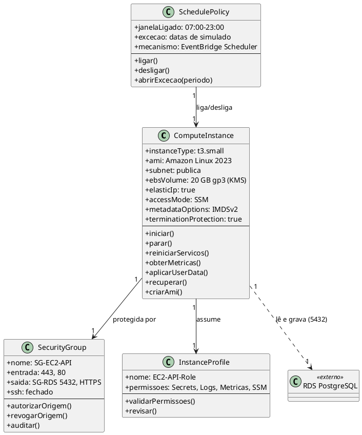
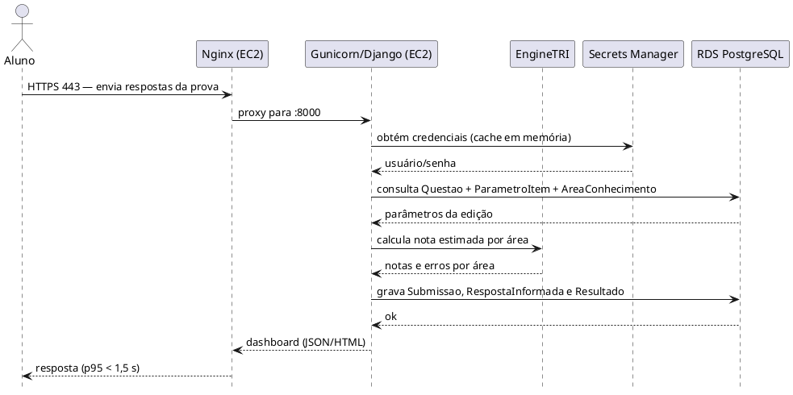
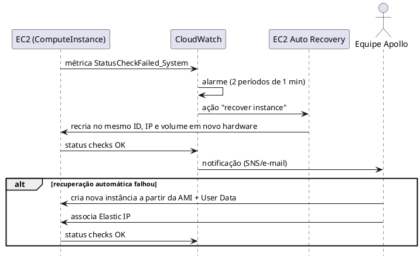
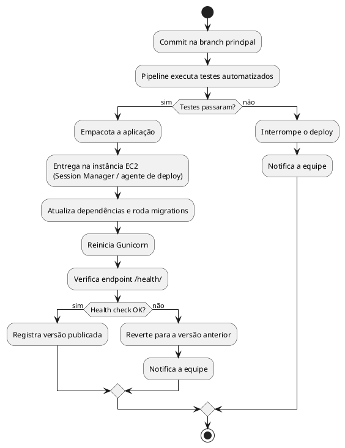
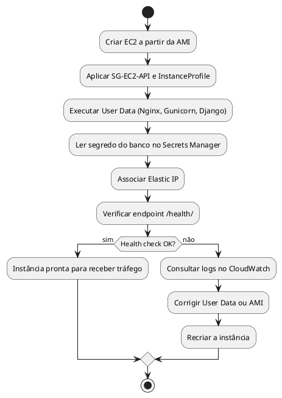

**Modelo de Análise (Classes de Análise) — Dimensionamento de Computação (EC2)**

| | |
|---|---|
| **Projeto** | Apollo — Análise de desempenho no ENEM via TRI |
| **Documento** | Modelo de Análise (Classes de Análise) — Dimensionamento de Computação (EC2) |
| **Versão** | 1.0 |
| **Data** | 21/10/2026 |
| **Status** | Em Desenvolvimento |
| **Responsável** | Equipe do Projeto Apollo (Arthur Maurity, Bernardo Casanovas, Bernardo Miller, Lucas Jesus) |
| **Disciplina** | Projeto de Cloud — IBMEC |
| **Fase RUP/UP** | Elaboração |

> **Convenção.** Valores marcados **[Doc]** vêm dos documentos já entregues (Requisitos Suplementares, Documento de Visão, Casos de Uso Arquiteturais). Valores marcados **[Premissa]** são estimativas da equipe, a validar. Preços AWS são **valores de referência** (us-east-1, sob demanda), a confirmar no AWS Pricing Calculator.

---

# 1. Introdução

## 1.1 Propósito

Dimensionar a camada de computação Amazon EC2 do Apollo, que executa a API Django (Gunicorn + Nginx) responsável por receber as respostas do aluno, aplicar o EngineTRI e entregar o dashboard. O documento modela como classes de análise os componentes dessa camada e justifica capacidade, rede, segurança, operação e custo com base nos requisitos do projeto.

O modelo deriva dos artefatos anteriores: Documento de Visão, Requisitos Suplementares, Casos de Uso Arquiteturais (em especial UC-ARQ-004 Conectividade entre Camadas, UC-ARQ-005 Monitoramento e UC-ARQ-006 Pipeline de Deploy), Modelo de Análise de Segurança e Modelo de Análise (Classes) — RDS.

## 1.2 Escopo

**Dentro do escopo:**
- Uma instância EC2 (`ComputeInstance`) executando Django, Gunicorn e Nginx.
- Security Group da instância (`SecurityGroup`, SG-EC2-API).
- Perfil de acesso IAM da instância (`InstanceProfile`).
- Política de liga/desliga para controle de custo (`SchedulePolicy`).
- Cálculo de vCPU, memória, armazenamento, conexões e custo.

**Fora do escopo (evolução futura):** Application Load Balancer, Target Group, Auto Scaling Group, Scaling Policy, Launch Template e múltiplas instâncias em Multi-AZ. Não se aplicam ao Apollo: a escala é de dezenas a centenas de alunos simultâneos, o SLA é 99% e o orçamento é US$ 100/mês (um ALB sozinho custaria ≈ US$ 22–27/mês). Também fora do escopo: RDS (documento próprio) e Lambda de ingestão (serverless).

## 1.3 Siglas

| Sigla | Significado |
|---|---|
| EC2 | Elastic Compute Cloud |
| EBS | Elastic Block Store |
| AMI | Amazon Machine Image |
| SG | Security Group |
| IAM | Identity and Access Management |
| SSM | AWS Systems Manager |
| EIP | Elastic IP |
| TRI | Teoria de Resposta ao Item |
| SLA | Service Level Agreement |
| RPO / RTO | Recovery Point / Recovery Time Objective |
| RNF | Requisito Não Funcional |

## 1.4 Referências

- Apollo — Documento de Visão
- Apollo — Requisitos Suplementares
- Apollo — Casos de Uso Arquiteturais (UC-ARQ-001 a 007)
- Apollo — Modelo de Análise de Segurança
- Apollo — Modelo de Análise (Classes) — RDS
- AWS — Documentação do Amazon EC2 e página de preços

---

# 2. Visão Geral do Dimensionamento

## 2.1 Requisitos que orientam o dimensionamento

| ID | Requisito | Valor | Fonte |
|---|---|---|---|
| — | Alunos simultâneos | dezenas a centenas (pico adotado: 300) | [Doc] / [Premissa] |
| RNF-PER-01 | Latência p95 de submissão | < 1,5 s | [Doc] |
| RNF-PER-02 | Vazão de submissões | ≥ 50/min, erro < 1% | [Doc] |
| — | Requisições totais no pico (leitura + submissão) | ≈ 30 req/s | [Premissa] |
| — | CPU por submissão (EngineTRI, 4 áreas × 45 itens) | ≈ 150 ms | [Premissa] |
| — | CPU por requisição de leitura (dashboard) | ≈ 20 ms | [Premissa] |
| — | Memória por worker Gunicorn (Django + numpy) | ≈ 200 MB | [Premissa] |
| RNF-CON-01 | Disponibilidade | 99% (≈ 7,2 h/30 dias) | [Doc] |
| RNF-CON-04 | RTO | < 4 h | [Doc] |
| RNF-CAP-01 | Nova edição sem mudança estrutural | Apenas carga de dados | [Doc] |
| RNF-SEG | Acesso restrito e segredos fora do código | SG por origem, Secrets Manager | [Doc] |
| RNF-CUS-01/02/03 | Orçamento e controle | US$ 100/mês; alertas 80%/100%; desligar quando ocioso | [Doc] |
| — | Orçamento alocado para EC2 | ≈ US$ 25/mês (25% do total) | [Premissa] |

## 2.2 Arquitetura de computação

```
 Aluno ──HTTPS 443──►  ┌──────────────────────────────────────────────┐
                       │ VPC Apollo (us-east-1) — sub-rede pública    │
                       │                                              │
                       │  ┌────────────────────────────────────────┐  │
                       │  │ EC2 t3.small  (SG-EC2-API, Elastic IP) │  │
                       │  │  Nginx :443 ─► Gunicorn :8000 ─► Django│  │
                       │  │  (3 workers × 2 threads) + EngineTRI   │  │
                       │  │  EBS gp3 20 GB (criptografado)         │  │
                       │  └───────────────┬────────────────────────┘  │
                       │                  │ 5432                      │
                       │  ┌───────────────▼────────────┐              │
                       │  │ RDS PostgreSQL (sub-rede   │              │
                       │  │ privada, SG-RDS)           │              │
                       │  └────────────────────────────┘              │
                       └──────────────────────────────────────────────┘
 Apoio: Secrets Manager (credenciais) │ CloudWatch (métricas, logs, alarmes)
        SSM Session Manager (acesso administrativo, sem porta 22)
        IAM InstanceProfile (permissões mínimas)
```

## 2.3 Matriz de rastreabilidade

| Requisito | Classe de análise | Serviço AWS | Configuração |
|---|---|---|---|
| RNF-PER-01/02 | ComputeInstance | EC2 | t3.small, 3 workers × 2 threads |
| RNF-CON-01 | ComputeInstance | EC2 | Instância única; recuperação automática (alarme) |
| RNF-CON-04 | ComputeInstance | EC2 + AMI | Recriação a partir de AMI/User Data |
| RNF-SEG | SecurityGroup | SG | 443 público; 22 fechada; origem do RDS é este SG |
| RNF-SEG-05 | InstanceProfile | IAM | Leitura do segredo do banco; escrita de logs |
| RNF-CUS-03 | SchedulePolicy | EventBridge/SSM | Parar fora do horário de uso |
| RNF-CUS-01/02 | ComputeInstance | Budgets | Alertas em 80% e 100% |
| UC-ARQ-005 | ComputeInstance | CloudWatch | CPU, memória, status checks |
| UC-ARQ-006 | ComputeInstance | Pipeline de deploy | User Data + entrega automatizada |

---

# 3. Especificação das Classes de Análise

## 3.1 ComputeInstance

**Responsabilidade:** representar a instância EC2 que executa a API Django do Apollo, gerenciando configuração, disponibilidade, desempenho e segurança.

| Atributo | Valor | Justificativa |
|---|---|---|
| instanceType | t3.small (2 vCPU burst, 2 GiB) | Atende o pico estimado com folga de memória (ver 8.1) |
| ami | Amazon Linux 2023 | Suporte de longo prazo, otimizada para AWS |
| subnetId | sub-rede pública | Sem NAT Gateway (≈ US$ 32/mês, fora do orçamento) |
| securityGroup | SG-EC2-API | 443 público; sem SSH |
| instanceProfile | EC2-API-Role | Permissões mínimas (ver 3.3) |
| ebsVolume | 20 GB gp3, criptografado (KMS padrão) | SO + aplicação + logs; RNF-SEG-02 |
| elasticIp | sim | Endereço estável para DNS/TLS |
| userData | script de instalação | Instala Nginx, Gunicorn, Django; reprodutível |
| accessMode | SSM Session Manager | Sem chave SSH nem porta 22 |
| monitoring | básico (5 min) + CloudWatch Agent (memória) | Detalhado custa ≈ US$ 2/mês por instância |
| terminationProtection | true | Evita remoção acidental |
| metadataOptions | IMDSv2 obrigatório | Protege credenciais da instância |

**Métodos:** `iniciar()`, `parar()`, `reiniciarServicos()`, `obterMetricas()`, `aplicarUserData()`, `recuperar()`, `criarAmi()`.

**Relacionamentos:** protegida por 1 `SecurityGroup`; assume 1 `InstanceProfile`; controlada por 1 `SchedulePolicy`.

**Custo:** ver 3.5.

## 3.2 SecurityGroup (SG-EC2-API)

**Responsabilidade:** filtrar o tráfego de rede da instância (RNF-SEG).

| Regra | Origem/Destino | Porta | Justificativa |
|---|---|---|---|
| Entrada | Internet (0.0.0.0/0) | 443 | Acesso HTTPS dos alunos |
| Entrada | Internet (0.0.0.0/0) | 80 | Apenas redirecionamento para HTTPS |
| Entrada | — | 22 | **Fechada**; administração via SSM |
| Saída | SG-RDS | 5432 | Acesso ao banco |
| Saída | Internet | 443 | Secrets Manager, CloudWatch, SSM, atualizações |

**Métodos:** `autorizarOrigem()`, `revogarOrigem()`, `auditar()`.

## 3.3 InstanceProfile (EC2-API-Role)

**Responsabilidade:** conceder à instância apenas as permissões necessárias, sem credenciais fixas no código.

| Permissão | Recurso | Justificativa |
|---|---|---|
| secretsmanager:GetSecretValue | Segredo do banco do Apollo | RNF-SEG-05 |
| logs:CreateLogStream / PutLogEvents | Grupo de logs do Apollo | UC-ARQ-005 |
| cloudwatch:PutMetricData | Namespace do Apollo | Métrica de memória |
| AmazonSSMManagedInstanceCore | Instância | Acesso administrativo sem SSH |

**Métodos:** `validarPermissoes()`, `revisar()`. Nenhuma permissão `*` em recursos.

## 3.4 SchedulePolicy

**Responsabilidade:** reduzir custo desligando a instância quando não há uso (RNF-CUS-03). Substitui, no Apollo, a `ScalingPolicy` do modelo-base.

| Atributo | Valor | Justificativa |
|---|---|---|
| janelaLigado | 07:00–23:00 (America/Sao_Paulo) | **[Premissa]** horário de estudo dos alunos |
| janelaExcecao | datas de simulado/ENEM: sempre ligada | Evita indisponibilidade em uso real |
| mecanismo | agendamento (EventBridge Scheduler/SSM) | Sem custo relevante |
| ordemDeParada | API primeiro; RDS pode seguir a mesma agenda | Consistência |

**Métodos:** `ligar()`, `desligar()`, `abrirExcecao(periodo)`.

**Efeito:** com 16 h/dia ligada, o custo de computação cai ≈ 33% (ver 8.4).

## 3.5 Estimativa de custo por componente

| Componente | Configuração | Custo/mês |
|---|---|---|
| ComputeInstance | t3.small On-Demand, 24×7 | ≈ US$ 15,2 |
| EBS | 20 GB gp3 | ≈ US$ 1,6 |
| Elastic IP / IPv4 público | 1 endereço | ≈ US$ 3,7 |
| SecurityGroup, InstanceProfile, SchedulePolicy | — | US$ 0 |

---

# 4. Diagrama de Classes



---

# 5. Diagrama de Sequência — Requisição do Aluno até o Resultado

Substitui o "Auto Scaling (Scale Out)" do modelo-base, que não se aplica ao Apollo.



---

# 6. Diagrama de Sequência — Recuperação Automática da Instância

Substitui o "Failover do ALB" do modelo-base. Sem ALB nem segunda instância, a resiliência vem da recuperação automática do EC2 e da recriação a partir de AMI.



---

# 7. Diagramas de Atividades — Deploy e Provisionamento

Substituem o "Deploy com Launch Template" do modelo-base. Cobrem UC-ARQ-006.

## 7.1 Deploy de uma nova versão



## 7.2 Provisionamento de uma instância nova (primeira vez ou recuperação)



---

# 8. Memória de Cálculo

## 8.1 vCPU e memória

| Item | Fórmula | Resultado |
|---|---|---|
| Alunos simultâneos (pico) | [Premissa] | 300 |
| Requisições totais | 300 alunos ÷ 1 ação a cada 10 s | ≈ 30 req/s |
| CPU de leitura | 30 req/s × 20 ms | ≈ 0,60 vCPU |
| Submissões (pico) | 50/min ÷ 60 | ≈ 0,83/s |
| CPU de submissão | 0,83/s × 150 ms | ≈ 0,125 vCPU |
| CPU total | 0,60 + 0,125 | ≈ 0,73 vCPU |
| vCPU com margem (×2) | 0,73 × 2 | ≈ 1,5 → **2 vCPU** |
| Memória | 3 workers × 200 MB + Nginx ≈ 30 MB + SO/agentes ≈ 350 MB | ≈ 1 GB de 2 GiB (≈ 50%) |
| Instância escolhida | 2 vCPU, 2 GiB | **t3.small** |

**Créditos de CPU (família t3):** t3.small acumula 24 créditos/h (baseline 20% por vCPU). O pico de 0,73 vCPU consome ≈ 44 créditos/h, saldo líquido ≈ −20/h. Um pico de 2 h consome ≈ 40 créditos e o restante do dia, de baixa carga, repõe mais de 400. Só um pico contínuo de vários dias esgotaria o saldo.

## 8.2 Concorrência e latência

| Item | Fórmula | Resultado |
|---|---|---|
| Slots concorrentes | 3 workers × 2 threads | 6 |
| Tempo médio por requisição (CPU + banco) | [Premissa] | ≈ 60 ms |
| Capacidade | 6 ÷ 0,06 s | ≈ 100 req/s |
| Demanda de pico | — | ≈ 30 req/s |
| Folga | 100 ÷ 30 | ≈ 3× |
| Latência de uma submissão | 150 ms (TRI) + ≈ 50 ms (gravação) | ≈ 0,2–0,3 s, com p95 < 1,5 s |
| Conexões com o RDS | 6 persistentes (`CONN_MAX_AGE`) | Dentro das ≈ 25 previstas no dimensionamento do RDS |

## 8.3 Armazenamento

| Item | Cálculo | Resultado |
|---|---|---|
| Sistema operacional | AMI padrão | ≈ 8 GB |
| Aplicação e dependências (Python, numpy) | — | ≈ 2 GB |
| Logs locais (com rotação) | — | ≈ 2 GB |
| Margem | — | ≈ 8 GB |
| **Volume** | | **20 GB gp3** |

Dados dos alunos e das provas ficam no RDS; o disco da EC2 não guarda dado persistente.

## 8.4 Disponibilidade e recuperação

| Item | Cálculo | Resultado |
|---|---|---|
| Indisponibilidade permitida (99%) | 30 d × 24 h × 1% | ≈ 7,2 h/mês |
| Recuperação automática do EC2 | alarme + recover | ≈ 5–10 min **[Premissa]** |
| Recriação manual (AMI + User Data) | — | < 1 h **[Premissa]** |
| RTO exigido | RNF-CON-04 | < 4 h → atendido |
| RPO da camada de computação | instância sem estado | Não se aplica (dados no RDS) |

## 8.5 Custo total mensal (referência)

| Componente | Cálculo | Custo/mês |
|---|---|---|
| EC2 t3.small, 24×7 | ≈ US$ 0,0208/h × 730 h | ≈ US$ 15,2 |
| EBS gp3 | 20 GB × ≈ US$ 0,08 | ≈ US$ 1,6 |
| IPv4 público (Elastic IP) | ≈ US$ 0,005/h × 730 h | ≈ US$ 3,7 |
| Monitoramento (agente + alarmes) | acima do Free Tier | ≈ US$ 1,0 |
| Transferência de saída | primeiros 100 GB/mês gratuitos | US$ 0 |
| **Total (24×7)** | | **≈ US$ 21,5** |
| Total com SchedulePolicy (16 h/dia) | EC2 ≈ US$ 10,1; demais iguais | ≈ US$ 16,4 |
| Parcela do orçamento de US$ 100 | 21,5 ÷ 100 | ≈ 21% |
| EC2 + RDS (24×7) | 21,5 + 15,3 | ≈ US$ 36,8 (≈ 37%) |

---

# 9. Trade-Offs Documentados

| Decisão | Escolha | Alternativa | Prós / Contras | Impacto |
|---|---|---|---|---|
| Classe | t3.small | t3.micro (Free Tier) | micro é gratuito, mas 1 GiB aperta com 3 workers + agentes | small ≈ +US$ 15 |
| Classe | t3.small | t3.medium | medium dobra o custo sem necessidade no pico estimado | medium ≈ +US$ 15 |
| Quantidade | 1 instância | 2 instâncias + ALB + ASG | HA e escala automática, mas ≈ +US$ 60–70/mês e SLA de 99% não exige | ≈ +US$ 60–70 |
| Balanceador | Sem ALB (Nginx na instância) | ALB | ALB dá TLS gerenciado e health check, mas custa ≈ US$ 22–27/mês | ≈ +US$ 22–27 |
| Escala | Instância fixa + atualização manual de classe | Auto Scaling | Auto Scaling exigiria ≥ 2 instâncias e ALB | — |
| Compra | On-Demand | Reserved/Savings Plan | compromisso de 1 ano inadequado a projeto acadêmico | — |
| Rede | Sub-rede pública + SG restritivo | Sub-rede privada + NAT | NAT custa ≈ US$ 32/mês | ≈ +US$ 32 |
| Acesso admin | SSM Session Manager | SSH com chave | SSM elimina porta 22 e gestão de chaves | US$ 0 |
| SO | Amazon Linux 2023 | Ubuntu LTS | AL2023 é otimizado e tem suporte longo; Ubuntu é mais familiar | US$ 0 |
| Operação | Desligar fora do horário | 24×7 | ≈ −33% de EC2, mas indisponível fora da janela | ≈ −US$ 5 |
| Monitoramento | Básico + agente de memória | Detalhado (1 min) | detalhado ≈ +US$ 2/mês por instância | ≈ +US$ 2 |

---

# 10. Riscos e Mitigações

| # | Risco | Probabilidade | Impacto | Mitigação |
|---|---|---|---|---|
| R1 | Falha da instância ou do hardware (instância única) | Média | Alto | Alarme `StatusCheckFailed_System` com recuperação automática; AMI atualizada; RTO < 4 h |
| R2 | Esgotamento de créditos de CPU (t3) | Média | Médio | Alarme `CPUCreditBalance`; modo `unlimited` ou upgrade de classe |
| R3 | Memória insuficiente com workers do EngineTRI | Média | Médio | Alarme de memória pelo CloudWatch Agent; reduzir workers ou subir de classe |
| R4 | Pico acima do estimado (dia de simulado) | Média | Alto | `SchedulePolicy` com exceção; subir para t3.medium antes do evento (manual) |
| R5 | Exposição indevida (porta pública) | Baixa | Crítico | Somente 443/80; sem SSH; SG revisado; IAM de privilégio mínimo; IMDSv2 |
| R6 | Instância desligada pela agenda durante uso | Média | Médio | Janela ampla + exceção para datas de simulado; alarme de erro 5xx |
| R7 | Deploy com falha | Média | Alto | Testes no pipeline; health check pós-deploy; reversão automática (UC-ARQ-006) |
| R8 | Estouro de orçamento | Baixa | Médio | AWS Budgets 80%/100%; `SchedulePolicy` (RNF-CUS) |
| R9 | TLS sem ALB (certificado gerenciado manualmente) | Média | Médio | Certificado no Nginx com renovação automática (requer domínio) — **decisão pendente** |
| R10 | Perda de estado local | Baixa | Baixo | Instância sem estado; dados no RDS; código no repositório |

---

# 11. Considerações Finais

## 11.1 Lições aprendidas
- O dimensionamento deve partir dos requisitos do próprio projeto. Replicar um desenho com ALB, Auto Scaling e Multi-AZ custaria mais do que o orçamento do EC2 permite e não é exigido por um SLA de 99%.
- Instância única só é aceitável porque a camada é sem estado: o que importa para a recuperação está no RDS e no repositório.
- Controle de custo é parte do desenho: agendar liga/desliga e evitar NAT valem mais do que escolher a menor instância.

## 11.2 Próximos passos
1. Validar as premissas da seção 2.1 (pico de alunos, CPU do EngineTRI) medindo o código real.
2. Confirmar preços no AWS Pricing Calculator.
3. Decidir como será o TLS e o domínio (R9).
4. Definir a janela da `SchedulePolicy`.
5. Avaliar ALB + segunda instância somente se o SLA ou a carga crescerem.

---

# 12. Aprovações

| Nome | Papel | Data | Assinatura |
|---|---|---|---|
| Arthur Maurity | Equipe Apollo | | |
| Bernardo Casanovas | Equipe Apollo | | |
| Bernardo Miller | Equipe Apollo | | |
| Lucas Jesus | Equipe Apollo | | |

# 13. Histórico de Versões

| Versão | Data | Autor | Descrição |
|---|---|---|---|
| 1.0 | 21/10/2026 | Equipe Apollo | Versão inicial adaptada do modelo-base |
