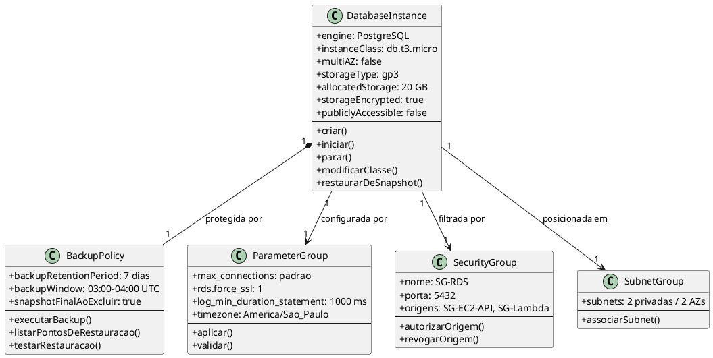
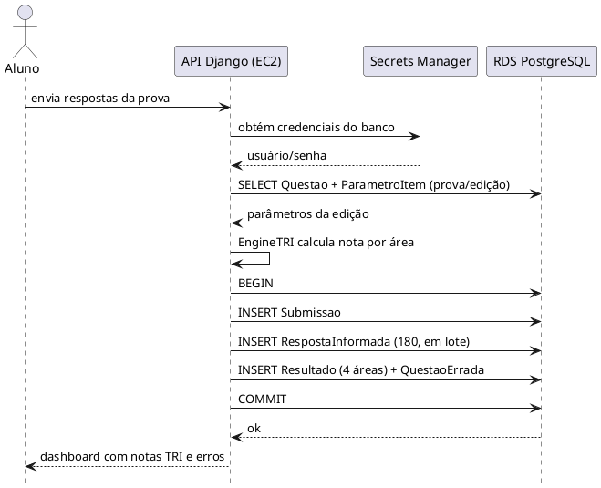
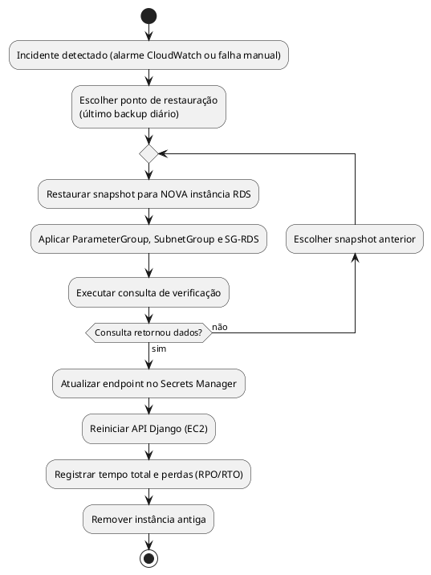

**Modelo de Análise (Classes de Análise) — Dimensionamento de Banco de Dados (RDS)**

| | |
|---|---|
| **Projeto** | Apollo — Análise de desempenho no ENEM via TRI |
| **Documento** | Modelo de Análise (Classes de Análise) — Dimensionamento do RDS |
| **Versão** | 1.0 |
| **Data** | 21/10/2026 |
| **Status** | Em Desenvolvimento |
| **Responsável** | Equipe do Projeto Apollo (Arthur Maurity, Bernardo Casanovas, Bernardo Miller, Lucas Jesus) |
| **Disciplina** | Projeto de Cloud — IBMEC |
| **Fase RUP/UP** | Elaboração |

> **Convenção.** Valores marcados **[Doc]** vêm dos documentos já entregues (Requisitos Suplementares, Documento de Visão). Valores marcados **[Premissa]** são estimativas da equipe e devem ser validados. Preços AWS são **valores de referência** (us-east-1, sob demanda) a confirmar no AWS Pricing Calculator.

---

# 1. Introdução

## 1.1 Propósito

Dimensionar o banco de dados relacional do Apollo (Amazon RDS for PostgreSQL) e modelar, como classes de análise, os componentes de infraestrutura que o compõem, justificando cada decisão de capacidade, segurança, backup e custo com base nos requisitos do projeto.

## 1.2 Escopo

**Dentro do escopo:**
- Uma instância RDS PostgreSQL em **Single-AZ**, na sub-rede privada da VPC do Apollo.
- Armazenamento, conexões, backup automático, parâmetros, segurança de rede e grupo de sub-redes.
- Memória de cálculo e custo mensal dentro do orçamento de US$ 100/mês.

**Fora do escopo (evolução futura):** Multi-AZ, Read Replica, RDS Proxy, Auto Scaling de instância, backup cross-region e criptografia com chave gerenciada pelo cliente (CMK).

## 1.3 Siglas

| Sigla | Significado |
|---|---|
| RDS | Amazon Relational Database Service |
| TRI | Teoria de Resposta ao Item |
| AZ | Availability Zone |
| SG | Security Group |
| VPC | Virtual Private Cloud |
| RPO / RTO | Recovery Point / Recovery Time Objective |
| KMS | AWS Key Management Service |
| IOPS | Operações de E/S por segundo |
| PITR | Point-in-Time Recovery |
| RNF | Requisito Não Funcional |

## 1.4 Referências

- Apollo — Requisitos Suplementares (RNF-PER, RNF-CAP, RNF-CON, RNF-OPS, RNF-SEG, RNF-CUS)
- Apollo — Documento de Visão
- Apollo — Casos de Uso Arquiteturais (UC-ARQ-001 a 007)
- Apollo — Modelo de Análise de Segurança
- Apollo — Diagrama de Classes (domínio) e Diagrama de Sequência (UC01)
- AWS — Documentação do Amazon RDS for PostgreSQL e página de preços

---

# 2. Visão Geral do Dimensionamento

## 2.1 Requisitos que orientam o dimensionamento

| ID | Requisito | Valor | Fonte |
|---|---|---|---|
| RNF-PER-01 | Latência p95 de submissão | < 1,5 s | [Doc] |
| RNF-PER-02 | Vazão de submissões | ≥ 50/min, erro < 1% | [Doc] |
| — | Alunos simultâneos | dezenas a centenas (pico adotado: 300) | [Doc] / [Premissa] |
| RNF-CAP-01 | Nova edição do ENEM sem mudança estrutural | Apenas carga de dados | [Doc] |
| RNF-CON-01 | Disponibilidade (SLA) | 99% (≈ 7 h de indisponibilidade/30 dias) | [Doc] |
| RNF-CON-03 | RPO | < 24 h | [Doc] |
| RNF-CON-04 | RTO | < 4 h | [Doc] |
| RNF-OPS-04 | Backup diário, retenção | ≥ 7 dias | [Doc] |
| RNF-OPS-05 | Restauração testada | ao menos 1 vez | [Doc] |
| RNF-SEG-02 | Criptografia em repouso | KMS padrão da AWS | [Doc] |
| RNF-SEG-05 | Credenciais | AWS Secrets Manager | [Doc] |
| RNF-CUS-01/02/03 | Orçamento e controle | US$ 100/mês; alertas em 80%/100%; desligar quando ocioso | [Doc] |
| — | Volume de dados (1º ano) | 5.000 alunos × 4 submissões = 20.000 submissões | [Premissa] |

## 2.2 Arquitetura de dados

```
                        VPC Apollo (us-east-1)
 ┌────────────────────────────────────────────────────────────┐
 │  Sub-rede pública                                          │
 │   ┌──────────────────────┐                                 │
 │   │ EC2 — Django/Gunicorn│  SG-EC2-API                     │
 │   │ + Nginx              │                                 │
 │   └──────────┬───────────┘                                 │
 │              │ 5432                                        │
 │  Sub-redes privadas (2 AZs — exigência do Subnet Group)    │
 │   ┌──────────▼───────────┐     ┌──────────────────────┐    │
 │   │ RDS PostgreSQL       │◄────│ Lambda (ingestão)    │    │
 │   │ db.t3.micro, Single  │5432 │ SG-Lambda            │    │
 │   │ -AZ, gp3 20 GB       │     └──────────────────────┘    │
 │   │ SG-RDS               │                                 │
 │   └──────────┬───────────┘                                 │
 └──────────────┼─────────────────────────────────────────────┘
                │ backup automático diário (retenção 7 dias)
                ▼
          Snapshots (S3 gerenciado pela AWS, criptografados com KMS)

 Credenciais: Secrets Manager │ Métricas/alarmes: CloudWatch
```

## 2.3 Matriz de rastreabilidade

| Requisito | Decisão de dimensionamento | Classe |
|---|---|---|
| RNF-PER-01/02 | db.t3.micro, gp3 (3.000 IOPS de base), escrita em lote por submissão | DatabaseInstance |
| RNF-CON-01 | Single-AZ aceito: 99% tolera ≈ 7 h/mês | DatabaseInstance |
| RNF-CON-03/04, RNF-OPS-04/05 | Backup automático diário, retenção 7 dias, restauração testada | BackupPolicy |
| RNF-PER-02, RNF-CAP-01 | Parâmetros de conexão/log ajustados à carga | ParameterGroup |
| RNF-SEG-02 | Criptografia KMS em repouso; TLS obrigatório em trânsito | DatabaseInstance / ParameterGroup |
| RNF-SEG-05 | Acesso só por SG-EC2-API e SG-Lambda; senha no Secrets Manager | SecurityGroup |
| RNF-CUS-01/02/03 | Custo ≈ US$ 15/mês (≈ US$ 0 no Free Tier) | DatabaseInstance |
| Exigência do RDS | Subnet Group com sub-redes em 2 AZs | SubnetGroup |

---

# 3. Classes de Análise

## 3.1 DatabaseInstance

**Responsabilidade:** hospedar os dados relacionais do Apollo (Aluno, EdicaoEnem, AreaConhecimento, Questao, ParametroItem, Submissao, RespostaInformada, Resultado).

| Atributo | Valor | Justificativa |
|---|---|---|
| engine | PostgreSQL (versão estável mais recente suportada) | Modelo relacional com integridade referencial |
| instanceClass | db.t3.micro (2 vCPU burst, 1 GiB) | Pico de ≈ 1 submissão/s; elegível ao Free Tier |
| multiAZ | false | SLA de 99% e orçamento de US$ 100 não justificam o custo dobrado |
| storageType | gp3 | 3.000 IOPS de base sem custo extra, mais barato que io1 |
| allocatedStorage | 20 GB (mínimo do serviço) | Uso estimado < 1 GB (ver 7.2) |
| storageEncrypted | true (KMS padrão AWS) | RNF-SEG-02 |
| publiclyAccessible | false | Banco só acessível de dentro da VPC |
| deletionProtection | true | Evita remoção acidental |

**Métodos:** `criar()`, `iniciar()`, `parar()` (RNF-CUS-03, fora de horário de uso), `modificarClasse()`, `restaurarDeSnapshot()`.

**Relacionamentos:** usa `ParameterGroup`, `SubnetGroup`, `SecurityGroup`; é protegida por `BackupPolicy`.

**Custo estimado:** ≈ US$ 13/mês (instância) + US$ 2,30/mês (20 GB gp3). **[Premissa — preço de referência]**

## 3.2 BackupPolicy

**Responsabilidade:** garantir RPO < 24 h e permitir restauração (RNF-CON-03, RNF-OPS-04/05).

| Atributo | Valor | Justificativa |
|---|---|---|
| backupRetentionPeriod | 7 dias | Mínimo exigido por RNF-OPS-04 |
| backupWindow | 03:00–04:00 UTC (madrugada) | Janela de menor uso |
| copyTagsToSnapshot | true | Rastreabilidade |
| snapshotFinalAoExcluir | true | Preserva dados ao remover a instância |

**Métodos:** `executarBackup()`, `listarPontosDeRestauracao()`, `testarRestauracao()` (obrigatório 1 vez — RNF-OPS-05).

**Custo:** o armazenamento de backup até o tamanho do banco é gratuito; custo esperado ≈ US$ 0.

> **Nota.** Com backups automáticos ligados, o RDS também registra logs de transação e permite restaurar a um instante dentro da retenção (PITR) sem custo adicional. O projeto **não assume** PITR como requisito; o compromisso formal é RPO < 24 h.

## 3.3 ParameterGroup

**Responsabilidade:** configurar o PostgreSQL de forma adequada à carga do Apollo.

| Parâmetro | Valor | Justificativa |
|---|---|---|
| max_connections | padrão da classe (≈ 112 em 1 GiB) | Uso previsto ≈ 25 (ver 7.1); sem necessidade de alterar |
| rds.force_ssl | 1 | TLS obrigatório em trânsito |
| log_min_duration_statement | 1000 ms | Registra consultas lentas (RNF-PER-01) |
| timezone | America/Sao_Paulo | Horário local nos registros |
| shared_buffers / work_mem | padrão RDS / 4 MB | Evitar esgotar 1 GiB de memória |

**Métodos:** `aplicar()`, `validar()`.

## 3.4 SecurityGroup (SG-RDS)

**Responsabilidade:** isolar o banco na rede (RNF-SEG).

| Regra | Origem | Porta | Justificativa |
|---|---|---|---|
| Entrada | SG-EC2-API | 5432 | API Django lê/escreve |
| Entrada | SG-Lambda | 5432 | Lambda de ingestão grava resultados (UC-ARQ-004) |
| Saída | — | — | Sem necessidade |

Nenhuma regra com `0.0.0.0/0`.

**Métodos:** `autorizarOrigem()`, `revogarOrigem()`.

## 3.5 SubnetGroup

**Responsabilidade:** definir em quais sub-redes privadas a instância pode ser colocada.

| Atributo | Valor | Justificativa |
|---|---|---|
| subnets | 2 sub-redes privadas em AZs distintas | O RDS exige cobertura de ≥ 2 AZs mesmo em Single-AZ |
| acessoInternet | não | Sem NAT Gateway (custo ≈ US$ 32/mês, fora do orçamento) |

---

# 4. Diagrama de Classes



---

# 5. Diagrama de Sequência — Persistência de uma Submissão

Substitui o "Failover Multi-AZ" do modelo-base, que não se aplica ao Apollo (Single-AZ).



---

# 6. Diagrama de Atividades — Restauração a partir de Backup

Substitui a "Restauração PITR" do modelo-base. Atende RNF-CON-04 (RTO < 4 h) e RNF-OPS-05.



---

# 7. Memória de Cálculo

## 7.1 vCPU, memória e conexões

| Item | Cálculo | Resultado |
|---|---|---|
| Carga de pico | 50 submissões/min ÷ 60 | ≈ 0,83 submissão/s |
| Linhas por submissão | 1 + 180 respostas + 4 resultados + erros | ≈ 190 |
| Transações de escrita | 1 por submissão (lote) | ≈ 1 transação/s |
| Conexões | 3 workers × 2 threads (API) + 10 (reserva do Lambda) + 5 (administração/migrations) | ≈ 21–25 |
| max_connections padrão (1 GiB) | memória ÷ 9.531.392 | ≈ 112 |
| Memória | shared_buffers ≈ 256 MB + 25 × 4 MB (work_mem) + SO | ≈ 650–700 MB de 1 GiB |

**Conclusão:** db.t3.micro atende, com margem curta de memória. Gatilho de upgrade para db.t3.small (2 GiB): swap/FreeableMemory baixa ou CPU sustentada acima de 70%.

## 7.2 Armazenamento e IOPS

| Tabela | Linhas (1º ano) | Bytes/linha (com índices) | Tamanho |
|---|---|---|---|
| Questao | 7 edições × 180 = 1.260 | ~1.000 | ≈ 1,3 MB |
| ParametroItem | 1.260 | ~150 | ≈ 0,2 MB |
| Aluno | 5.000 | ~300 | ≈ 1,5 MB |
| Submissao | 20.000 | ~200 | ≈ 4 MB |
| RespostaInformada | 20.000 × 180 = 3,6 M | ~100 | ≈ 360 MB |
| Resultado | 80.000 | ~120 | ≈ 10 MB |
| QuestaoErrada | ~1,2 M (estimativa média de 60 erros/prova) | ~100 | ≈ 120 MB |
| **Total** | | | **≈ 0,5 GB** |

Com margem de 2× para WAL, bloat e crescimento: ≈ 1 GB → **20 GB (mínimo gp3) é suficiente**; crescimento de armazenamento é online, sem parada (RNF-CAP-01).

IOPS: ≈ 1 transação/s × ~190 linhas ≈ centenas de operações/s no pico, abaixo dos **3.000 IOPS de base** do gp3.

## 7.3 Disponibilidade

| Item | Cálculo | Resultado |
|---|---|---|
| Indisponibilidade permitida (99%) | 30 dias × 24 h × 1% | ≈ 7,2 h/mês |
| Restauração de snapshot (banco < 1 GB) | **[Premissa]** 20–45 min + reconfiguração | < 1,5 h |
| RTO exigido | RNF-CON-04 | < 4 h → atendido |
| RPO | backup diário | < 24 h → atendido |

Um incidente grave por mês ainda cabe no SLA de 99%; Multi-AZ não é necessário.

## 7.4 Custo total mensal (referência)

| Item | Cálculo | Custo/mês |
|---|---|---|
| RDS db.t3.micro, Single-AZ | ≈ US$ 0,018/h × 730 h | ≈ US$ 13,0 |
| Armazenamento gp3 | 20 GB × ≈ US$ 0,115 | ≈ US$ 2,3 |
| Backup (≤ tamanho do banco) | gratuito | US$ 0 |
| **Total** | | **≈ US$ 15,3** |
| Total no Free Tier (12 primeiros meses da conta) | 750 h + 20 GB inclusos | ≈ US$ 0 |
| Parcela do orçamento de US$ 100 | 15,3 ÷ 100 | ≈ 15% |
| Cenário de upgrade (db.t3.small) | ≈ US$ 26 + 2,3 | ≈ US$ 28 (≈ 28%) |

---

# 8. Trade-Offs

| Decisão | Escolha | Alternativa | Motivo / Custo da escolha |
|---|---|---|---|
| Classe da instância | db.t3.micro | db.t3.small | Menor custo e Free Tier; risco de memória apertada |
| Disponibilidade | Single-AZ | Multi-AZ | Economiza ≈ 100% do custo da instância; aceita ≈ 7 h/mês de indisponibilidade |
| Leitura | Sem Read Replica | Réplica de leitura | Carga de leitura baixa; evita custo e complexidade |
| Armazenamento | gp3 | io1/io2 | IOPS suficiente sem custo adicional |
| Backup | Diário, 7 dias | 30 dias / cross-region | Atende RNF-OPS-04; retenção maior só se o custo for irrelevante |
| Criptografia | KMS padrão AWS | CMK própria | RNF-SEG-02 atendido; CMK custa ≈ US$ 1/mês e gestão adicional |
| Conexões | Direto, sem RDS Proxy | RDS Proxy | Baixa concorrência; Proxy é custo extra |
| Operação | Desligar quando ocioso | Sempre ligado | RNF-CUS-03; pode causar indisponibilidade planejada |

---

# 9. Riscos e Mitigações

| # | Risco | Probabilidade | Impacto | Mitigação |
|---|---|---|---|---|
| R1 | Falha da AZ ou da instância (Single-AZ) | Média | Alto | Restauração de snapshot (seção 6); RTO < 4 h; Multi-AZ como evolução |
| R2 | Memória insuficiente em 1 GiB sob pico | Média | Médio | Alarme de FreeableMemory; upgrade para db.t3.small |
| R3 | Esgotamento de créditos de CPU (família t3) | Média | Médio | Alarme de CPUCreditBalance; modo `unlimited` ou upgrade |
| R4 | Estouro de conexões por Lambda concorrente | Baixa | Alto | Reserved concurrency do Lambda; `CONN_MAX_AGE` no Django |
| R5 | Backup nunca testado | Média | Alto | Teste de restauração obrigatório (RNF-OPS-05), registrado |
| R6 | Perda de dados > 24 h | Baixa | Alto | Backup diário + PITR dos backups automáticos |
| R7 | Estouro de orçamento | Baixa | Médio | AWS Budgets 80%/100%; desligar fora do horário (RNF-CUS) |
| R8 | Exposição do banco | Baixa | Alto | `publiclyAccessible=false`, SG por origem, TLS obrigatório |
| R9 | Lambda na VPC sem acesso ao Secrets Manager (sem NAT) | Média | Alto | Interface VPC Endpoint (custo ≈ US$ 7/mês/AZ) ou credenciais via variável criptografada — decisão pendente |
| R10 | Fim do Free Tier após 12 meses | Alta | Baixo | Custo de referência já cabe no orçamento (≈ US$ 15) |

---

# 10. Considerações Finais

## 10.1 Lições aprendidas
- O dimensionamento deve partir dos requisitos do próprio projeto; copiar um perfil de alta disponibilidade geraria custo muito acima do orçamento.
- O Subnet Group exige duas AZs mesmo sem Multi-AZ — decisão de rede e de alta disponibilidade são independentes.
- Backup só tem valor depois de testado.

## 10.2 Próximos passos
1. Validar as premissas da seção 2.1 (volume de alunos e submissões) com a equipe.
2. Confirmar preços no AWS Pricing Calculator.
3. Definir como a Lambda obtém credenciais (R9).
4. Executar e registrar o teste de restauração (RNF-OPS-05).
5. Avaliar Multi-AZ e RDS Proxy somente se o SLA ou a carga crescerem.

---

# 11. Aprovações

| Nome | Papel | Data | Assinatura |
|---|---|---|---|
| Arthur Maurity | Equipe Apollo | | |
| Bernardo Casanovas | Equipe Apollo | | |
| Bernardo Miller | Equipe Apollo | | |
| Lucas Jesus | Equipe Apollo | | |

# 12. Histórico de Versões

| Versão | Data | Autor | Descrição |
|---|---|---|---|
| 1.0 | 21/10/2026 | Equipe Apollo | Versão inicial adaptada do modelo-base |
