**Consolidação da Arquitetura — Modelo de Design (Diagramas de Sequência/Comunicação)**

| | |
|---|---|
| **Projeto** | Apollo — Análise de desempenho no ENEM via TRI |
| **Documento** | Modelo de Design (Diagramas de Sequência/Comunicação) — Consolidação da Arquitetura |
| **Versão** | 1.0 |
| **Data** | 22/10/2026 |
| **Status** | Em Desenvolvimento |
| **Responsável** | Equipe do Projeto Apollo (Arthur Maurity, Bernardo Casanovas, Bernardo Miller, Lucas Jesus) |
| **Disciplina** | Projeto de Cloud — IBMEC |
| **Fase RUP/UP** | Elaboração |

> **Convenção.** **[Doc]** = vem dos documentos já entregues. **[Premissa]** = decisão ou estimativa da equipe ainda não formalizada. Onde a documentação não define um mecanismo, o documento escolhe o mais simples e marca como premissa.

---

# 1. Introdução

## 1.1 Propósito

Demonstrar, por diagramas de sequência e de comunicação, como os componentes do Apollo interagem nos fluxos críticos do sistema. O modelo valida a coerência da arquitetura definida nos artefatos anteriores (rede, segurança, RDS, EC2) e serve de base para a implementação.

O modelo deriva dos artefatos:
- Documento de Visão — seção de arquitetura AWS
- Requisitos Suplementares — desempenho, disponibilidade, segurança, operação, manutenibilidade, custo
- Casos de Uso Arquiteturais — UC-ARQ-001 a UC-ARQ-007
- Modelo de Análise de Segurança — pacotes Identity & Access, Network Security, Data Protection e Secrets & Audit
- Modelo de Análise (Classes) — RDS — `DatabaseInstance`, `BackupPolicy`, `ParameterGroup`, `SecurityGroup`, `SubnetGroup`
- Modelo de Análise (Classes) — EC2 — `ComputeInstance`, `InstanceProfile`, `SchedulePolicy`, `SecurityGroup`

## 1.2 Escopo

| Fluxo | Descrição | Cadeia de componentes |
|---|---|---|
| Fluxo 1 | Envio e análise da submissão (serverless) | Aluno → Formulário (S3 + CloudFront) → API Gateway → Lambda (EngineTRI) → RDS |
| Fluxo 2 | Consulta do dashboard (IaaS) | Aluno → Nginx → Django (EC2) → RDS |
| Fluxo 3 | Autenticação do aluno | Aluno → Nginx → Django (EC2) → RDS |
| Fluxo 4 | Deploy automatizado (CI/CD) | GitHub → Pipeline → EC2 |
| Fluxo 5 | Restauração do RDS a partir de backup | Equipe → RDS → Secrets Manager → EC2/Lambda |
| Fluxo 6 | Monitoramento e alerta | EC2/Lambda/RDS → CloudWatch → SNS → e-mail |

**Fora do escopo:** fluxos de Big Data, Multi-AZ/failover automático, cache dedicado (Redis), balanceador de carga, upload de arquivos de alunos, MFA para alunos (MFA se aplica apenas aos usuários IAM da equipe).

## 1.3 Siglas

| Sigla | Significado |
|---|---|
| UML | Unified Modeling Language |
| EC2 | Elastic Compute Cloud |
| RDS | Relational Database Service |
| S3 | Simple Storage Service |
| CDN | Content Delivery Network (CloudFront) |
| SNS | Simple Notification Service |
| TRI | Teoria de Resposta ao Item |
| SG | Security Group |
| SSM | AWS Systems Manager |
| RPO / RTO | Recovery Point / Recovery Time Objective |
| SLA | Service Level Agreement |
| LGPD | Lei Geral de Proteção de Dados |
| RNF | Requisito Não Funcional |

## 1.4 Referências

- Apollo — Documento de Visão
- Apollo — Requisitos Suplementares
- Apollo — Casos de Uso Arquiteturais
- Apollo — Modelo de Análise de Segurança
- Apollo — Modelo de Análise (Classes) — RDS
- Apollo — Modelo de Análise (Classes) — EC2
- UML Distilled (Martin Fowler)
- AWS Well-Architected Framework — Operational Excellence

---

# 2. Visão Geral dos Fluxos Críticos

## 2.1 Mapa de fluxos

| Fluxo | Descrição | Ator | Componentes principais | Prioridade | Requisitos |
|---|---|---|---|---|---|
| 1 | Envio e análise da submissão | Aluno | S3, CloudFront, API Gateway, Lambda, Secrets Manager, RDS, CloudWatch | Crítica | RNF-PER-01 (p95 < 1,5 s), RNF-PER-02 (≥ 50/min), RNF-CON-02 |
| 2 | Consulta do dashboard | Aluno | Nginx, Django (EC2), RDS, CloudWatch | Crítica | RNF-SEG-03, RNF-USA-01, RNF-CON-01 (99%) |
| 3 | Autenticação do aluno | Aluno | Nginx, Django (EC2), RDS | Alta | RNF-SEG-01, RNF-SEG-03, RNF-SEG-06 |
| 4 | Deploy automatizado | Desenvolvedor | GitHub, Pipeline, EC2, CloudWatch | Média | RNF-MAN-01 (≤ 15 min), RNF-MAN-02 (rollback ≤ 30 min) |
| 5 | Restauração do RDS | Equipe | RDS, SNS, Secrets Manager, EC2, Lambda | Alta | RNF-CON-03 (RPO < 24 h), RNF-CON-04 (RTO < 4 h), RNF-OPS-05 |
| 6 | Monitoramento e alerta | Sistema AWS | CloudWatch, SNS, AWS Budgets | Média | RNF-OPS-01/02/03, RNF-CUS-02 |

## 2.2 Diagrama de contexto geral

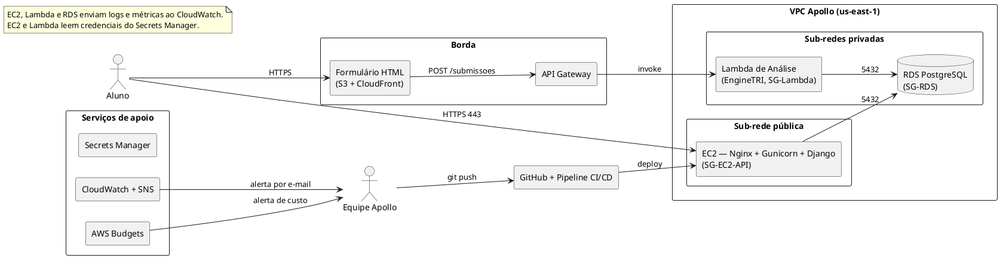

---

# 3. Especificação dos Fluxos

## 3.1 Fluxo 1 — Envio e Análise da Submissão (Serverless)

### 3.1.1 Descrição

O aluno preenche a grade de respostas (45 questões por área, alternativas A–E) em uma única tela. O formulário, servido por S3 + CloudFront, envia a submissão ao API Gateway, que aciona a Lambda de Análise. A Lambda valida o payload, lê os parâmetros TRI da edição no RDS, calcula a nota por área com o EngineTRI e grava Submissao, RespostaInformada, Resultado e QuestaoErrada em uma única transação.

### 3.1.2 Requisitos atendidos

| Requisito | Valor | Fonte |
|---|---|---|
| RNF-PER-01 | p95 do processamento < 1,5 s | [Doc] |
| RNF-PER-02 | ≥ 50 submissões/min, erro < 1% | [Doc] |
| RNF-CON-02 | Endpoint disponível durante a aplicação de simulados | [Doc] |
| RNF-SEG-04/05 | IAM role própria da Lambda; credenciais no Secrets Manager | [Doc] |
| RNF-OPS-03 | Log com identificador da submissão | [Doc] |
| RNF-USA-03 | Erro de validação indica o campo e a correção | [Doc] |

### 3.1.3 Diagrama de sequência

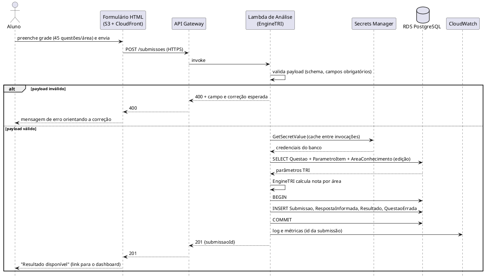

### 3.1.4 Diagrama de comunicação

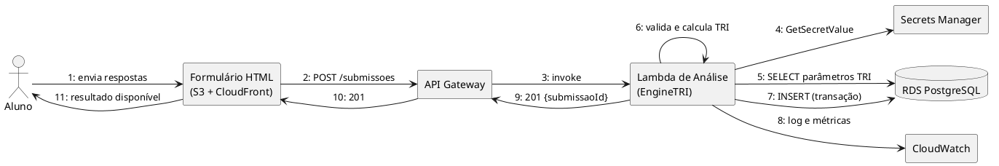

### 3.1.5 Tabela de mensagens

| # | De | Para | Mensagem | Protocolo | Requisito |
|---|---|---|---|---|---|
| 1 | Aluno | Formulário | Envia grade de respostas | HTTPS | RNF-USA-02 |
| 2 | Formulário | API Gateway | POST /submissoes | HTTPS | RNF-SEG-01 |
| 3 | API Gateway | Lambda | Invoke | AWS SDK | RNF-PER-02 |
| 4 | Lambda | Secrets Manager | GetSecretValue | AWS SDK | RNF-SEG-05 |
| 5 | Lambda | RDS | SELECT Questao/ParametroItem | SQL/TLS (5432) | RNF-PER-01 |
| 6 | Lambda | Lambda | Valida payload e calcula TRI | local | RNF-PER-01 |
| 7 | Lambda | RDS | INSERT em transação | SQL/TLS (5432) | RNF-PER-01 |
| 8 | Lambda | CloudWatch | Logs e métricas | AWS SDK | RNF-OPS-03 |
| 9–10 | Lambda → API Gateway → Formulário | | HTTP 201 | HTTPS | — |
| 11 | Formulário | Aluno | Resultado disponível | HTTPS | RNF-USA-01 |

### 3.1.6 Riscos e mitigações

| Risco | Probabilidade | Impacto | Mitigação |
|---|---|---|---|
| Cold start da Lambda eleva a latência | Média | Médio | Pacote enxuto; avaliar concorrência provisionada só se o p95 estourar |
| Lambda na VPC sem acesso ao Secrets Manager (sem NAT) | Média | Alto | VPC Endpoint do Secrets Manager (≈ US$ 7/mês por AZ) ou outra forma de entrega do segredo — **decisão pendente** |
| SG-RDS não aceita a Lambda | Média | Alto | Regra de entrada 5432 a partir de SG-Lambda no SG-RDS |
| Esgotamento de conexões do RDS por concorrência da Lambda | Baixa | Alto | Limite de concorrência reservada na Lambda |
| Submissão em nome de outro aluno | Média | Alto | Identidade do aluno atestada na chamada (token assinado/authorizer) — **decisão pendente** |
| Payload malformado | Média | Baixo | Validação de schema antes de gravar (UC-ARQ-004) |

## 3.2 Fluxo 2 — Consulta do Dashboard (IaaS)

### 3.2.1 Descrição

O aluno autenticado acessa o dashboard. O Nginx repassa a requisição ao Gunicorn/Django na EC2, que valida a sessão, consulta o RDS (apenas as submissões do próprio aluno) e devolve nota TRI, acertos/erros/brancos e habilidades a melhorar.

### 3.2.2 Requisitos atendidos

| Requisito | Valor | Fonte |
|---|---|---|
| RNF-CON-01 | Disponibilidade de 99% | [Doc] |
| RNF-SEG-01 | Somente HTTPS/TLS | [Doc] |
| RNF-SEG-03 | Aluno só vê os próprios resultados | [Doc] |
| RNF-USA-01 | Dashboard em linguagem simples | [Doc] |
| RNF-OPS-03 | Requisições registradas no CloudWatch Logs | [Doc] |

### 3.2.3 Diagrama de sequência

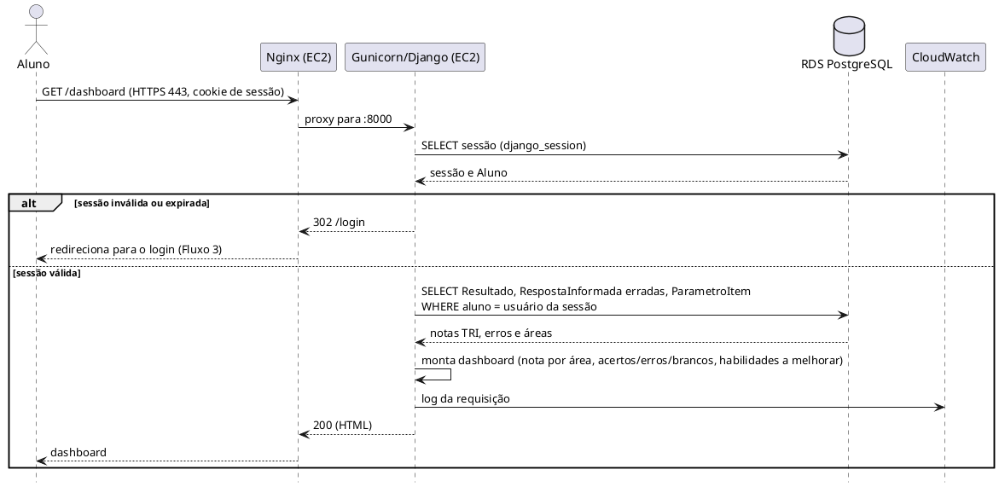

### 3.2.4 Diagrama de comunicação

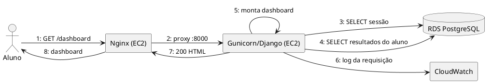

### 3.2.5 Tabela de mensagens

| # | De | Para | Mensagem | Protocolo | Requisito |
|---|---|---|---|---|---|
| 1 | Aluno | Nginx | GET /dashboard | HTTPS | RNF-SEG-01 |
| 2 | Nginx | Django | Proxy | HTTP (local) | — |
| 3 | Django | RDS | SELECT sessão | SQL/TLS (5432) | RNF-SEG-03 |
| 4 | Django | RDS | SELECT resultados do aluno | SQL/TLS (5432) | RNF-SEG-03 |
| 5 | Django | Django | Monta dashboard | local | RNF-USA-01 |
| 6 | Django | CloudWatch | Log da requisição | AWS SDK | RNF-OPS-03 |
| 7–8 | Django → Nginx → Aluno | | HTTP 200 | HTTPS | — |

### 3.2.6 Riscos e mitigações

| Risco | Probabilidade | Impacto | Mitigação |
|---|---|---|---|
| EC2 como ponto único de falha | Média | Alto | Recuperação automática do EC2; recriação por AMI (documento de classes EC2); aceito pelo SLA de 99% |
| Gargalo de leitura no RDS | Baixa | Médio | Índices por aluno/submissão; consulta paginada |
| Vazamento entre alunos (filtro ausente) | Baixa | Crítico | Toda consulta filtra pelo aluno da sessão; teste automatizado |
| TLS sem balanceador | Média | Médio | Certificado no Nginx com renovação automática — **decisão pendente** |
| Instância desligada pela `SchedulePolicy` em horário de uso | Média | Médio | Exceção para datas de simulado |

## 3.3 Fluxo 3 — Autenticação do Aluno

### 3.3.1 Descrição

O aluno informa credenciais no login. O Django valida a senha contra o hash armazenado no RDS e cria uma sessão (cookie `HttpOnly` e `Secure`). A sessão libera o dashboard (Fluxo 2).

> **[Premissa]** Os documentos exigem acesso autenticado (RNF-SEG-03), mas não definem o mecanismo. Este documento adota a autenticação nativa do Django com sessão no PostgreSQL, que não adiciona serviço nem custo. MFA e provedores externos (por exemplo Cognito) ficam como evolução.

### 3.3.2 Requisitos atendidos

| Requisito | Valor | Fonte |
|---|---|---|
| RNF-SEG-01 | Login somente por HTTPS | [Doc] |
| RNF-SEG-03 | Acesso autenticado aos próprios resultados | [Doc] |
| RNF-SEG-06 | LGPD: dados com finalidade pedagógica | [Doc] |
| RNF-SEG-05 | Chave e credenciais fora do código | [Doc] |

### 3.3.3 Diagrama de sequência

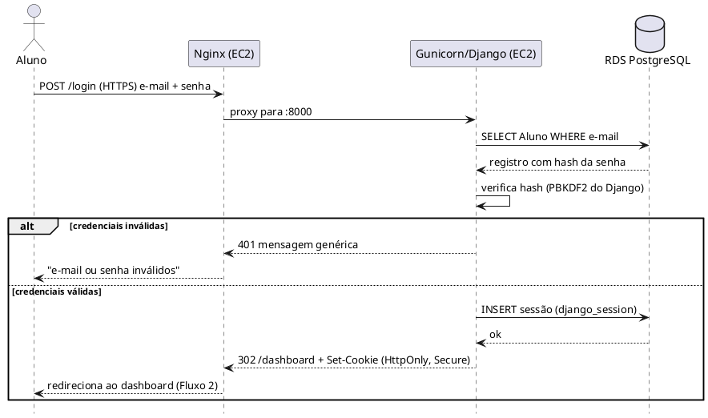

### 3.3.4 Diagrama de comunicação

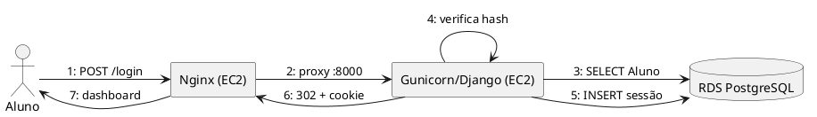

### 3.3.5 Tabela de mensagens

| # | De | Para | Mensagem | Protocolo | Requisito |
|---|---|---|---|---|---|
| 1 | Aluno | Nginx | POST /login | HTTPS | RNF-SEG-01 |
| 2 | Nginx | Django | Proxy | HTTP (local) | — |
| 3 | Django | RDS | SELECT Aluno | SQL/TLS (5432) | RNF-SEG-03 |
| 4 | Django | Django | Verifica hash da senha | local | RNF-SEG-03 |
| 5 | Django | RDS | INSERT sessão | SQL/TLS (5432) | RNF-SEG-03 |
| 6–7 | Django → Nginx → Aluno | | 302 + cookie seguro | HTTPS | RNF-SEG-01 |

### 3.3.6 Riscos e mitigações

| Risco | Probabilidade | Impacto | Mitigação |
|---|---|---|---|
| Força bruta no login | Média | Alto | Limite de tentativas por conta/IP na aplicação |
| Vazamento de credenciais | Baixa | Crítico | Senhas só como hash; HTTPS obrigatório; sem credenciais no código |
| Sessão roubada | Baixa | Alto | Cookie `HttpOnly` + `Secure`; expiração de sessão |
| Mecanismo de autenticação não formalizado | Alta | Médio | Formalizar nos Requisitos Suplementares (RNF-SEG-03) |

## 3.4 Fluxo 4 — Deploy Automatizado (CI/CD)

### 3.4.1 Descrição

O desenvolvedor envia código à branch principal. O pipeline executa os testes automatizados do EngineTRI e, se passarem, publica a nova versão da API na EC2, roda migrations, reinicia o Gunicorn e verifica o `/health/`. Se os testes ou o health check falharem, o deploy é interrompido e a equipe é notificada; o rollback é manual, conforme runbook.

> **[Premissa]** O UC-ARQ-006 admite GitHub Actions ou CodePipeline/CodeBuild. O diagrama usa "Pipeline CI/CD" de forma genérica; a ferramenta final é decisão da equipe.

### 3.4.2 Requisitos atendidos

| Requisito | Valor | Fonte |
|---|---|---|
| RNF-MAN-01 | Deploy semi-automatizado em até 15 min | [Doc] |
| RNF-MAN-02 | Rollback manual em até 30 min | [Doc] |
| RNF-MAN-03 | Mudanças rastreáveis no Git | [Doc] |
| UC-ARQ-006 | Testes bloqueiam o deploy | [Doc] |

### 3.4.3 Diagrama de sequência

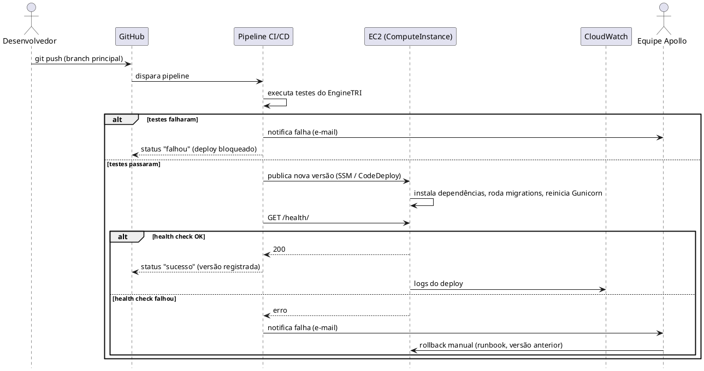

### 3.4.4 Diagrama de comunicação

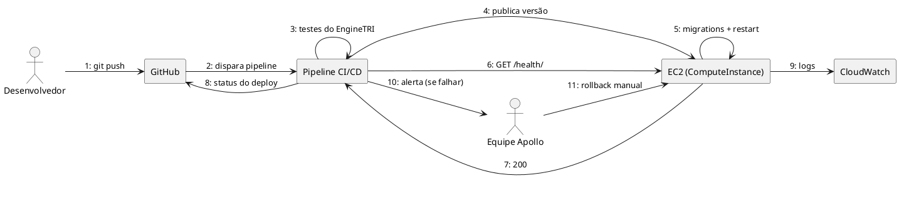

### 3.4.5 Tabela de mensagens

| # | De | Para | Mensagem | Protocolo | Requisito |
|---|---|---|---|---|---|
| 1 | Desenvolvedor | GitHub | git push | HTTPS | RNF-MAN-03 |
| 2 | GitHub | Pipeline | Dispara pipeline | HTTPS | RNF-MAN-01 |
| 3 | Pipeline | Pipeline | Testes do EngineTRI | local | UC-ARQ-006 |
| 4 | Pipeline | EC2 | Publica versão | SSM/CodeDeploy | RNF-MAN-01 |
| 5 | EC2 | EC2 | Migrations + reinício | local | — |
| 6–7 | Pipeline ↔ EC2 | | GET /health/ → 200 | HTTPS | — |
| 8 | Pipeline | GitHub | Status do deploy | HTTPS | RNF-MAN-03 |
| 9 | EC2 | CloudWatch | Logs | AWS SDK | RNF-OPS-03 |
| 10–11 | Pipeline → Equipe → EC2 | | Alerta e rollback manual | e-mail / SSM | RNF-MAN-02 |

### 3.4.6 Riscos e mitigações

| Risco | Probabilidade | Impacto | Mitigação |
|---|---|---|---|
| Testes insuficientes deixam passar defeito | Média | Médio | Testes do EngineTRI com casos de referência |
| Deploy falha na EC2 | Média | Alto | Health check pós-deploy; rollback manual documentado (≤ 30 min) |
| Erro humano no rollback manual | Média | Médio | Runbook passo a passo; automatizar em script único |
| Downtime durante o deploy (instância única) | Alta | Baixo | Janela fora do horário de uso; aceito pelo SLA de 99% |
| Função Lambda fora do pipeline | Média | Médio | **[Premissa]** incluir a publicação da Lambda no mesmo pipeline |

## 3.5 Fluxo 5 — Restauração do RDS a partir de Backup

### 3.5.1 Descrição

Em caso de falha da instância RDS, o RDS publica um evento no SNS, que avisa a equipe por e-mail. A equipe restaura o último backup automático em uma nova instância (mesmos `SubnetGroup`, `SecurityGroup` e `ParameterGroup`), atualiza o endpoint no Secrets Manager, reinicia a API e valida os dados. O mesmo procedimento atende o teste de recuperação exigido (RNF-OPS-05). Substitui o failover Multi-AZ, que o Apollo não utiliza.

### 3.5.2 Requisitos atendidos

| Requisito | Valor | Fonte |
|---|---|---|
| RNF-CON-03 | RPO < 24 h | [Doc] |
| RNF-CON-04 | RTO < 4 h | [Doc] |
| RNF-CON-05 | MTTR de incidentes críticos < 1 h após identificação | [Doc] |
| RNF-OPS-04 | Backup diário, retenção ≥ 7 dias | [Doc] |
| RNF-OPS-05 | Restauração testada ao menos 1 vez | [Doc] |

### 3.5.3 Diagrama de sequência

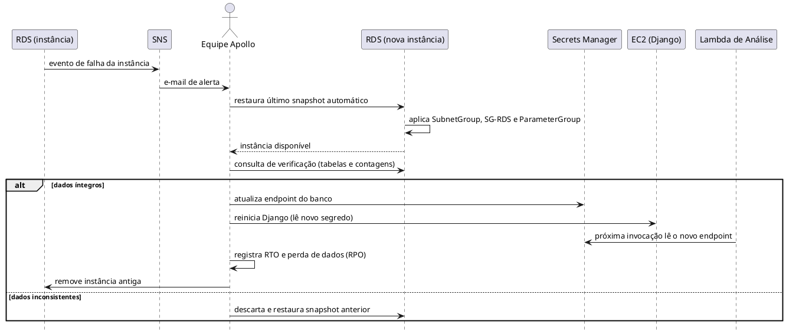

### 3.5.4 Diagrama de comunicação

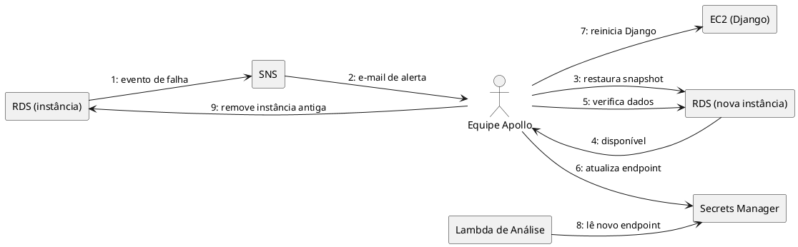

### 3.5.5 Tabela de mensagens

| # | De | Para | Mensagem | Protocolo | Requisito |
|---|---|---|---|---|---|
| 1 | RDS | SNS | Evento de falha | AWS interno | RNF-OPS-02 |
| 2 | SNS | Equipe | E-mail de alerta | e-mail | RNF-OPS-02 |
| 3 | Equipe | RDS (nova) | Restaurar snapshot | Console/CLI | RNF-CON-04 |
| 4 | RDS (nova) | Equipe | Instância disponível | — | — |
| 5 | Equipe | RDS (nova) | Consulta de verificação | SQL/TLS (5432) | RNF-OPS-05 |
| 6 | Equipe | Secrets Manager | Atualiza endpoint | AWS SDK | RNF-SEG-05 |
| 7 | Equipe | EC2 | Reinicia Django | SSM | RNF-CON-05 |
| 8 | Lambda | Secrets Manager | Lê novo endpoint | AWS SDK | RNF-SEG-05 |
| 9 | Equipe | RDS (antiga) | Remove instância | Console/CLI | RNF-CUS-01 |

### 3.5.6 Riscos e mitigações

| Risco | Probabilidade | Impacto | Mitigação |
|---|---|---|---|
| Restauração nunca testada | Média | Alto | Teste obrigatório com evidência (RNF-OPS-05) |
| Perda de até 24 h de submissões | Baixa | Alto | Aceita pelo RPO; backups automáticos também permitem restaurar a um instante dentro da retenção |
| Endpoint antigo em cache na Lambda | Média | Médio | Reiniciar a API e invalidar o cache do segredo na Lambda |
| RTO acima de 4 h | Baixa | Alto | Banco pequeno (< 1 GB); procedimento ensaiado |
| Custo de duas instâncias durante a troca | Baixa | Baixo | Remover a instância antiga após validar |

## 3.6 Fluxo 6 — Monitoramento e Alerta

### 3.6.1 Descrição

EC2, Lambda e RDS enviam métricas e logs ao CloudWatch. Alarmes de erro, indisponibilidade, CPU/memória e armazenamento disparam notificação por e-mail via SNS. O AWS Budgets avisa a equipe quando o custo atinge 80% e 100% do orçamento.

### 3.6.2 Requisitos atendidos

| Requisito | Valor | Fonte |
|---|---|---|
| RNF-OPS-01 | Dashboard CloudWatch com disponibilidade, latência e erros | [Doc] |
| RNF-OPS-02 | Alarme envia e-mail à equipe (≤ 15 min após a falha) | [Doc] |
| RNF-OPS-03 | Logs centralizados com timestamp e id da submissão | [Doc] |
| RNF-CUS-02 | AWS Budgets em 80% e 100% | [Doc] |

### 3.6.3 Diagrama de sequência

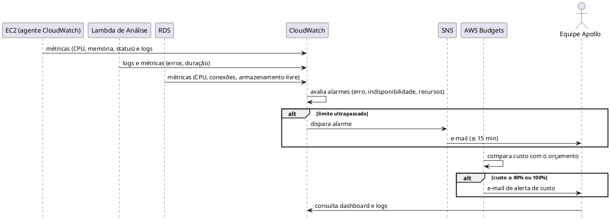

### 3.6.4 Diagrama de comunicação

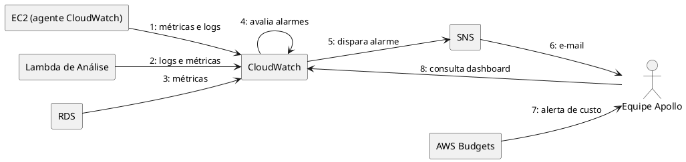

### 3.6.5 Tabela de mensagens

| # | De | Para | Mensagem | Protocolo | Requisito |
|---|---|---|---|---|---|
| 1 | EC2 | CloudWatch | Métricas e logs | AWS SDK | RNF-OPS-01/03 |
| 2 | Lambda | CloudWatch | Logs e métricas | AWS SDK | RNF-OPS-03 |
| 3 | RDS | CloudWatch | Métricas | AWS interno | RNF-OPS-01 |
| 4 | CloudWatch | CloudWatch | Avalia alarmes | interno | RNF-OPS-02 |
| 5 | CloudWatch | SNS | Dispara alarme | AWS interno | RNF-OPS-02 |
| 6 | SNS | Equipe | E-mail | e-mail | RNF-OPS-02 |
| 7 | AWS Budgets | Equipe | Alerta 80%/100% | e-mail | RNF-CUS-02 |
| 8 | Equipe | CloudWatch | Consulta dashboard | HTTPS | RNF-OPS-01 |

### 3.6.6 Riscos e mitigações

| Risco | Probabilidade | Impacto | Mitigação |
|---|---|---|---|
| Alarmes demais (fadiga) | Média | Baixo | Poucos alarmes críticos: erros 5xx, status check, CPU, memória, armazenamento |
| E-mail de alerta não lido | Média | Médio | Assinatura confirmada por mais de um integrante |
| Custo do monitoramento | Baixa | Baixo | Monitoramento básico; um agente de memória (≈ US$ 1/mês) |
| Memória da EC2 sem métrica nativa | Alta | Médio | CloudWatch Agent (já previsto no dimensionamento EC2) |

---

# 4. Diagrama de Classes Consolidado

Consolida as classes de infraestrutura dos modelos de RDS e EC2.

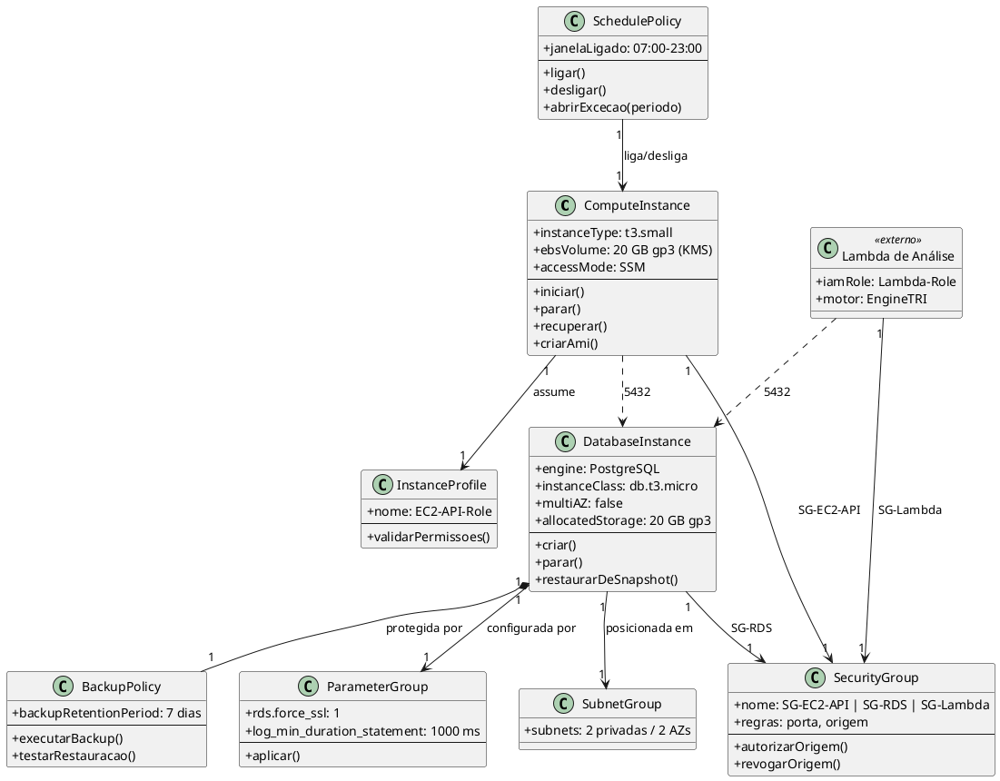

---

# 5. Matriz de Rastreamento Consolidada

| Fluxo | Requisitos (Doc. Suplementar) | Caso de Uso | Pacote (Modelo de Segurança) | Classes | Serviços AWS |
|---|---|---|---|---|---|
| 1 | RNF-PER-01/02, RNF-CON-02, RNF-SEG-04/05, RNF-USA-03 | UC-ARQ-003, UC-ARQ-004 | Network Security, Secrets & Audit | `DatabaseInstance`, `SecurityGroup` (SG-Lambda, SG-RDS) | S3, CloudFront, API Gateway, Lambda, Secrets Manager, RDS |
| 2 | RNF-CON-01, RNF-SEG-01/03, RNF-USA-01 | UC-ARQ-004 | Network Security, Data Protection | `ComputeInstance`, `SecurityGroup` (SG-EC2-API), `DatabaseInstance` | EC2, RDS, CloudWatch |
| 3 | RNF-SEG-01/03/06 | UC-ARQ-004 | Identity & Access, Data Protection | `ComputeInstance`, `DatabaseInstance` | EC2, RDS |
| 4 | RNF-MAN-01/02/03 | UC-ARQ-006 | Secrets & Audit | `ComputeInstance`, `InstanceProfile` | GitHub, Pipeline, EC2 |
| 5 | RNF-CON-03/04/05, RNF-OPS-04/05 | UC-ARQ-004, UC-ARQ-005 | Secrets & Audit | `DatabaseInstance`, `BackupPolicy`, `SubnetGroup`, `ParameterGroup` | RDS, SNS, Secrets Manager |
| 6 | RNF-OPS-01/02/03, RNF-CUS-02 | UC-ARQ-005 | Secrets & Audit | `ComputeInstance`, `SchedulePolicy`, `DatabaseInstance` | CloudWatch, SNS, AWS Budgets |

---

# 6. Considerações Finais

## 6.1 Lições aprendidas
- Diagramas de sequência mostram a ordem das mensagens; os de comunicação mostram quem conversa com quem. Usar os dois expõe lacunas que um só esconde.
- Desenhar os fluxos revelou três decisões ainda abertas: como a Lambda obtém credenciais sem NAT, como a identidade do aluno chega à Lambda e como funciona o login do aluno.
- O CloudWatch aparece em todos os fluxos como componente transversal de observabilidade.
- A consolidação confirma que a arquitetura atende o SLA de 99% e o orçamento de US$ 100/mês com instância única, sem balanceador, sem cache dedicado e sem Multi-AZ.

## 6.2 Decisões pendentes
1. Mecanismo de entrega do segredo do banco à Lambda na VPC (VPC Endpoint ou alternativa).
2. Como a Lambda sabe que a submissão pertence ao aluno autenticado.
3. Formalizar a autenticação do aluno (Django nativo) em RNF-SEG-03.
4. TLS e domínio da EC2 (Nginx com certificado renovável).
5. Ferramenta do pipeline (GitHub Actions ou CodePipeline/CodeBuild).
6. Incluir `SG-Lambda` nas regras de entrada do `SG-RDS` (e corrigir o Modelo de Análise de Segurança).

## 6.3 Próximos passos
1. Resolver as decisões pendentes acima.
2. Implementar os fluxos 1 e 2 como núcleo do MVP.
3. Executar e registrar o teste de restauração do Fluxo 5.
4. Medir o p95 real da submissão no Fluxo 1.

---

# 7. Aprovações

| Nome | Papel | Data | Assinatura |
|---|---|---|---|
| Arthur Maurity | Equipe Apollo | | |
| Bernardo Casanovas | Equipe Apollo | | |
| Bernardo Miller | Equipe Apollo | | |
| Lucas Jesus | Equipe Apollo | | |

# 8. Histórico de Versões

| Versão | Data | Autor | Descrição |
|---|---|---|---|
| 1.0 | 22/10/2026 | Equipe Apollo | Versão inicial adaptada do modelo-base |
