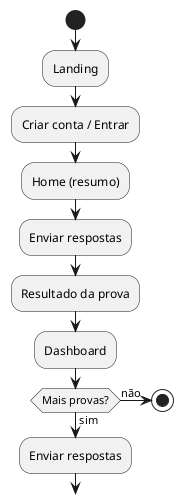
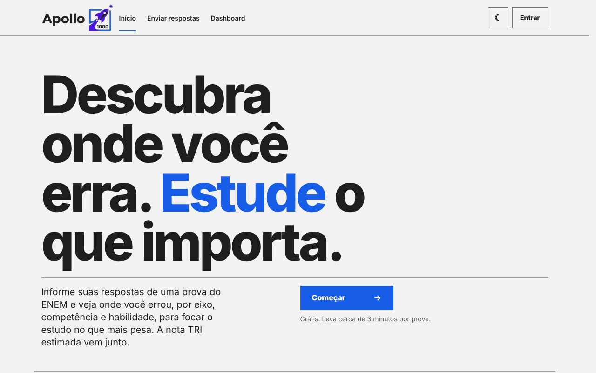
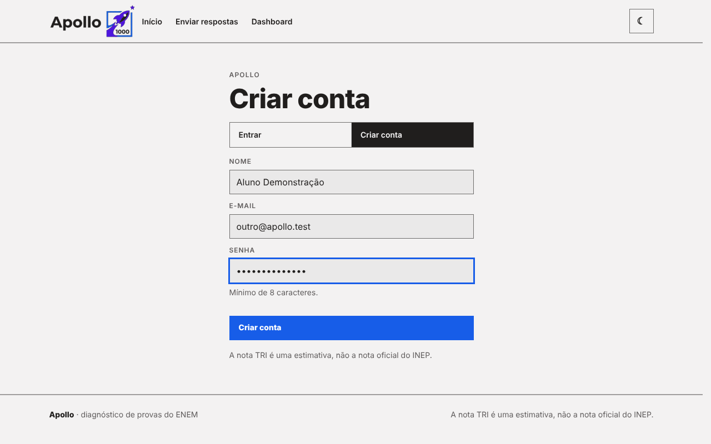
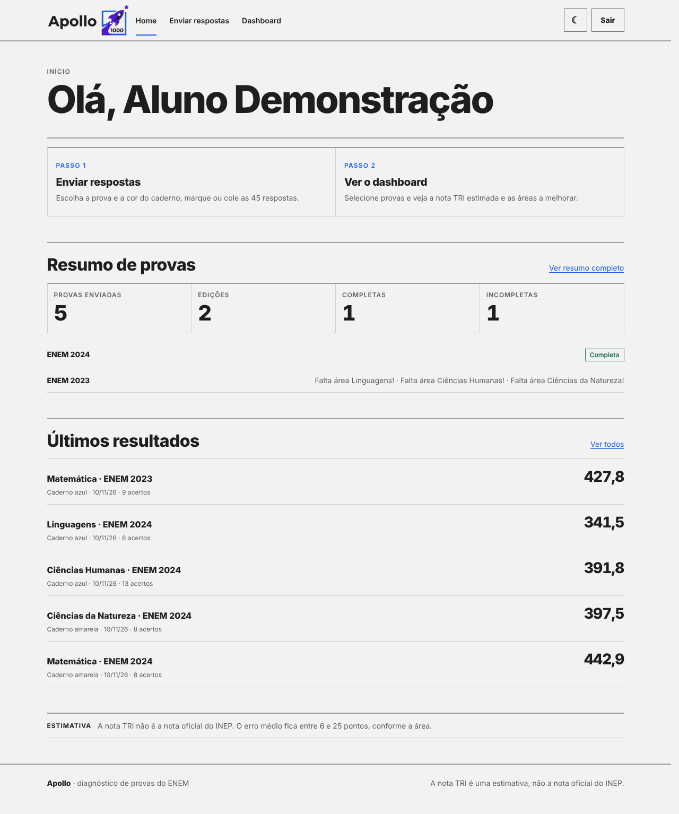
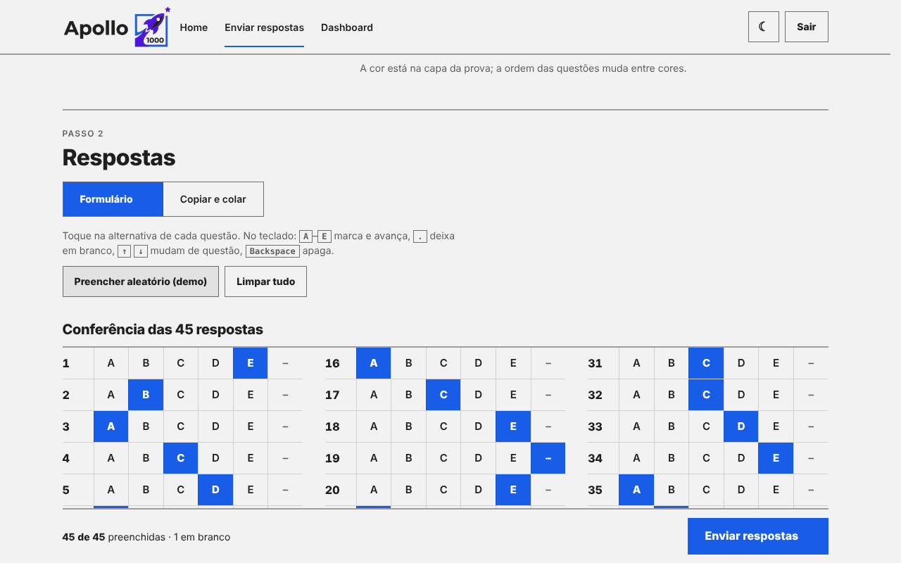
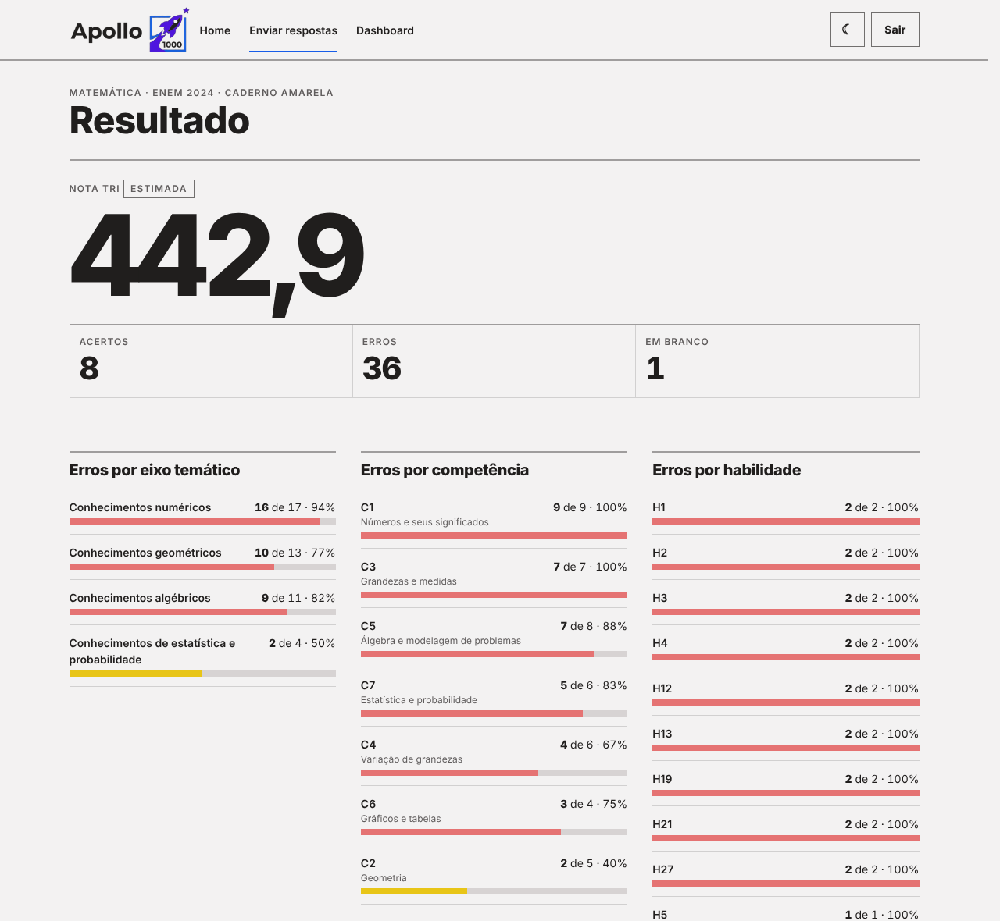
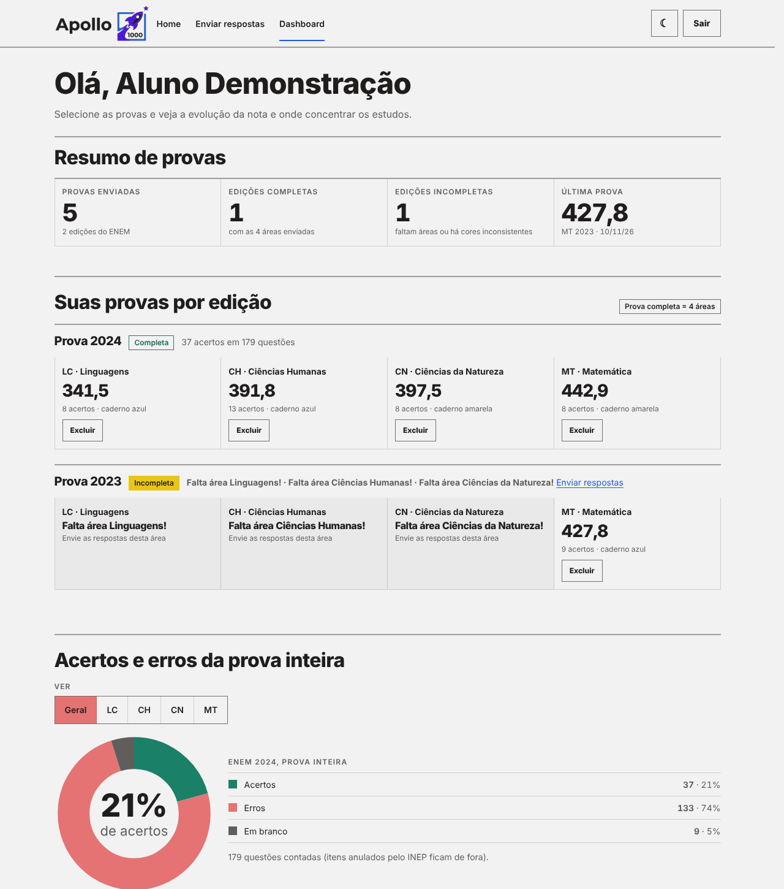
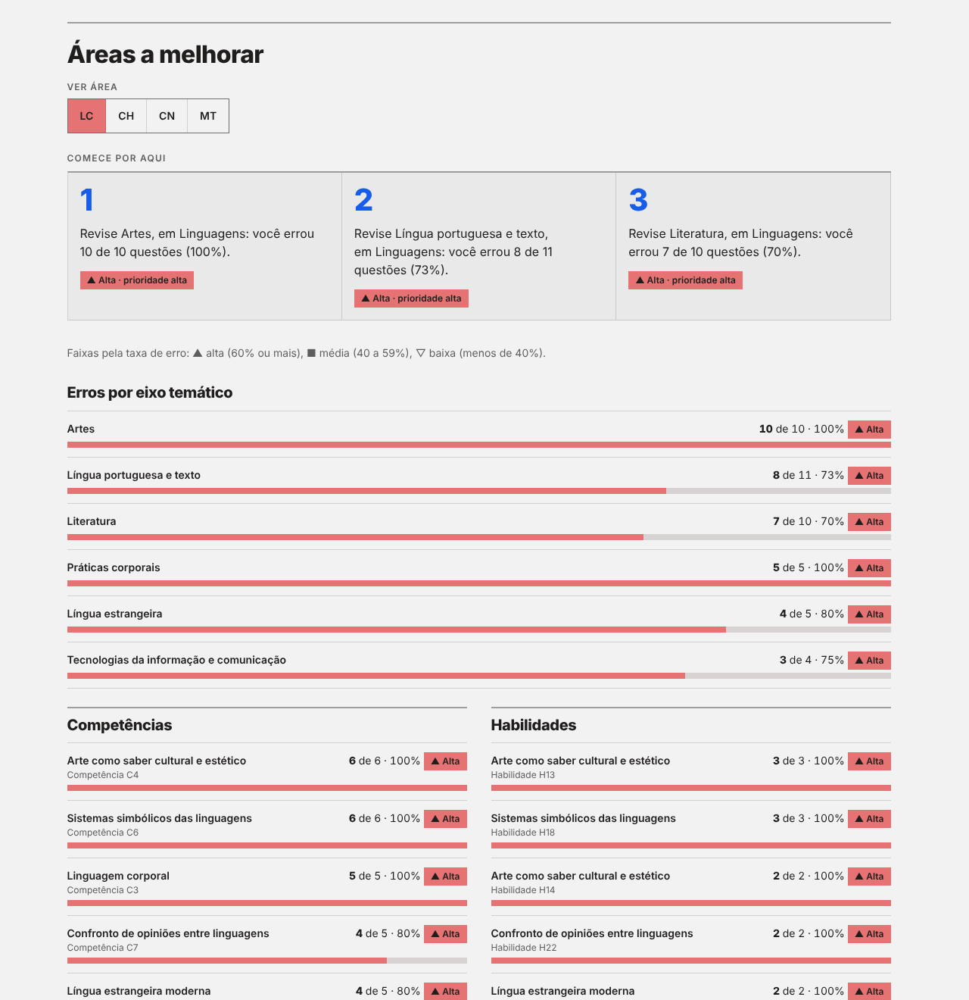

**Protótipo de Alta Fidelidade**

**Projeto Apollo**

|  |  |
| --- | --- |
| **Projeto** | Apollo — Plataforma de Análise de Desempenho no ENEM |
| **Documento** | Protótipo de Alta Fidelidade (telas da aplicação) |
| **Versão** | 2.0 |
| **Data** | 10/11/2026 |
| **Status** | Em Revisão |
| **Responsável** | Equipe do Projeto Apollo |
| **Disciplina** | Projeto de Cloud |
| **Fase RUP/UP** | Elaboração |

# 1. Introdução

## 1.1. Propósito

Registrar as telas do Apollo com o nível de detalhe da aplicação real, para validar o fluxo do aluno (cadastro, envio de respostas, resultado e dashboard) e rastrear cada tela até os requisitos funcionais do [Documento de Visão](../Iniciacao/dv.md).

## 1.2. Origem das imagens

As imagens deste documento são **capturas da aplicação implementada** (Django + DRF, versão do repositório `appFinal`), executada com a base real do INEP carregada (ENEM 2016–2025, 7.400 itens). Os dados do aluno exibidos são de uma **conta de demonstração** ("Aluno Demonstração"), com respostas geradas pelo botão *Preencher aleatório (demo)*; por isso as notas são baixas e servem apenas para ilustrar a interface. A nota TRI é uma **estimativa**, não a nota oficial do INEP.

# 2. Fluxo do aluno

# 3. Telas

## 3.1. Landing

Apresenta a proposta do produto ("Descubra onde você erra. Estude o que importa."), os três passos de uso e as dúvidas frequentes. Atende ao posicionamento descrito no Documento de Visão.

## 3.2. Criar conta e entrar (RF-01)

Um único formulário alterna entre *Entrar* e *Criar conta*. A senha exige no mínimo 8 caracteres.

## 3.3. Home

Resume as provas já enviadas e aponta o que estudar primeiro.

## 3.4. Envio de respostas (RF-03)

O aluno escolhe ano, área e cor do caderno (a ordem das questões muda entre cores) e marca as 45 alternativas na grade ou cola o gabarito. A cor é validada por dia de prova: Linguagens e Humanas compartilham o caderno, assim como Natureza e Matemática.

## 3.5. Resultado (RF-04, RF-05, RF-06)

Mostra a nota TRI estimada, acertos, erros e brancos, e agrupa os erros por eixo temático, competência e habilidade. A correção e a gravação de submissão, respostas e resultado ocorrem em uma única transação.

## 3.6. Dashboard (RF-06, RF-07)

Reúne o histórico por edição, a evolução da nota por área e as **áreas a melhorar**, ordenadas por taxa de erro e classificadas em prioridade alta, média ou baixa.

# 4. Rastreabilidade tela → requisito → teste

| **Tela** | **Requisitos** | **Endpoint / rota** | **Teste automatizado** |
| --- | --- | --- | --- |
| Landing | Posicionamento | `/` | `test_paginas_respondem` |
| Criar conta e entrar | RF-01 | `/api/cadastro/`, `/api/login/` | `test_cadastro_login_e_health` |
| Envio de respostas | RF-03, RF-04 | `POST /api/submissoes/` | testes de transação e de cor por dia |
| Resultado | RF-04, RF-05, RF-06 | `/api/submissoes/`, `/api/resultados/` | `test_prova_incompleta_faz_rollback_total` |
| Dashboard | RF-06, RF-07 | `/api/dashboard/` | `test_paginas_usam_rotas_reais` |
| Painel administrativo | RF-02, RF-09 | `/admin/` | verificado na EC2 (lista de tabelas e 7.400 questões) |

# 5. Considerações Finais

As telas cobrem o fluxo completo do aluno e correspondem à aplicação implantada na EC2. Melhorias previstas: modo escuro (já disponível pelo botão do topo), exportação do relatório e recomendações de estudo por assunto.

# 6. Aprovações

| **Função** | **Nome** | **Data** | **Assinatura** |
| --- | --- | --- | --- |
| Designer / Desenvolvedor Frontend |  |  |  |
| Professor Responsável | Jonh Carvalho |  |  |

# 7. Histórico de Versões

| **Versão** | **Data** | **Autor** | **Descrição das Alterações** |
| --- | --- | --- | --- |
| 1.0 | 21/09/2026 | Equipe do Projeto Apollo | Versão inicial (modelo da disciplina). |
| 2.0 | 10/11/2026 | Equipe do Projeto Apollo | Substituição pelo protótipo real do Apollo, com capturas da aplicação implementada e rastreabilidade. |
