**Diagramas de Sequência e de Comunicação**

**Projeto Apollo**

|  |  |
| --- | --- |
| **Projeto** | Apollo — Plataforma de Análise de Desempenho no ENEM |
| **Documento** | Diagramas de Sequência e de Comunicação |
| **Versão** | 1.0 |
| **Data** | 08/11/2026 |
| **Status** | Em Revisão |
| **Responsável** | Equipe do Projeto Apollo |
| **Disciplina** | Projeto de Cloud |
| **Fase RUP/UP** | Elaboração |

# 1. Introdução

## 1.1. Propósito

Detalhar, por meio de diagramas de sequência e de comunicação, as interações entre os componentes do Apollo nos seis fluxos arquiteturalmente relevantes: autenticação, envio de respostas, dashboard, consulta por atributo JSONB, deploy e persistência/recuperação.

## 1.2. Escopo

Componentes: Aluno, Administrador, Desenvolvedor, `web` (Django + DRF + Gunicorn), `db` (PostgreSQL 16), volume `pgdata`, Docker Compose, GitHub, CloudWatch/SNS.

## 1.3. Siglas

| **Sigla** | **Definição** |
| --- | --- |
| API | Interface de programação |
| JSONB | JSON binário do PostgreSQL |
| GIN | Índice invertido |
| TRI | Teoria de Resposta ao Item |

## 1.4. Referências

* Casos de Uso Arquiteturais v2.0; Requisitos Suplementares v2.0
* Dimensionamento de Computação e de Banco de Dados v1.0

# 2. Visão Geral dos Fluxos

| **Fluxo** | **Descrição** | **Casos de Uso** | **RNF** |
| --- | --- | --- | --- |
| F1 | Cadastro e login do aluno | UC-ARQ-004 | RNF-SEG-03 |
| F2 | Envio de respostas com transação atômica | UC-ARQ-004 | RNF-DAD-01, RNF-PER-01 |
| F3 | Consulta do dashboard (nota TRI e habilidades) | UC-ARQ-004 | RNF-PER-03, RNF-SEG-03 |
| F4 | Consulta de questões por atributo JSONB | UC-ARQ-003/004 | RNF-PER-04 |
| F5 | Deploy e rollback | UC-ARQ-006 | RNF-MAN-01/02 |
| F6 | Persistência após reinício e restauração de backup | UC-ARQ-003/007 | RNF-DAD-02, RNF-CON-03/04 |

# 3. Especificação dos Fluxos

## 3.1. F1 — Cadastro e Login

### Diagrama de Sequência

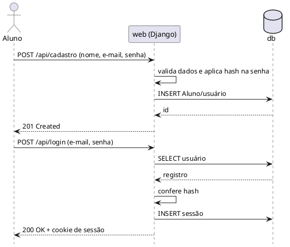

### Diagrama de Comunicação

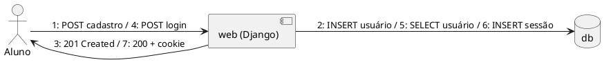

| **#** | **Mensagem** | **De → Para** | **Dados** |
| --- | --- | --- | --- |
| 1 | POST cadastro | Aluno → web | nome, e-mail, senha |
| 2 | INSERT usuário | web → db | senha em hash |
| 3 | 201 Created | web → Aluno | id |
| 4 | POST login | Aluno → web | e-mail, senha |
| 5–6 | SELECT usuário / INSERT sessão | web → db | credenciais, sessão |
| 7 | 200 OK + cookie | web → Aluno | cookie de sessão |

## 3.2. F2 — Envio de Respostas (Transação Atômica)

### Diagrama de Sequência

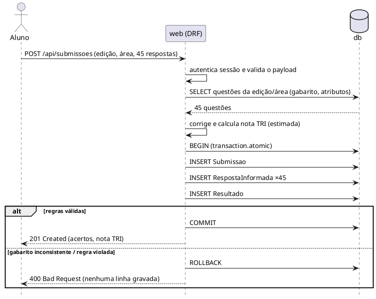

### Diagrama de Comunicação

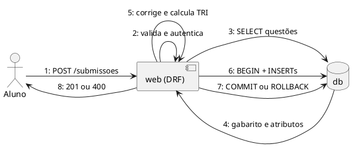

| **#** | **Mensagem** | **De → Para** | **Dados** |
| --- | --- | --- | --- |
| 1 | POST /submissoes | Aluno → web | edição, área, respostas |
| 2 | validar / autenticar | web | sessão, esquema |
| 3–4 | SELECT questões | web ↔ db | gabarito, atributos |
| 5 | corrigir e calcular TRI | web | acertos, nota |
| 6 | BEGIN + INSERTs | web → db | Submissao, Respostas, Resultado |
| 7 | COMMIT / ROLLBACK | web → db | decisão da transação |
| 8 | 201 / 400 | web → Aluno | resultado ou erro |

## 3.3. F3 — Consulta do Dashboard

### Diagrama de Sequência

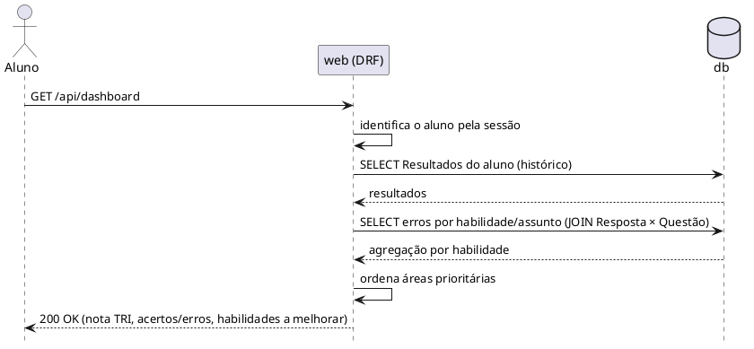

### Diagrama de Comunicação

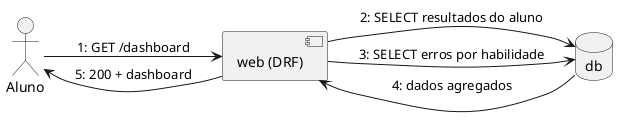

| **#** | **Mensagem** | **De → Para** | **Dados** |
| --- | --- | --- | --- |
| 1 | GET /dashboard | Aluno → web | cookie de sessão |
| 2 | SELECT resultados | web → db | filtro pelo aluno autenticado |
| 3–4 | SELECT erros por habilidade | web ↔ db | agregação |
| 5 | 200 OK | web → Aluno | nota TRI, habilidades |

## 3.4. F4 — Consulta por Atributo JSONB

### Diagrama de Sequência

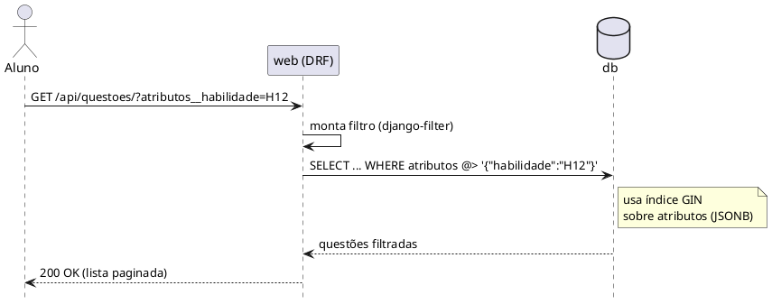

### Diagrama de Comunicação

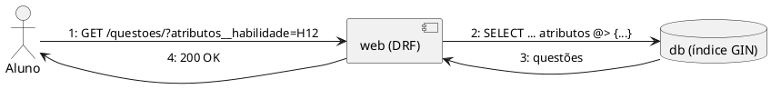

| **#** | **Mensagem** | **De → Para** | **Dados** |
| --- | --- | --- | --- |
| 1 | GET com filtro | Aluno → web | `atributos__habilidade=H12` |
| 2 | SELECT com `@>` | web → db | consulta JSONB indexada |
| 3 | resultado | db → web | linhas |
| 4 | 200 OK | web → Aluno | JSON paginado |

## 3.5. F5 — Deploy e Rollback

### Diagrama de Sequência

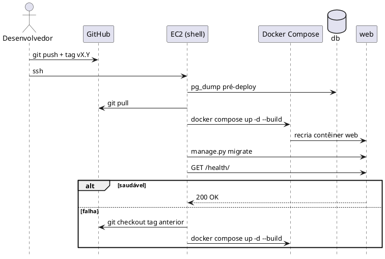

### Diagrama de Comunicação

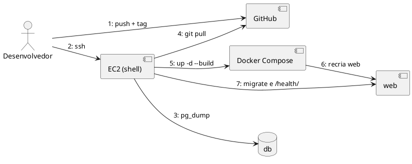

| **#** | **Mensagem** | **De → Para** | **Dados** |
| --- | --- | --- | --- |
| 1 | push + tag | Dev → GitHub | commits, versão |
| 2 | ssh | Dev → EC2 | chave `.pem` |
| 3 | `pg_dump` | EC2 → db | backup pré-deploy |
| 4 | `git pull` | EC2 → GitHub | código |
| 5–6 | `up -d --build` | EC2 → Compose → web | nova imagem |
| 7 | migrate e `/health/` | EC2 → web | verificação |

## 3.6. F6 — Persistência e Restauração

### Diagrama de Sequência

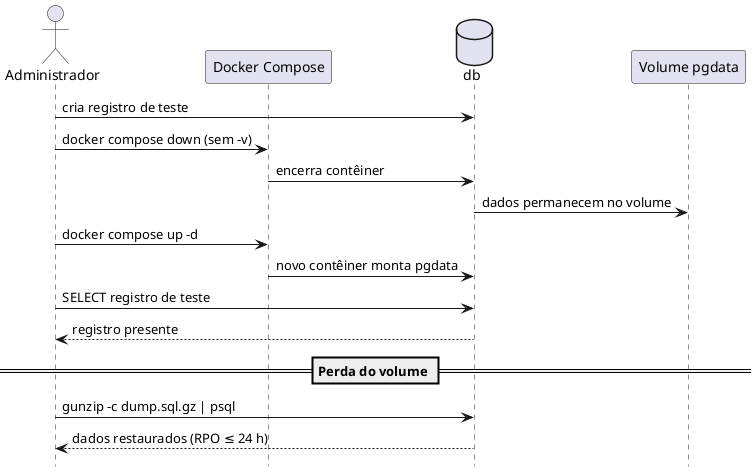

### Diagrama de Comunicação

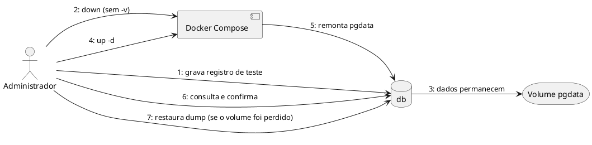

| **#** | **Mensagem** | **De → Para** | **Dados** |
| --- | --- | --- | --- |
| 1 | gravar registro de teste | Admin → db | linha de teste |
| 2–3 | `down` sem `-v` | Admin → Compose → db | volume preservado |
| 4–5 | `up -d` | Admin → Compose → db | montagem de `pgdata` |
| 6 | consultar | Admin → db | confirma persistência |
| 7 | restaurar dump | Admin → db | `.sql.gz` diário |

# 4. Diagrama de Classes de Análise

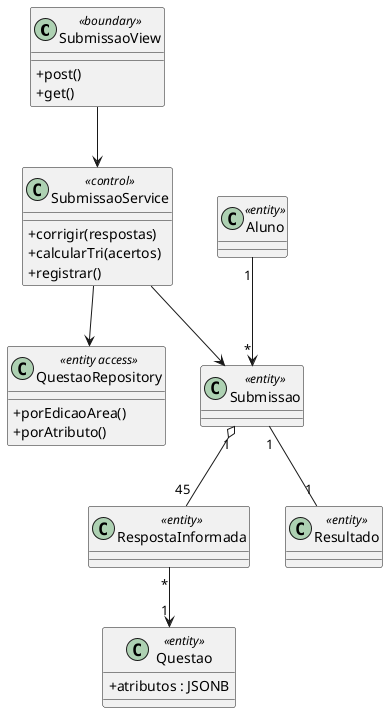

# 5. Matriz de Rastreamento

| **Fluxo** | **Requisitos** | **Caso de Uso** | **Componentes** | **Evidência prevista (README)** |
| --- | --- | --- | --- | --- |
| F1 | RNF-SEG-03 | UC-ARQ-004 | web, db | Teste de login |
| F2 | RNF-DAD-01, RNF-PER-01/02 | UC-ARQ-004 | web, db | Teste de *rollback*; medição de p95 |
| F3 | RNF-PER-03, RNF-SEG-03 | UC-ARQ-004 | web, db | Captura do dashboard |
| F4 | RNF-PER-04 | UC-ARQ-003/004 | web, db (GIN) | `EXPLAIN` mostrando índice |
| F5 | RNF-MAN-01/02 | UC-ARQ-006 | GitHub, EC2, Compose | Log do deploy e do rollback |
| F6 | RNF-DAD-02, RNF-CON-03/04 | UC-ARQ-003/007 | db, pgdata | Print antes/depois do `down`/`up`; restauração |

# 6. Considerações Finais

Os seis fluxos cobrem os requisitos centrais da AP2: transação atômica, índice JSONB, persistência em volume e deploy reprodutível. Cada fluxo possui uma evidência a ser anexada ao README.

# 7. Aprovações

| **Função** | **Nome** | **Data** | **Assinatura** |
| --- | --- | --- | --- |
| Arquiteto de Soluções |  |  |  |
| Professor Responsável |  |  |  |

# 8. Histórico de Versões

| **Versão** | **Data** | **Autor** | **Descrição das Alterações** |
| --- | --- | --- | --- |
| 1.0 | 08/11/2026 | Equipe do Projeto Apollo | Criação: seis fluxos com sequência e comunicação, classes de análise e matriz. |
