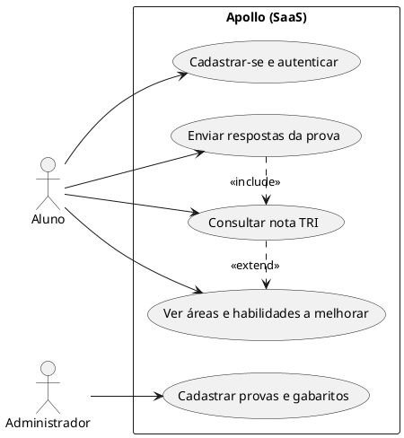
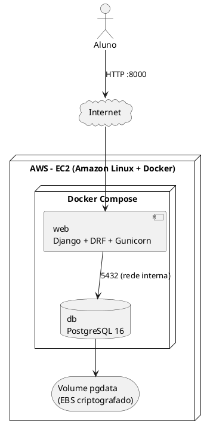

**Documento de Visão**

**Projeto Apollo**

|  |  |
| --- | --- |
| **Projeto** | Apollo — Plataforma de Análise de Desempenho no ENEM |
| **Documento** | Documento de Visão |
| **Versão** | 2.2 |
| **Data** | 11/11/2026 |
| **Status** | Em Revisão |
| **Responsável** | Equipe do Projeto Apollo |
| **Disciplina** | Projeto de Cloud |
| **Fase RUP/UP** | Iniciação |

# 1. Introdução

## 1.1. Propósito

Este documento descreve a visão do **Apollo**: uma plataforma SaaS na qual estudantes enviam suas respostas das provas do ENEM e recebem uma análise criteriosa de erros, a **nota estimada em TRI** e as **áreas de conhecimento e habilidades em que precisam melhorar**, apresentadas em um dashboard.

## 1.2. Escopo

Inclui: cadastro e autenticação de alunos; base de provas e gabaritos do ENEM de **2016 a 2025** (10 edições; 4 áreas — Linguagens, Humanas, Natureza e Matemática — com 45 questões cada, em até 4 cadernos por cor; 7.400 itens carregados); envio de respostas (a cor do caderno é validada por dia de aplicação: LC e CH, e CN e MT, usam a mesma cor); correção; cálculo da nota TRI; análise de erros por área, habilidade e assunto; dashboard; API REST e painel administrativo.

Não inclui: correção de redação, aplicativo móvel nativo, pagamento/assinatura e integração com sistemas oficiais do INEP.

## 1.3. Definições, Acrônimos e Abreviações

| **Termo** | **Definição** |
| --- | --- |
| ENEM | Exame Nacional do Ensino Médio |
| TRI | Teoria de Resposta ao Item: estima o desempenho considerando a dificuldade, discriminação e acerto casual de cada questão |
| SaaS | Software como Serviço |
| Habilidade | Competência avaliada pela questão (matriz de referência do ENEM) |
| API | Interface de programação (REST/JSON) |
| EC2 | Servidor virtual da AWS onde a aplicação é executada |

## 1.4. Referências

* Documento de Requisitos Suplementares — Apollo (v2.2)
* Casos de Uso Arquiteturais — Apollo (v2.1)
* Matrizes de Referência do ENEM e provas/gabaritos publicados pelo INEP
* Roteiros da disciplina (Django, PostgreSQL, Docker, EC2)

# 2. Posicionamento

## 2.1. Oportunidade de Negócio

Após o ENEM e simulados, o aluno recebe apenas a contagem de acertos. Não sabe **quais habilidades** falhou, nem como a TRI penaliza acertos inconsistentes. Cursos preparatórios oferecem análises, mas pagas e pouco granulares. O Apollo democratiza a análise com base em provas oficiais reais.

## 2.2. Declaração do Problema

| **Item** | **Descrição** |
| --- | --- |
| O problema de | falta de diagnóstico detalhado do desempenho em provas do ENEM |
| afeta | estudantes do ensino médio e de cursinhos, e seus professores |
| cujo impacto é | estudo sem foco, baixa evolução de nota e desperdício de tempo |
| uma solução bem-sucedida seria | uma plataforma em que o aluno envia suas respostas e vê nota TRI, erros e plano de melhoria por habilidade |

## 2.3. Declaração de Posição do Produto

| **Item** | **Descrição** |
| --- | --- |
| Para | estudantes que se preparam para o ENEM |
| Que | precisam saber onde erram e quanto isso pesa na nota |
| O Apollo | é uma plataforma web SaaS de análise de desempenho |
| Que | calcula a nota em TRI e identifica áreas e habilidades a melhorar |
| Diferentemente de | planilhas manuais e simuladores que só informam acertos |
| Nosso produto | usa provas oficiais de 2016 a 2025 e apresenta o diagnóstico em dashboard simples |

# 3. Stakeholders e Usuários

| **Papel** | **Descrição** | **Interesse principal** |
| --- | --- | --- |
| Aluno | Usuário final que envia respostas | Entender erros e evoluir a nota |
| Professor/Tutor | Acompanha o desempenho (evolução futura) | Priorizar conteúdos |
| Administrador | Estudante do grupo que mantém base de provas e infraestrutura | Operar a plataforma com estabilidade |
| Professor da disciplina | Avaliador acadêmico | Aderência técnica e documental |

# 4. Visão Geral do Produto

## 4.1. Perspectiva do Produto

## 4.2. Resumo dos Recursos

| **Recurso** | **Benefício** |
| --- | --- |
| Base de provas 2016–2025 | Análise com questões reais e gabaritos oficiais |
| Envio de respostas por área | Fluxo simples (45 questões A–E por área) |
| Correção e nota TRI | Estimativa próxima da escala do ENEM |
| Análise de erros por habilidade/assunto | Mostra onde estudar primeiro |
| Dashboard | Visão clara de desempenho e evolução |
| API REST e Admin | Integração futura e gestão da base |

## 4.3. Premissas e Dependências

* Provas e gabaritos de 2016–2025 estão disponíveis publicamente e serão carregados via *seed*.
* Os parâmetros de dificuldade dos itens (TRI) podem ser estimados quando os oficiais não estão disponíveis; a nota exibida é **estimativa**, não resultado oficial.
* Acesso à AWS Academy/conta da equipe durante o semestre.

# 5. Requisitos de Alto Nível

## 5.1. Funcionais

| **ID** | **Requisito** |
| --- | --- |
| RF-01 | Permitir cadastro e login de alunos. |
| RF-02 | Manter cadastro de edições, áreas e questões (com gabarito e atributos de habilidade/assunto). |
| RF-03 | Receber as respostas do aluno por edição e área. |
| RF-04 | Corrigir a prova e persistir submissão, respostas e resultado de forma atômica. |
| RF-05 | Calcular a nota estimada em TRI por área. |
| RF-06 | Identificar erros por habilidade e assunto e destacar áreas prioritárias. |
| RF-07 | Exibir dashboard com histórico de submissões do aluno. |
| RF-08 | Permitir filtrar questões por atributos (ex.: habilidade). |
| RF-09 | Oferecer painel administrativo para a base de provas. |

## 5.2. Não Funcionais (resumo)

| **Categoria** | **Meta** | **Referência** |
| --- | --- | --- |
| Desempenho | p95 < 1,5 s no envio; ≥ 50 submissões/min | RNF-PER-01/02 |
| Disponibilidade | 99% mensal | RNF-CON-01 |
| Recuperação | RPO < 24 h; RTO < 4 h | RNF-CON-03/04 |
| Segurança | Segredos fora do Git; banco não exposto; LGPD | RNF-SEG |
| Custo | ≈ US$ 21,23/mês (AWS Pricing Calculator) | RNF-CUS-01 |

# 6. Arquitetura da Solução (Visão Geral)

A aplicação Django + DRF e o banco PostgreSQL executam em contêineres Docker Compose em **uma instância EC2**. O banco usa volume nomeado para persistência e só é acessível pela rede interna do Compose.

**Evolução prevista:** HTTPS com Nginx, banco gerenciado (RDS) e componentes serverless, conforme análise de alternativas no Documento de Requisitos Suplementares.

# 7. Restrições

* Pilha: Python/Django, DRF, PostgreSQL, Docker, AWS EC2.
* Custo: ≈ US$ 21,23/mês, estimado na AWS Pricing Calculator. Equipe: 4 estudantes. Prazo: semestre letivo.
* Provas do ENEM de 2016 a 2025 (a meta inicial era 2019 em diante; a base foi ampliada).

# 8. Riscos

| **Risco** | **Probabilidade** | **Impacto** | **Mitigação** |
| --- | --- | --- | --- |
| Parâmetros TRI oficiais indisponíveis | Alta | Médio | Estimar parâmetros e rotular a nota como estimativa |
| EC2 como ponto único de falha | Média | Alto | Restart automático, backup diário, procedimento de recuperação documentado |
| Vazamento de segredos no Git | Baixa | Alto | `.env` no `.gitignore`, `.env.example`, varredura do histórico |
| Custo acima do estimado | Baixa | Médio | Revisar a estimativa na AWS Pricing Calculator e desligar a EC2 fora de teste |
| Desalinhamento da equipe/prazo | Média | Alto | Plano semanal, commits individuais, revisão cruzada |
| Dados pessoais de alunos (LGPD) | Média | Alto | Coleta mínima, finalidade definida, exclusão de conta |

# 9. Critérios de Sucesso

| **Critério** | **Indicador** |
| --- | --- |
| Entrega funcional | API respondendo na EC2 durante a avaliação |
| Valor ao aluno | Dashboard exibe nota TRI e habilidades a melhorar |
| Qualidade | Testes automatizados passando; transação com *rollback* demonstrada |
| Custo | Faturamento mensal próximo da estimativa da AWS Pricing Calculator (≈ US$ 21,23) |

# 10. Considerações Finais

O Documento de Visão alinha escopo, arquitetura e metas do Apollo para a AP2. Mudanças relevantes devem ser registradas no histórico de versões.

# 11. Aprovações

| **Função** | **Nome** | **Data** | **Assinatura** |
| --- | --- | --- | --- |
| Gerente do Projeto | Arthur Maurity, Bernardo Casanovas, Bernardo Miller, Lucas Jesus | 10/11/2026 | Aprovado em revisão da equipe |
| Professor Responsável | Jonh Carvalho |  |  |

# 12. Histórico de Versões

| **Versão** | **Data** | **Autor** | **Descrição das Alterações** |
| --- | --- | --- | --- |
| 1.0 | 21/09/2026 | Equipe do Projeto Apollo | Versão inicial. |
| 2.0 | 08/11/2026 | Equipe do Projeto Apollo | Escopo 2019–2025; arquitetura Django + PostgreSQL em Docker na EC2; custo e RNF unificados com o RS v2.0. |
| 2.1 | 10/11/2026 | Equipe do Projeto Apollo | Escopo alinhado à base implantada na EC2: ENEM 2016–2025 (10 edições, 7.400 itens). |
| 2.2 | 11/11/2026 | Equipe do Projeto Apollo | Incluída a regra de cor do caderno por dia de aplicação no escopo; referências cruzadas atualizadas (RS v2.2, CUA v2.1). |
