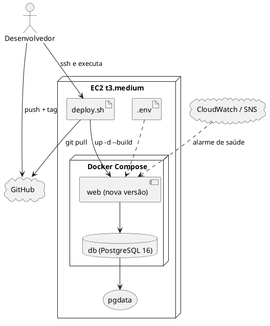
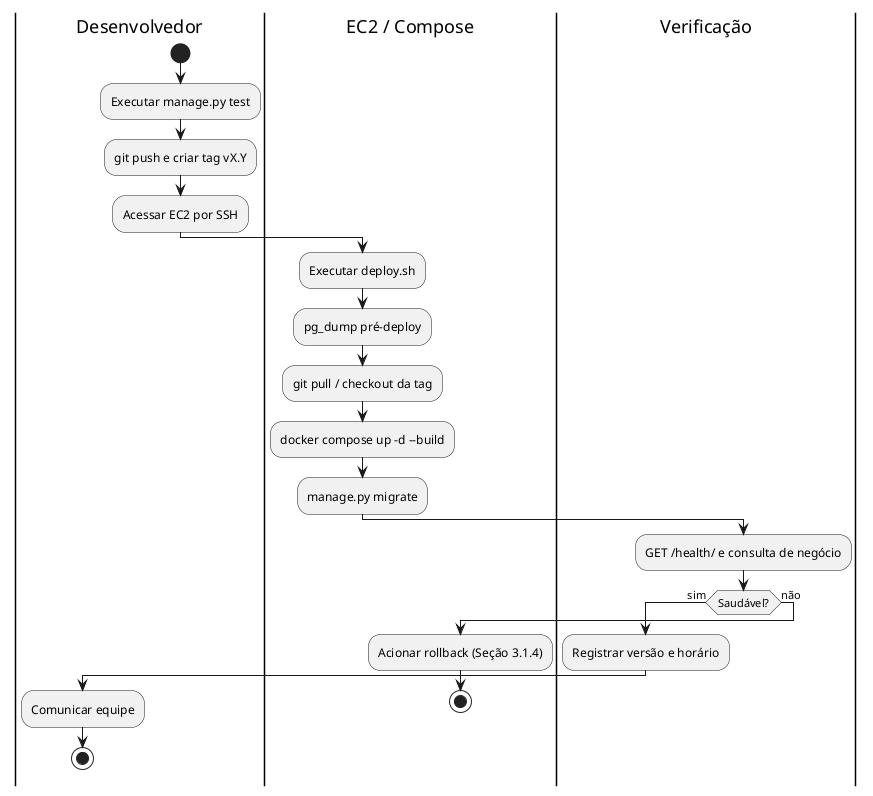
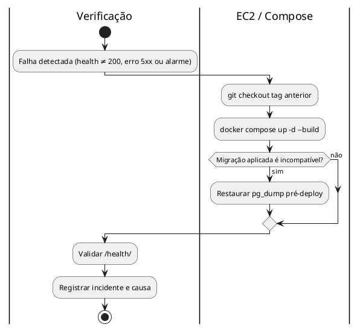
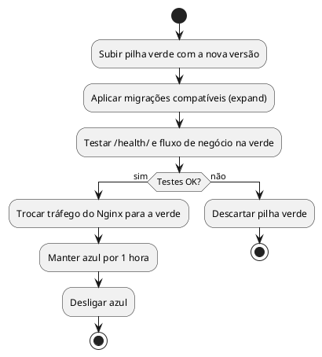
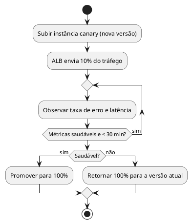
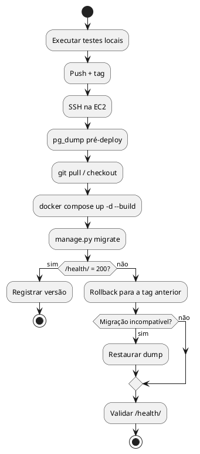

**Atividades de Deploy**

**Projeto Apollo**

|  |  |
| --- | --- |
| **Projeto** | Apollo — Plataforma de Análise de Desempenho no ENEM |
| **Documento** | Atividades de Deploy |
| **Versão** | 1.0 |
| **Data** | 08/11/2026 |
| **Status** | Em Revisão |
| **Responsável** | Equipe do Projeto Apollo |
| **Disciplina** | Projeto de Cloud |
| **Fase RUP/UP** | Transição |

# 1. Introdução

## 1.1. Propósito

Especificar a estratégia de deploy do Apollo, comparar alternativas (Rolling/Recreate, Blue-Green e Canary), detalhar o pipeline e o procedimento de rollback da estratégia escolhida e registrar tempos, custos e riscos.

## 1.2. Escopo

Publicação de novas versões da aplicação Django (`web`) e aplicação de migrações no PostgreSQL (`db`) em uma EC2 com Docker Compose. Fora do escopo: ambientes múltiplos de produção e entrega contínua totalmente automatizada.

## 1.3. Siglas

| **Sigla** | **Definição** |
| --- | --- |
| CI/CD | Integração/Entrega Contínua |
| RTO / RPO | Objetivos de tempo/ponto de recuperação |
| SLA | Acordo de nível de serviço |
| ALB | Application Load Balancer |
| SSH | Secure Shell |

## 1.4. Referências

* Requisitos Suplementares v2.0 (RNF-MAN-01/02, RNF-CON, RNF-CUS)
* Casos de Uso Arquiteturais v2.0 (UC-ARQ-006, UC-ARQ-007)
* Dimensionamento de Computação e de Banco de Dados v1.0
* Roteiro 14 — Django + PostgreSQL em Docker na EC2

# 2. Visão Geral

## 2.1. Requisitos do Deploy

| **Requisito** | **Valor** | **Origem** |
| --- | --- | --- |
| Disponibilidade (SLA) | 99% mensal | RNF-CON-01 |
| RTO | < 4 horas | RNF-CON-04 |
| RPO | < 24 horas | RNF-CON-03 |
| Tempo máximo de deploy | 15 minutos | RNF-MAN-01 |
| Tempo máximo de rollback | 30 minutos | RNF-MAN-02 |
| Zero downtime | Não exigido (indisponibilidade de segundos é tolerada pelo SLA) | Decisão do projeto |
| Usuários | ≈ 200 alunos | Dimensionamento |
| TPS no pico | ≈ 0,83 submissão/s (≈ 2,5 req/s totais) | RNF-PER-02 |
| Orçamento total | US$ 100/mês | RNF-CUS-01 |
| Orçamento adicional para deploy | até US$ 5/mês (a infraestrutura base já custa ≈ US$ 37) | Decisão do projeto |

## 2.2. Comparação das Estratégias

| **Critério** | **Recreate/Rolling simples** | **Blue-Green** | **Canary** |
| --- | --- | --- | --- |
| Custo adicional | US$ 0 | ≈ US$ 30/mês (2ª EC2 permanente) ou ≈ US$ 0,05/h só durante o deploy | ≈ US$ 47/mês (ALB + 2ª EC2) |
| Complexidade | Baixa (3 comandos) | Média (duas pilhas, troca de tráfego, banco compartilhado) | Alta (ALB, pesos, métricas) |
| Risco | Médio: erro afeta 100% dos usuários por alguns segundos | Baixo | Muito baixo |
| Tempo de rollback | ≈ 10 min | ≈ 2 min (volta o tráfego) | ≈ 2 min |
| Zero downtime | Não (≈ 30–60 s) | Sim | Sim |
| Detecção de erros | Manual (`/health/` + logs) | Teste na pilha nova antes da troca | Métricas por fatia de tráfego |
| Adequação ao SLA de 99% | ✅ (7 h/mês de tolerância) | ✅ | ✅ |
| Adequação ao RTO | ✅ | ✅ | ✅ |
| Adequação ao orçamento | ✅ | ⚠️ (consome 30% do orçamento) | ❌ (consome 47%) |
| **Escolha** | ✅ | ❌ | ❌ |

> **Banco de dados:** em qualquer estratégia o `db` é único. Migrações incompatíveis com a versão anterior inviabilizam a coexistência de duas versões (Blue-Green/Canary) sem *expand/contract*, o que aumenta a complexidade.

## 2.3. Arquitetura de Deploy

## 2.4. Plataformas de Hospedagem Avaliadas

Além da estratégia de publicação (seção 2.2), o grupo comparou onde executar a aplicação e o banco. Os valores são estimativas de custo mensal em us-east-1 e devem ser conferidos na calculadora da AWS.

| **Alternativa** | **Como funciona** | **Custo estimado** | **Prós** | **Contras** | **Decisão** |
| --- | --- | --- | --- | --- | --- |
| Elastic Beanstalk + SQLite (AP1) | A plataforma gerencia a EC2; o banco é um arquivo no disco da instância | ≈ US$ 15–30 | Deploy simples pela plataforma | Banco no disco efêmero (perde dados se a instância for substituída); sem JSONB/GIN; sem controle do ambiente | Substituída |
| **EC2 + Docker Compose + PostgreSQL em contêiner** | `web` e `db` em uma EC2, dados no volume `pgdata` | **≈ US$ 37** | Controle total; PostgreSQL com JSONB e GIN; portátil; custo baixo; reproduz o Roteiro 14 | Administração manual; ponto único de falha; backup por `pg_dump` | **Escolhida** |
| EC2 + Amazon RDS (PostgreSQL) | `web` na EC2 e banco gerenciado | ≈ US$ 50–55 | Backups, patches e Multi-AZ gerenciados | Custo maior; rede VPC/SG mais complexa; excede a necessidade de ≈ 200 alunos | Evolução (ver `dimrbd`) |
| ECS/Fargate + RDS | Contêineres sem gerenciar a VM | ≈ US$ 60 ou mais | Sem servidor para administrar | Mais configuração (cluster, roles, ALB); custo maior | Descartada |

**Por que a EC2 com Docker:** a AP2 pede PostgreSQL em contêiner com volume Docker, segredos fora do Git e deploy por `git pull` + `docker compose up -d --build`. A persistência foi comprovada reiniciando os contêineres (`docker compose down` / `up`) sem remover o volume.

# 3. Especificação das Estratégias

## 3.1. Estratégia Escolhida: Recreate/Rolling Simples

### 3.1.1. Descrição

O desenvolvedor acessa a EC2 por SSH, gera um `pg_dump` de segurança, atualiza o código com `git pull` (por *tag*), reconstrói a imagem `web` e recria o contêiner com `docker compose up -d --build`. O `db` não é recriado. As migrações são aplicadas e a saúde é verificada em `/health/`. A indisponibilidade esperada é de ≈ 30–60 s [Guessing — medir].

### 3.1.2. Justificativa

| **Requisito** | **Valor** | **Atende?** | **Justificativa** |
| --- | --- | --- | --- |
| SLA | 99% (≈ 7 h/mês) | ✅ | Dezenas de deploys de ≈ 1 min consomem minutos do orçamento de indisponibilidade |
| RTO | < 4 h | ✅ | Rollback em ≈ 10 min; recuperação completa em ≈ 1 h |
| Rollback | ≤ 30 min | ✅ | `git checkout <tag>` + rebuild ≈ 10 min |
| Deploy | ≤ 15 min | ✅ | ≈ 8 min no total |
| Custo | ≤ US$ 5 adicionais | ✅ | US$ 0 adicional |

### 3.1.3. Pipeline de Deploy

### 3.1.4. Procedimento de Rollback

### 3.1.5. Tabela de Atividades

| **#** | **Responsável** | **Atividade** | **Descrição** | **Tempo** | **Custo** |
| --- | --- | --- | --- | --- | --- |
| 1 | Desenvolvedor | Testes locais | `python manage.py test` | 2 min | US$ 0 |
| 2 | Desenvolvedor | Push e tag | Publicar no GitHub e criar `vX.Y` | 1 min | US$ 0 |
| 3 | Desenvolvedor | Acesso SSH | Conectar à EC2 | 0,5 min | US$ 0 |
| 4 | EC2 / Compose | Backup pré-deploy | `pg_dump` compactado | 1 min | US$ 0 |
| 5 | EC2 / Compose | Atualizar código | `git pull` / `checkout` da tag | 0,5 min | US$ 0 |
| 6 | EC2 / Compose | Construir e subir | `docker compose up -d --build` | 4 min | US$ 0 |
| 7 | EC2 / Compose | Migrações | `manage.py migrate` | 0,5 min | US$ 0 |
| 8 | Verificação | Validação | `/health/` + consulta de negócio | 1 min | US$ 0 |
| **Total** |  |  |  | **≈ 10,5 min** | **US$ 0** |

### 3.1.6. Riscos

| **Risco** | **Probabilidade** | **Impacto** | **Mitigação** |
| --- | --- | --- | --- |
| Falha no `docker build` deixa a versão antiga fora do ar | Baixa | Alto | `up -d --build` só troca o contêiner após a build ter sucesso |
| Migração irreversível | Média | Alto | `pg_dump` obrigatório antes de migrar |
| Erro humano no deploy manual | Média | Médio | `deploy.sh` único e *checklist* |
| `.env` ausente ou desatualizado | Baixa | Alto | Validar variáveis no início do `deploy.sh` |

## 3.2. Alternativa: Blue-Green

### 3.2.1. Descrição

Duas pilhas `web` (azul = atual, verde = nova) apontam para o **mesmo** `db`. Um Nginx na frente (ou uma segunda EC2 com Elastic IP trocado) direciona o tráfego. A pilha verde é testada antes da troca; o rollback é reverter o tráfego.

### 3.2.2. Pipeline

### 3.2.3. Comparação com a escolhida

| **Critério** | **Recreate** | **Blue-Green** |
| --- | --- | --- |
| Downtime | ≈ 30–60 s | ≈ 0 s |
| Custo | US$ 0 | +US$ 30/mês (permanente) |
| Memória na EC2 | ≈ 2 GiB | ≈ 2,5–3 GiB com duas pilhas `web` (cabe, mas reduz a folga) |
| Banco | Migração direta | Exige migrações compatíveis nas duas versões |

**Conclusão:** benefício (zero downtime) não exigido pelo SLA; custo e complexidade desproporcionais. **Descartada.**

## 3.3. Alternativa: Canary

### 3.3.1. Descrição

Um ALB distribui o tráfego entre a versão atual e uma instância *canary* (ex.: 10%). Métricas de erro decidem a promoção.

### 3.3.2. Pipeline

### 3.3.3. Comparação com a escolhida

| **Critério** | **Recreate** | **Canary** |
| --- | --- | --- |
| Custo | US$ 0 | ≈ US$ 47/mês (ALB + 2ª EC2) |
| Volume de tráfego | ≈ 2,5 req/s | Insuficiente para métricas estatisticamente úteis em 10% |
| Complexidade | Baixa | Alta |

**Conclusão:** com ≈ 200 usuários, a fatia canary geraria poucas requisições, sem sinal confiável, e o custo estoura o orçamento de deploy. **Descartada.**

# 4. Diagrama de Atividades Consolidado

# 5. Matriz de Rastreabilidade

| **Requisito** | **Caso de Uso** | **Pacote** | **Classe / Componente** | **Estratégia** | **Diagrama** |
| --- | --- | --- | --- | --- | --- |
| RNF-MAN-01 (deploy ≤ 15 min) | UC-ARQ-006 | Transição | `deploy.sh`, Docker Compose | Recreate | Seção 3.1.3 |
| RNF-MAN-02 (rollback ≤ 30 min) | UC-ARQ-006 | Transição | Git (tags), Compose | Recreate | Seção 3.1.4 |
| RNF-CON-01 (SLA 99%) | UC-ARQ-004 | Elaboração | `web`, `db` | Recreate | Seção 2.2 |
| RNF-CON-03/04 (RPO/RTO) | UC-ARQ-007 | Elaboração | `pg_dump`, volume `pgdata` | Recreate | Seção 3.1.4 |
| RNF-DAD-03 (migrações) | UC-ARQ-006 | Construção | `manage.py migrate` | Recreate | Seção 3.1.3 |
| RNF-CUS-01 (custo) | UC-ARQ-001 | Elaboração | EC2, EBS | Recreate | Seção 6 |
| RNF-MAN-03 (rastreabilidade) | UC-ARQ-006 | Transição | Git/GitHub | Todas | Seção 2.3 |

# 6. Tempo e Custo por Estratégia

## 6.1. Recreate/Rolling simples (escolhida)

| **Etapa** | **Tempo** | **Custo** |
| --- | --- | --- |
| Testes locais | 2 min | US$ 0 |
| Push, tag e SSH | 1,5 min | US$ 0 |
| Backup, pull e build | 5,5 min | US$ 0 |
| Migração e validação | 1,5 min | US$ 0 |
| **Total** | **≈ 10,5 min** (limite: 15 min ✅) | **US$ 0** |

## 6.2. Blue-Green

| **Etapa** | **Tempo** | **Custo** |
| --- | --- | --- |
| Subir pilha verde (build + testes) | 8 min | ≈ US$ 0,05 por hora de 2ª EC2 (ou US$ 30/mês permanente) |
| Troca de tráfego | 1 min | US$ 0 |
| Observação e desligamento da azul | 60 min | ≈ US$ 0,04 |
| **Total** | **≈ 70 min** (limite de 15 min ❌ se contada a observação; 9 min até a troca ✅) | **US$ 0,10 por deploy ou US$ 30/mês** |

## 6.3. Canary

| **Etapa** | **Tempo** | **Custo** |
| --- | --- | --- |
| Subir canary | 8 min | EC2 adicional |
| Observação | 30 min | ALB ≈ US$ 0,0225/h |
| Promoção | 2 min | US$ 0 |
| **Total** | **≈ 40 min** (acima do limite de 15 min ❌) | **≈ US$ 47/mês fixos** |

# 7. Lições e Próximos Passos

* Medir o tempo real de deploy e de indisponibilidade e registrar no README.
* Automatizar o disparo com GitHub Actions (testes → SSH → `deploy.sh`) quando o grupo concluir a entrega base.
* Adotar RDS e Blue-Green se o Apollo ganhar usuários reais e SLA mais exigente.
* Executar um ensaio de rollback antes da apresentação.

**Medições a registrar (substituir antes da entrega):**

| **Métrica** | **Previsto** | **Medido** |
| --- | --- | --- |
| Tempo total de deploy | ≈ 10,5 min | _preencher após o deploy_ |
| Indisponibilidade durante o deploy | ≈ 30–60 s | _preencher_ |
| Tempo de rollback | ≈ 10 min | _preencher após o ensaio_ |

# 8. Aprovações

| **Função** | **Nome** | **Data** | **Assinatura** |
| --- | --- | --- | --- |
| Arquiteto de Soluções | Arthur Maurity, Bernardo Casanovas, Bernardo Miller, Lucas Jesus | 10/11/2026 | Aprovado em revisão da equipe |
| Professor Responsável | Jonh Carvalho | 17/11/2026 | Pendente (avaliação da AP2) |

# 9. Histórico de Versões

| **Versão** | **Data** | **Autor** | **Descrição das Alterações** |
| --- | --- | --- | --- |
| 1.0 | 08/11/2026 | Equipe do Projeto Apollo | Criação: estratégia Recreate escolhida; Blue-Green e Canary avaliadas. |
| 1.1 | 10/11/2026 | Equipe do Projeto Apollo | Inclusão das plataformas avaliadas (Beanstalk, EC2 + Docker, EC2 + RDS, Fargate). |
